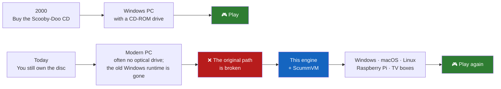

# Scooby-Doo ScummVM Engine

**Makes The Learning Company's classic *Scooby-Doo* CD-ROM adventures
playable again on a modern computer.**

In 2000 you could buy *Scooby-Doo! Showdown in Ghost Town* on CD, put the
disc in your Windows PC, and play. More than twenty-five years later you may
still own that disc — but the computer it was built for is gone. Modern
machines often have no optical drive, the game was written for an old Windows
runtime, and no engine still ships that can run it.

**The game survived. The computer it depended on didn't.**

This project rebuilds the missing piece: a new [ScummVM](https://www.scummvm.org/)
engine that reads the original game data directly and plays these titles on
hardware people actually own today.

## The broken path, and the fix



You supply the game you already own — your disc or a legally obtained ISO.
The engine does the rest: graphics, audio, and the Bink cutscenes all play
through ScummVM, with no original runtime required and nothing extra to
install. ScummVM runs on Windows, macOS, Linux, the Raspberry Pi, and TV
boxes, so the same build reaches the screen already under your TV.

## The larger goal

Compatibility solves only half the problem. Some people already own these
games and want to play them again. Others are meeting them for the first time
and would gladly buy a copy — if a modern authorized edition existed.

The long-term goal is to restore the whole experience players once had:
**discover a game, obtain it legitimately, and play it** — without needing
obsolete hardware or a decades-old operating system.

> **See it → Want it → Buy it → Play it**

Preservation keeps these games from disappearing. This engine makes them
playable again. An authorized digital edition could one day make them
available to buy again. The first two are underway here; the third is a
direction, not a promise.

***Showdown in Ghost Town* is playable in preview; *Phantom of the Knight* is in development.** · [Progress site →][pages]

[mobygames]: https://www.mobygames.com/game/scooby-doo-showdown-in-ghost-town/
[pages]: https://github.barefootbetters.com/scooby-engine/

- ▶ **Play it** — [Download & build instructions](docs/reference/download-and-install.md)
- 📸 **See it** — [Screenshots gallery](https://github.com/barefootbetters/scooby-engine/wiki/Screenshots) (every room, captured from our engine running)
- 🗺 **Screen map** — [room navigation map](https://github.com/barefootbetters/scooby-engine/wiki/Screenshots#screen-map) built from the engine's real exits
- 📋 **What works** — [Engine status & supported titles](docs/reference/scummvm-wiki-scooby.md)
- 🍴 **Why a fork** — [Why the engine is a ScummVM fork](docs/reference/why-forked-scummvm.md)

---

## Target games

These games came from
[The Learning Company's *Scooby-Doo* CD-ROM line][mobygames] (2000–2003).

| Title | Year | Developer | Status |
|---|---|---|---|
| *Scooby-Doo! Showdown in Ghost Town* | 2000 | TerraGlyph | ✅ Playable (preview, `ADGF_TESTING`) — complete, start to credits |
| *Scooby-Doo! Phantom of the Knight* | 2001 | TerraGlyph | 🚧 In development (Gen 1, same engine) — most rooms ported |
| *Scooby-Doo! Jinx at the Sphinx* | 2001 | TerraGlyph | 🔎 Detected only (Gen 2, `MMFW` archives not yet read) |
| *Scooby-Doo! Case File #1: The Glowing Bug Man* | 2002 | ImageBuilder Software | 🔎 Detected only (Gen 3, inherited TerraGlyph code) |
| *Scooby-Doo! Case File #2: The Scary Stone Dragon* | 2003 | Unknown | ❌ Excluded: a different engine, shared with a *Powerpuff Girls* title (WP-005) |

Per-title status moves as the work does; the
[status page](docs/reference/scummvm-wiki-scooby.md) is the live, authoritative version.

---

## Status

*Showdown in Ghost Town* is ported end to end and reaches the end credits on a
testing build; *Phantom of the Knight* is most of the way through its room port.
The engine reads the original discs directly — graphics, audio and the Bink
cutscenes all play through ScummVM, with no original runtime required — and it is
distributed as a **fork** of ScummVM rather than upstreamed
([why](docs/reference/why-forked-scummvm.md)).

Rather than restate a snapshot that goes stale, this README points to the live
sources:

- **Play / build it** — [Download & Install](docs/reference/download-and-install.md)
- **What works, per title, and the data files each game needs** — [status page](docs/reference/scummvm-wiki-scooby.md)
- **Where the work is right now** — the [progress site][pages] and the
  [work index](docs/work-packets/WORK_INDEX.md)

---

## What lives here

This repo holds the **research, docs and tooling**. The **engine code** lives in
the ScummVM fork at [barefootbetters/scummvm](https://github.com/barefootbetters/scummvm)
under `engines/scooby/` (branch `scooby-engine`).

```
docs/               Research, specs, and the work-packet governance
  01-VISION.md      Project vision, phases, scope
  02-SCUMMVM-INTEGRATION.md  ScummVM API contract + acceptance gates
  formats/          Reverse-engineered file-format specs (art, audio, exe)
  work-packets/     Units of work (WP-NNN) + the work index
  reference/        Install guide, status page, build notes, decisions
tools/              Python format-probing / extraction + fork helpers (PowerShell)
```

---

## How it works

Most engine reverse-engineering starts from fully opaque binaries. These games
turned out to be unusually well-structured: `object.ini` (every interactive
object, exit, and cursor as plain INI text) and `Scooby.eng` (a plain-text
string table) ship human-readable, and the `BK.XXX` cutscenes are Bink video,
which ScummVM already decodes. The real reverse-engineering was the proprietary
`TGIFILE.ART` graphics archive and the `.dat` audio containers — both now
decoded ([art](docs/formats/tgifile-art.md), [audio](docs/formats/audio-archives.md)).

### Development phases

- Phase 1 — Format Research ✅
- Phase 2 — ScummVM Engine Scaffold ✅
- Phase 3 — Resource Loading ✅
- Phase 4 — Game Logic — ✅ *Showdown* · 🚧 *Phantom*
- Phase 5 — Polish & distribution (as a fork) — *Showdown* closeout complete

See [docs/01-VISION.md](docs/01-VISION.md) for full phase exit criteria, and
[Why the engine is a ScummVM fork](docs/reference/why-forked-scummvm.md) for the
distribution decision.

---

## Legal

Reverse engineering for interoperability is lawful under 17 U.S.C. § 107
and EU Software Directive 2009/24/EC Article 6. ScummVM has operated under
this framework since 2001. No copyrighted game data is included here.
Players supply their own discs or legally obtained ISOs.

---

## Contributing

This is a personal research project. The engine scaffold exists and the Gen 1
titles are playable, but it isn't taking general code contributions yet.
Reverse-engineering collaboration is by arrangement — the Case File #1
executable work in [WP-011](docs/work-packets/WP-011-casefile-decompdecomp.md)
is one example. Build or gameplay problems go on the
[fork's issue tracker](https://github.com/barefootbetters/scummvm/issues).
