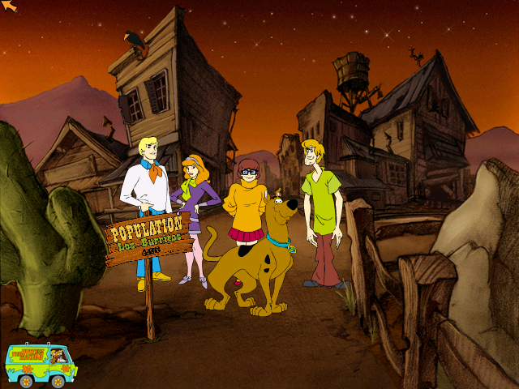
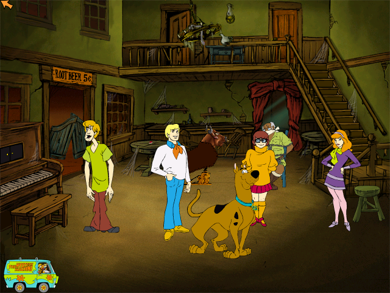
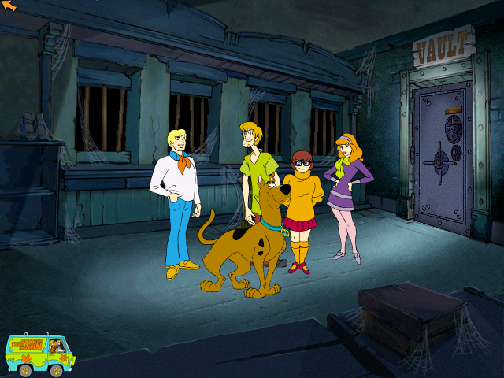
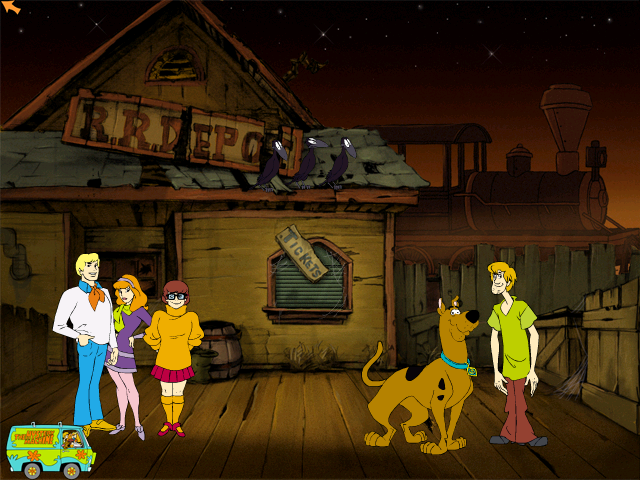
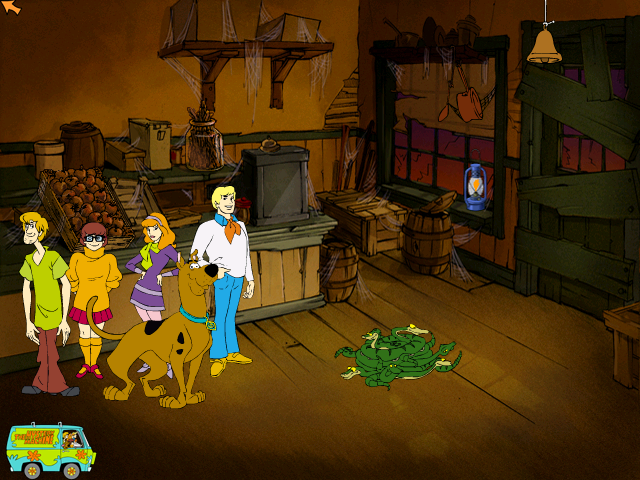
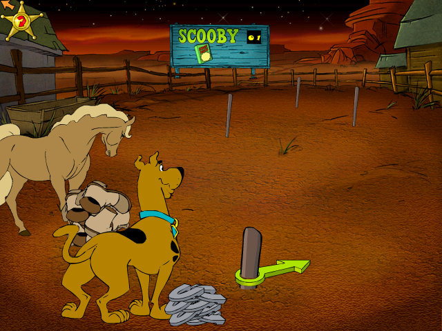

# Engine screenshots — the Scooby engine running

These are screen captures of **our `scooby` ScummVM engine actually running**
*Scooby-Doo! Showdown in Ghost Town* — not the original game. Each is the
engine's own 640×480 output: a decoded `TGIFILE.ART` background with the gang and
room objects composited as sprites, exactly as the engine draws them.

> **Provenance — why these are our engine, not reference frames.** Unlike the
> [`showdown-screens/`](../showdown-screens/index.md) library (which is captures of
> the *original* retail game from a YouTube longplay, used as RE ground truth),
> every image here was produced by the engine itself and verified by eye against
> the room before committing. Keep the two sets distinct: these are the port;
> those are the reference.

## How these were captured (2026-11-21)

Captured headlessly with the engine's built-in `test_script` harness
(see [02-SCUMMVM-INTEGRATION §9](../../../02-SCUMMVM-INTEGRATION.md#9-debug-channels)),
so no live mouse was needed:

- **Build:** the fork engine `barefootbetters/scummvm` (branch `scooby-engine`,
  commit `d1a26e7`), built on MSYS2 UCRT64.
- **Data:** a mounted *Showdown* disc (detected as `scooby:showdown`).
- **Method:** per room, a game-domain config of
  `start_room=<ROOM>` plus `test_script=wait 4500; shot <name>; quit`, which dumps
  the engine's screen surface to `test_shots/<name>.bmp`. Each BMP was converted to
  PNG losslessly and checked by eye against the room.

No image here was retouched, composited, or sourced from anything but the running
engine.

## Gallery

| File | Room | What it shows |
|---|---|---|
| `town_center.png` | `ROOM_P01_Town_Center` | Ghost Town hub — the gang, the POPULATION signpost, cactus/fence overlay |
| `saloon.png` | `ROOM_P12_Saloon` | The saloon interior — piano, "ROOT BEER 5¢", staircase |
| `bank.png` | `ROOM_P13_Bank` | The bank with the vault door and cobwebs |
| `railroad_station.png` | `ROOM_P09_Railroad_Station` | The R.R. depot, crows on the roof, the locomotive |
| `general_store.png` | `ROOM_P15_General_Store_Interior` | The general-store interior — lantern, barrels, the snake |
| `horseshoe_corral.png` | `ROOM_P30_Horseshoe_Corral` | The horseshoe-toss minigame (note the in-engine cursor) |

These feed the public [GitHub wiki Screenshots page](https://github.com/barefootbetters/scooby-engine/wiki/Screenshots).
