# Showdown reference screenshot library

Visual ground truth for the WP-002 *TGIFILE.ART* decoder and the Phase 3
scripted-room reimplementation. One clean stationary frame per distinct
room/scene in *Scooby-Doo! Showdown in Ghost Town* (TLC, 2000), captured
from a YouTube longplay.

Captured per [WP-009](../../../work-packets/WP-009-reference-screenshots.md).
Consumed by [EC-002 pre-flight](../../../execution-checklists/EC-002-probe-art-harness.md)
(decoder visual comparison) and the [WP-001 Ghidra session](../../../work-packets/WP-001-ghidra-session.md)
(scripted-room ground truth for `*_Room.cpp` reimplementation).

## Copyright

These are screen captures taken from publicly available YouTube footage
of gameplay. They are used here for **reverse-engineering reference and
documentation purposes only** — fair use in the context of a ScummVM
engine implementation project, consistent with how ScummVM documents
all supported games. No files extracted directly from the game disc are
stored in this repository.

## Naming convention

File naming is **strictly canonical-first**:

- Canonical IDs use the WP-008 `destinationroom=` values verbatim, e.g.
  `ROOM_P21_Boot_Hill1.png`, `ROOM_P12_Saloon.png`, `ROOM_Main_Menu.png`.
  Source of truth: `tools/samples/asset-catalog.json` `rooms` map
  (gitignored, regenerable per [WP-008 §Notes](../../../work-packets/WP-008-object-ini-catalog.md#notes)).
- If a captured frame can't be confidently canonicalized, save as
  `UNMATCHED_<descriptive-slug>.png` and set Match Status: `Unmatched`
  in the row's table cell, with justification in Notes.
- Character sprite captures (Daphne idle, Scooby walk, etc.) are named
  `OBJ_<NAME>.png` and live under the "Character sprites" section
  below — needed by WP-002's first-decode pass (`entry[0]` is
  `OBJ_DAPHNE_A`).

## Capture rules (binary)

- No transitions (fade, pan, cut) — wait for the room to fully render
  and the camera to settle.
- No motion blur or animation mid-frame.
- Player character allowed in frame but not blocking major background
  geometry.
- UI minimized where possible; if unavoidable, must not obscure key
  background geometry.
- Minimum source quality: 720p. No compression artifacts that obscure
  shapes or colors.
- Cropping allowed ONLY to remove black borders / letterboxing — never
  crop scene content.
- Full-size PNGs committed as-is (1920×1080 here, the source stream's
  native size). The gallery shows them as 320-px thumbnails for page
  weight; the underlying PNG is always full resolution.

Once a capture is taken, replace the `*(pending capture)*` cell with the
Markdown form below. Don't use an HTML `` tag: the ewiki renders
Markdown with raw HTML switched off, so an HTML image shows as an empty
cell there. The ewiki theme reads the `"width=320px"` title as the
thumbnail width; GitHub Pages fits the image to its column.

```markdown
[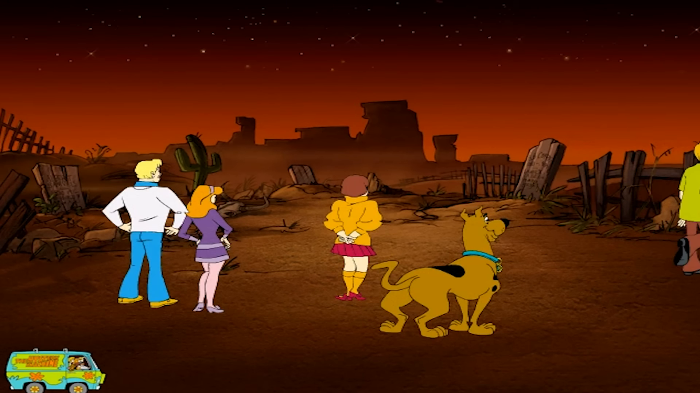](ROOM_P21_Boot_Hill1.png)
```

and fill in the row's Timestamp, Match Status, and Notes columns.

---

## Source video

Single-source YouTube longplay for all captures below:

- **URL:** <https://www.youtube.com/watch?v=aR2PP0EMDSw>
- **Channel / uploader:** dosdaysareover (`@dosdaysareover7781`)
- **Recorded:** 2018-08-13 (YouTube upload date)
- **Verified at session open (2026-06-03):** in-game title card reads
  "Showdown in Ghost Town"; ≥720p stream available. Uploader's title
  labels the game as "(CD-Rom, 2001)" but [01-VISION L43](../../../01-VISION.md#engine-lineage-2026-06-finding)
  records the release year as 2000 — discrepancy noted, not resolved
  in this WP; gameplay identity confirmed via title card.

**Captured 2026-11-13** from the 1080p VP9 stream (yt-dlp format 248,
1920×1080, 25 fps, 1:23:16.8). The longplay stretches the 4:3 game to fill
16:9; there is no letterbox or pillarbox, so no frame was cropped. Each
`[YT]` link opens the video at the row's timestamp.

Per-row `Source Video` column defaults to this global URL when blank.
If a second longplay is needed (e.g. for a chase sequence the first one
skips), add a second URL block here and link explicitly in affected
rows (e.g. `[YT2](url)`).

---

## Provenance schema

Every gallery row uses this 6-column schema per WP-009 §Deliverables:

| Preview | Room ID | Source Video | Timestamp | Match Status | Notes |
|---|---|---|---|---|---|

- **Match Status** ∈ {`Canonical`, `Unmatched`, `Gap`}
  - `Canonical` — filename is an exact WP-008 catalog ID; capture committed
  - `Unmatched` — `UNMATCHED_`-prefixed filename; capture committed in
    the Unmatched table at the bottom; the canonical row stays `Gap`
    until the file can be resolved to a canonical ID and renamed
  - `Gap` — canonical ID not captured in this pass; Preview and
    Timestamp blank, Notes carries one of: `Not reached in longplay` /
    `Not observable in source video`
- There is no `Uncertain` status. "Uncertain but probably matches" is
  not a valid third path — if you can't canonicalize confidently, save
  as `UNMATCHED_<slug>` and leave the canonical row as `Gap`.

---

## How frames were chosen and named

**Every room below is decoder-backed.** WP-009 planned two tiers: 16 rooms
with `TGIFILE.ART` art and 21 "scripted" rooms without. That split came
from WP-008, before the archive was decoded. [WP-002](../../../work-packets/WP-002-tgifile-art-decoder.md)
found 69 scene blocks, and all 37 catalog rooms have one, including Town
Center, Saloon, Main Menu, Pie Noon and Horseshoe Corral. See
[tgifile-art §Scene blocks](../../../formats/tgifile-art.md#scene-blocks)
for the scene-to-room mapping. So every row is a Required-tier PNG.

Frames were picked by measurement, not by eye alone:

1. Every scene background was decoded with `tools/probe_art.py`.
2. The video was sampled at 2 frames per second. Each sample was scored
   against all 69 backgrounds: the fraction of pixels within a small
   color tolerance, at 64×48. Characters and UI drawn over the background
   lower the score, so a high score also means an unobstructed frame.
3. For each room, the chosen frame is the one where that room is the best
   match and the score holds for a full second either side (no transition
   or camera move).
4. That exact timestamp was extracted losslessly at 1920×1080. Each frame
   was then checked by eye against its decoded background.

The Notes column gives each frame's scene block and match score; 1.00 is
a perfect background match. Chase rooms score 0.95 or more. Rooms with
the gang standing in them score lower: 0.75–0.89.

---

## Town & story rooms (P01–P20)

| Preview | Room ID | Source Video | Timestamp | Match Status | Notes |
|---|---|---|---|---|---|
| [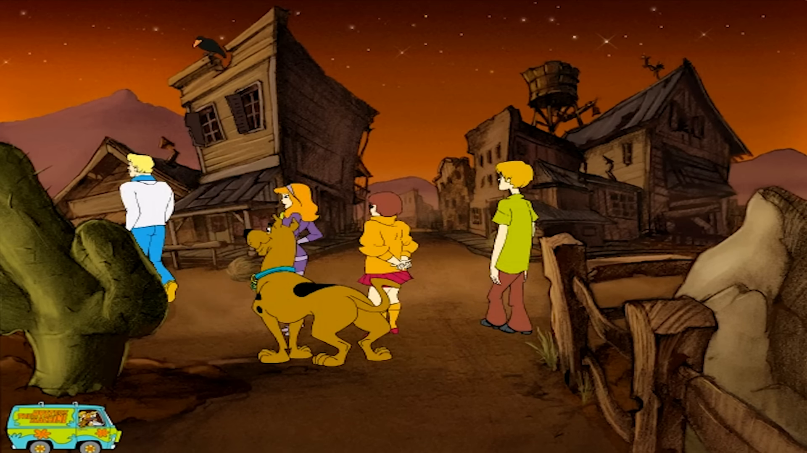](ROOM_P01_Town_Center.png) | `ROOM_P01_Town_Center` | [YT](https://www.youtube.com/watch?v=aR2PP0EMDSw&t=3937s) | 1:05:37.0 | Canonical | Scene block 0 (`probe_art.py --scene 0`); background match 0.88 |
| [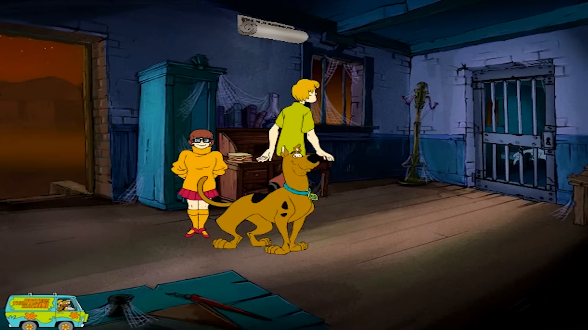](ROOM_P02_Sheriffs_Office.png) | `ROOM_P02_Sheriffs_Office` | [YT](https://www.youtube.com/watch?v=aR2PP0EMDSw&t=2650s) | 0:44:10.0 | Canonical | Scene block 12 (`probe_art.py --scene 12`); background match 0.88 |
| [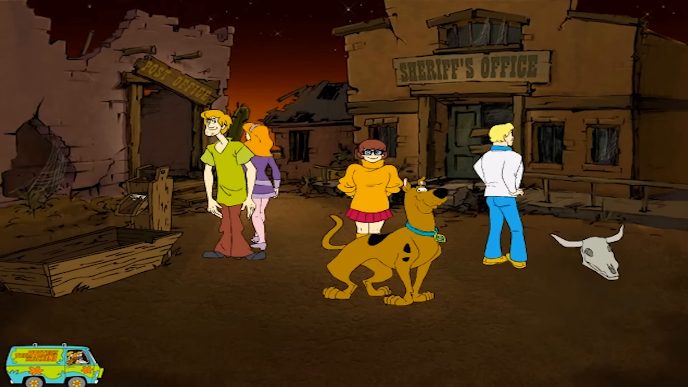](ROOM_P03_Street1.png) | `ROOM_P03_Street1` | [YT](https://www.youtube.com/watch?v=aR2PP0EMDSw&t=208s) | 0:03:28.5 | Canonical | Scene block 7 (`probe_art.py --scene 7`); background match 0.84 |
| [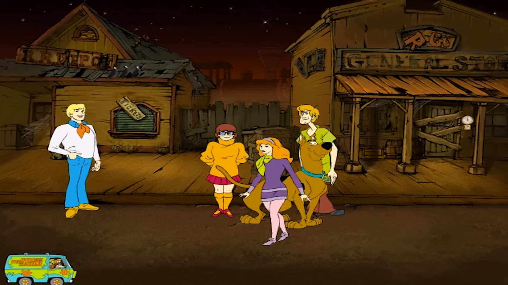](ROOM_P04_Street2.png) | `ROOM_P04_Street2` | [YT](https://www.youtube.com/watch?v=aR2PP0EMDSw&t=171s) | 0:02:51.5 | Canonical | Scene block 8 (`probe_art.py --scene 8`); background match 0.88 |
| [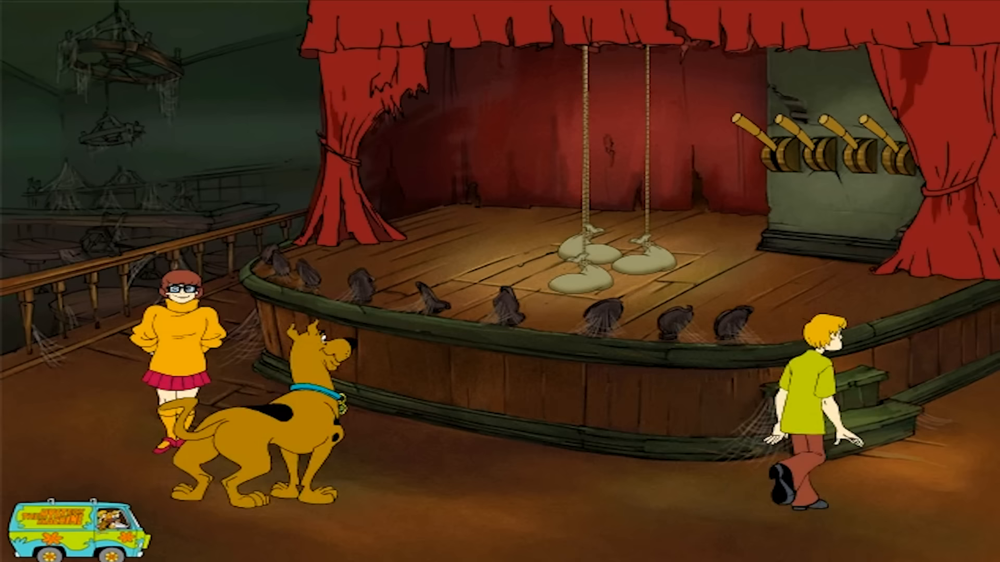](ROOM_P05_Stage.png) | `ROOM_P05_Stage` | [YT](https://www.youtube.com/watch?v=aR2PP0EMDSw&t=1512s) | 0:25:12.0 | Canonical | Scene block 20 (`probe_art.py --scene 20`); background match 0.81 |
| [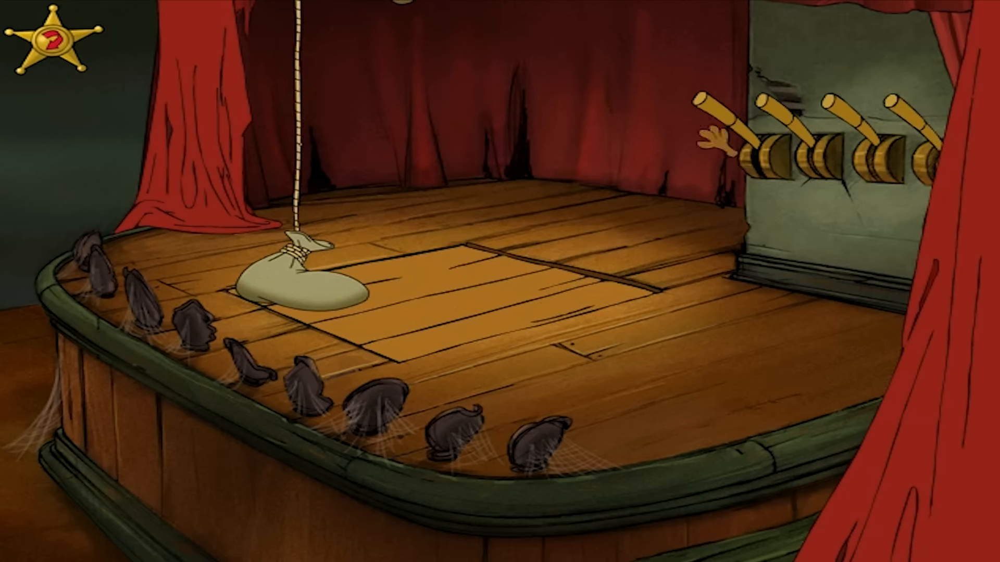](ROOM_P06_Stage_Trapdoor.png) | `ROOM_P06_Stage_Trapdoor` | [YT](https://www.youtube.com/watch?v=aR2PP0EMDSw&t=1526s) | 0:25:26.0 | Canonical | Scene block 21 (`probe_art.py --scene 21`); background match 0.83 |
| [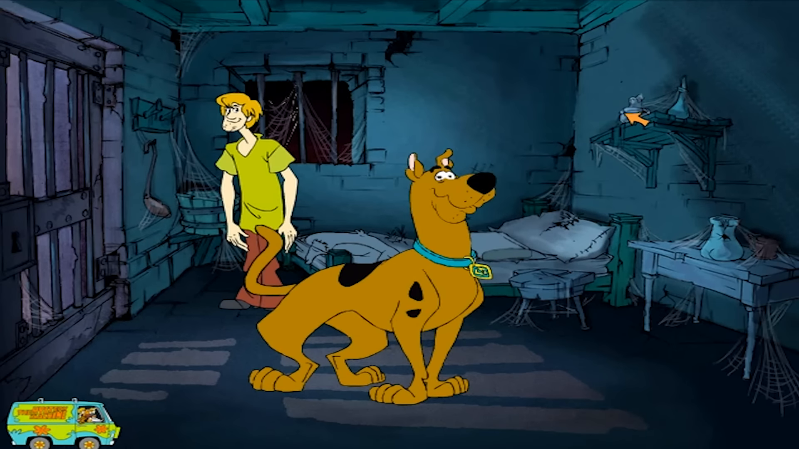](ROOM_P07_Jail.png) | `ROOM_P07_Jail` | [YT](https://www.youtube.com/watch?v=aR2PP0EMDSw&t=4019s) | 1:06:59.0 | Canonical | Scene block 22 (`probe_art.py --scene 22`); background match 0.84 |
| [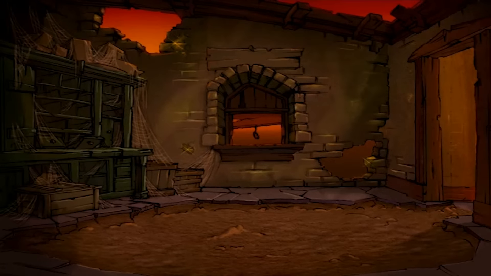](ROOM_P08_Post_Office.png) | `ROOM_P08_Post_Office` | [YT](https://www.youtube.com/watch?v=aR2PP0EMDSw&t=4746s) | 1:19:06.0 | Canonical | Scene block 13 (`probe_art.py --scene 13`); background match 0.98 |
| [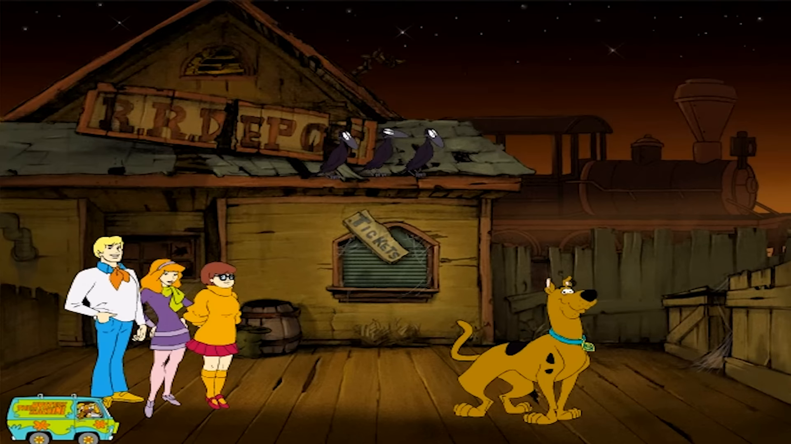](ROOM_P09_Railroad_Station.png) | `ROOM_P09_Railroad_Station` | [YT](https://www.youtube.com/watch?v=aR2PP0EMDSw&t=110s) | 0:01:50.5 | Canonical | Scene block 14 (`probe_art.py --scene 14`); background match 0.89 |
| [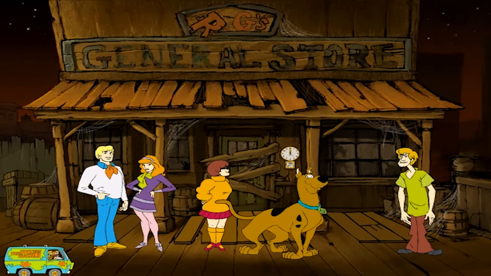](ROOM_P10_Front_Of_General_Store.png) | `ROOM_P10_Front_Of_General_Store` | [YT](https://www.youtube.com/watch?v=aR2PP0EMDSw&t=131s) | 0:02:11.0 | Canonical | Scene block 15 (`probe_art.py --scene 15`); background match 0.85 |
| [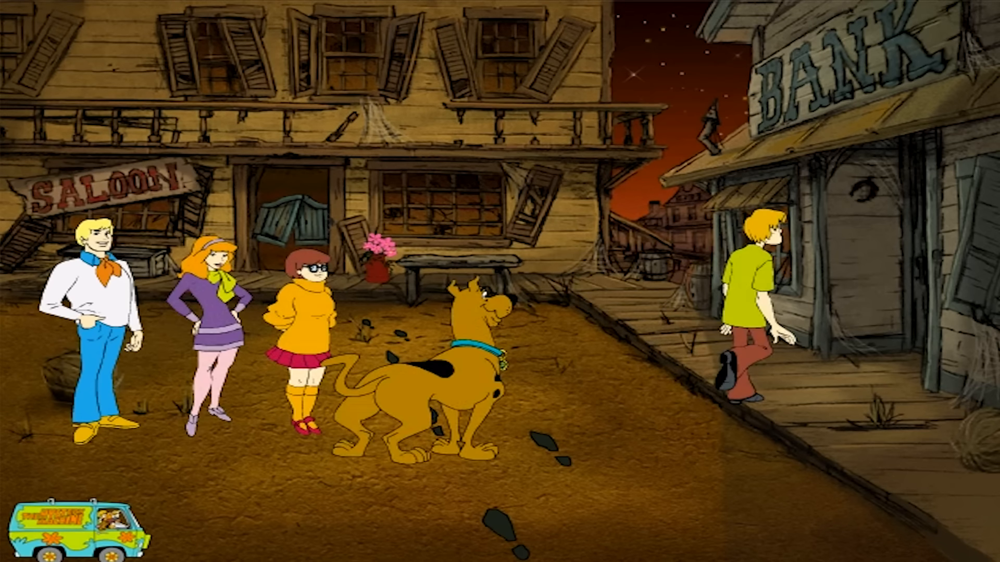](ROOM_P11_Street3.png) | `ROOM_P11_Street3` | [YT](https://www.youtube.com/watch?v=aR2PP0EMDSw&t=2439s) | 0:40:39.0 | Canonical | Scene block 1 (`probe_art.py --scene 1`); background match 0.87 |
| [](ROOM_P12_Saloon.png) | `ROOM_P12_Saloon` | [YT](https://www.youtube.com/watch?v=aR2PP0EMDSw&t=476s) | 0:07:56.0 | Canonical | Scene block 2 (`probe_art.py --scene 2`); background match 0.85 |
| [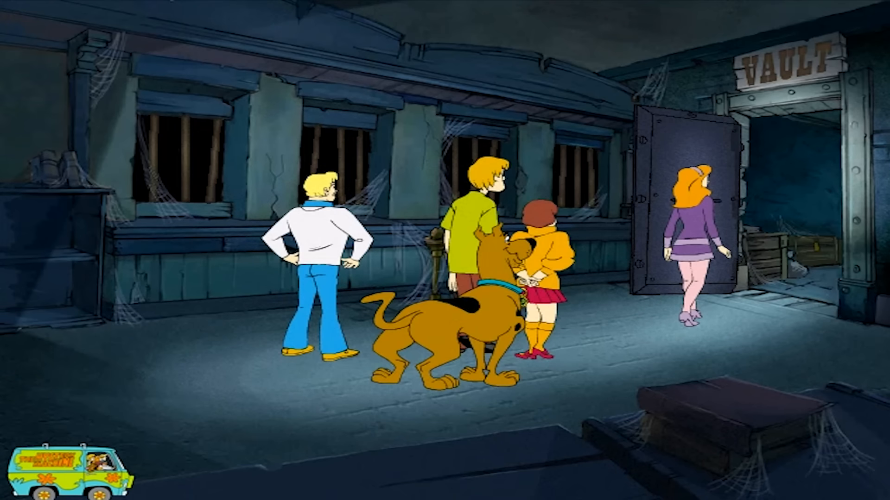](ROOM_P13_Bank.png) | `ROOM_P13_Bank` | [YT](https://www.youtube.com/watch?v=aR2PP0EMDSw&t=4123s) | 1:08:43.0 | Canonical | Scene block 16 (`probe_art.py --scene 16`); background match 0.85 |
| [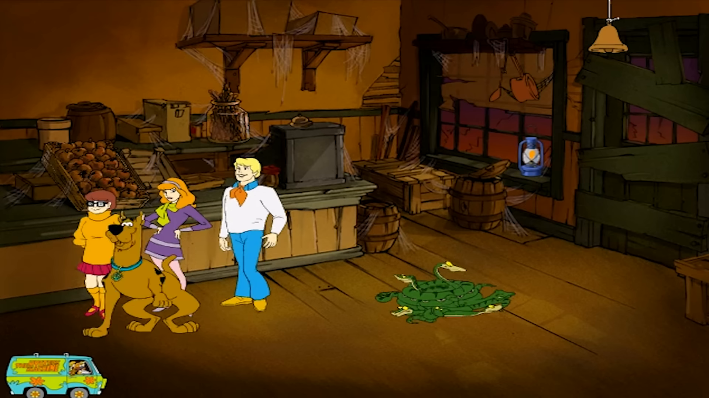](ROOM_P15_General_Store_Interior.png) | `ROOM_P15_General_Store_Interior` | [YT](https://www.youtube.com/watch?v=aR2PP0EMDSw&t=3442s) | 0:57:22.5 | Canonical | Scene block 24 (`probe_art.py --scene 24`); background match 0.88 |
| [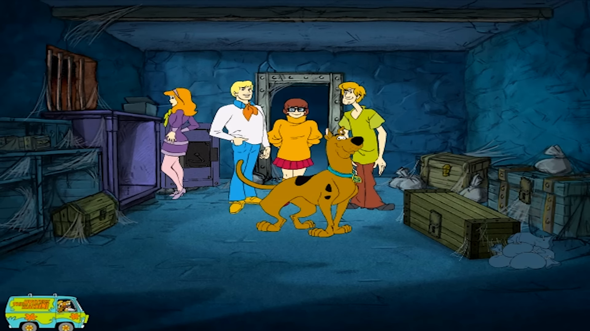](ROOM_P16_Bank_Vault.png) | `ROOM_P16_Bank_Vault` | [YT](https://www.youtube.com/watch?v=aR2PP0EMDSw&t=4128s) | 1:08:48.0 | Canonical | Scene block 25 (`probe_art.py --scene 25`); background match 0.85 |
| [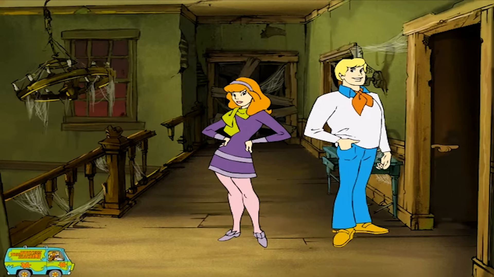](ROOM_P17_Hotel_Hall.png) | `ROOM_P17_Hotel_Hall` | [YT](https://www.youtube.com/watch?v=aR2PP0EMDSw&t=1639s) | 0:27:19.5 | Canonical | Scene block 3 (`probe_art.py --scene 3`); background match 0.80 |
| [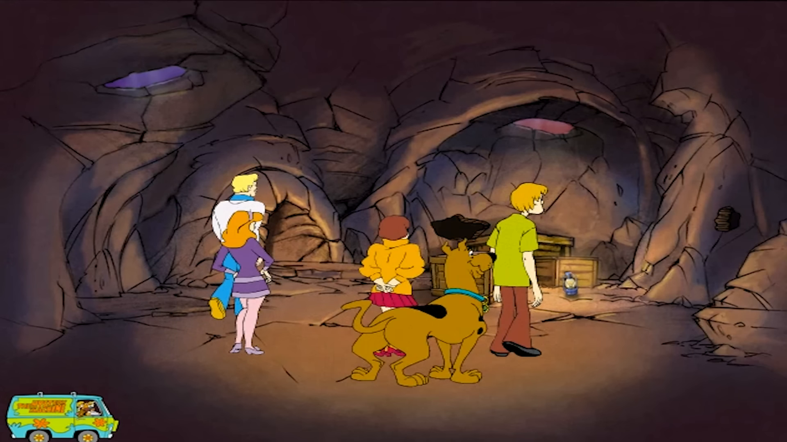](ROOM_P18_Tunnel_Lit.png) | `ROOM_P18_Tunnel_Lit` | [YT](https://www.youtube.com/watch?v=aR2PP0EMDSw&t=4632s) | 1:17:12.5 | Canonical | Scene block 42 (`probe_art.py --scene 42`); background match 0.87 |
| [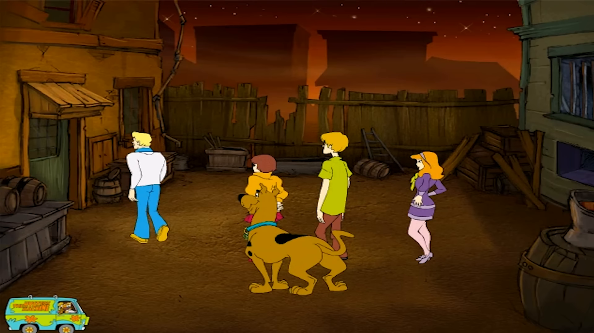](ROOM_P19_Back_Alley.png) | `ROOM_P19_Back_Alley` | [YT](https://www.youtube.com/watch?v=aR2PP0EMDSw&t=4134s) | 1:08:54.0 | Canonical | Scene block 26 (`probe_art.py --scene 26`); background match 0.89 |
| [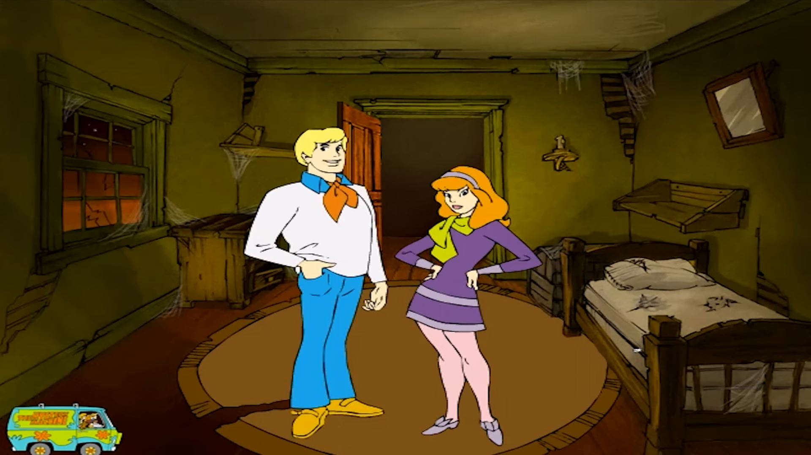](ROOM_P20_Hotel_Room.png) | `ROOM_P20_Hotel_Room` | [YT](https://www.youtube.com/watch?v=aR2PP0EMDSw&t=708s) | 0:11:48.5 | Canonical | Scene block 5 (`probe_art.py --scene 5`); background match 0.75 |

## Boot Hill (P21–P23)

| Preview | Room ID | Source Video | Timestamp | Match Status | Notes |
|---|---|---|---|---|---|
| [](ROOM_P21_Boot_Hill1.png) | `ROOM_P21_Boot_Hill1` | [YT](https://www.youtube.com/watch?v=aR2PP0EMDSw&t=4488s) | 1:14:48.0 | Canonical | Scene block 27 (`probe_art.py --scene 27`); background match 0.88 |
| [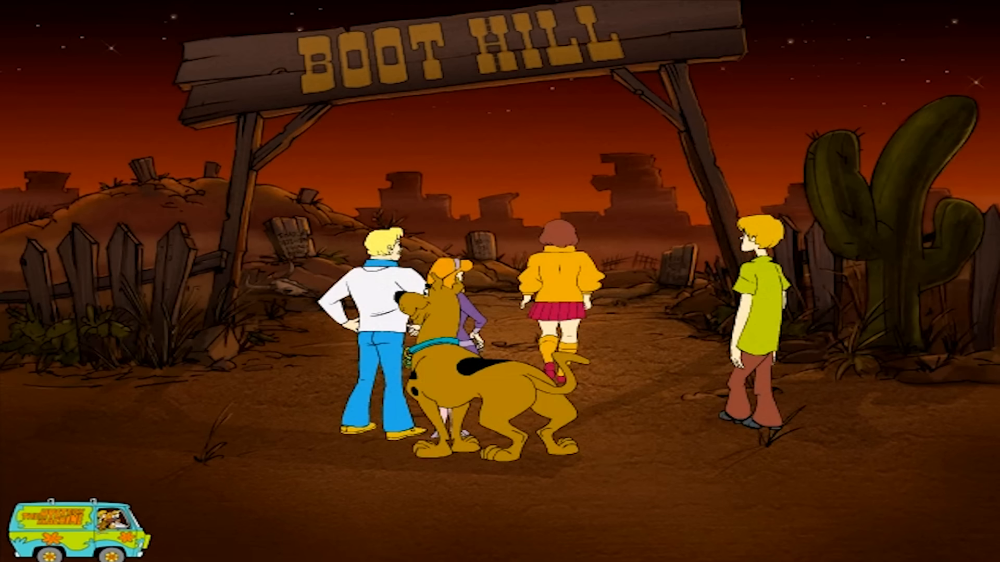](ROOM_P22_Boot_Hill2.png) | `ROOM_P22_Boot_Hill2` | [YT](https://www.youtube.com/watch?v=aR2PP0EMDSw&t=4578s) | 1:16:18.5 | Canonical | Scene block 28 (`probe_art.py --scene 28`); background match 0.89 |
| [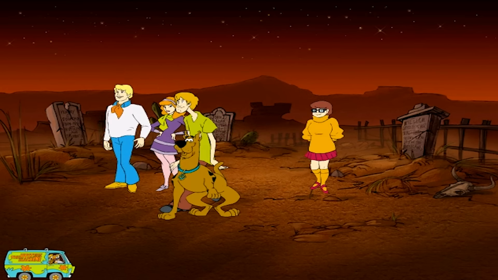](ROOM_P23_Boot_Hill3.png) | `ROOM_P23_Boot_Hill3` | [YT](https://www.youtube.com/watch?v=aR2PP0EMDSw&t=4512s) | 1:15:12.5 | Canonical | Scene block 29 (`probe_art.py --scene 29`); background match 0.89 |

## Chase sequences (P24–P28, P33–P39)

| Preview | Room ID | Source Video | Timestamp | Match Status | Notes |
|---|---|---|---|---|---|
| [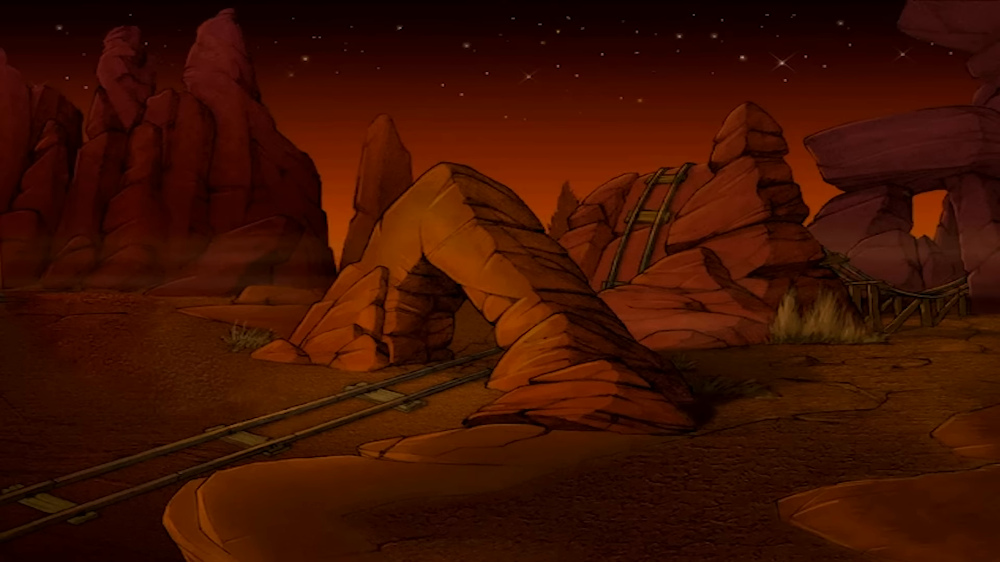](ROOM_P24_Chase_B1.png) | `ROOM_P24_Chase_B1` | [YT](https://www.youtube.com/watch?v=aR2PP0EMDSw&t=3879s) | 1:04:39.5 | Canonical | Scene block 30 (`probe_art.py --scene 30`); background match 0.99 |
| [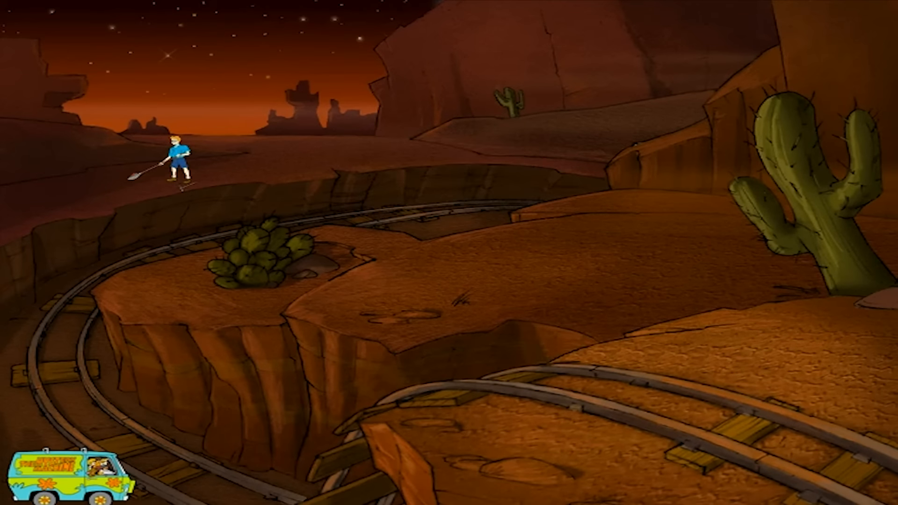](ROOM_P25_Chase_B2.png) | `ROOM_P25_Chase_B2` | [YT](https://www.youtube.com/watch?v=aR2PP0EMDSw&t=2936s) | 0:48:56.5 | Canonical | Scene block 31 (`probe_art.py --scene 31`); background match 0.98 |
| [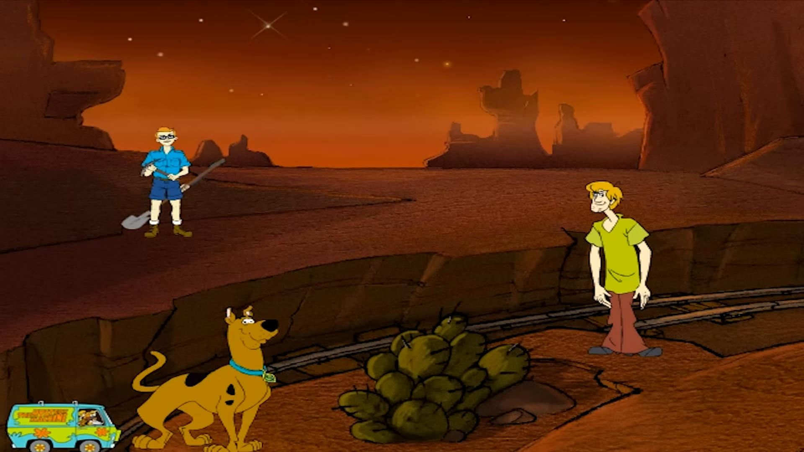](ROOM_P25A_Chase_B2_Closeup.png) | `ROOM_P25A_Chase_B2_Closeup` | [YT](https://www.youtube.com/watch?v=aR2PP0EMDSw&t=2894s) | 0:48:14.5 | Canonical | Scene block 48 (`probe_art.py --scene 48`); background match 0.91 |
| | `ROOM_P27_Chase_B4` | | | Gap | Not reached in longplay. Best whole-video match is 0.55 (a General Store frame), against 0.95+ for every chase room the player entered. Background decodes as scene 33. |
| [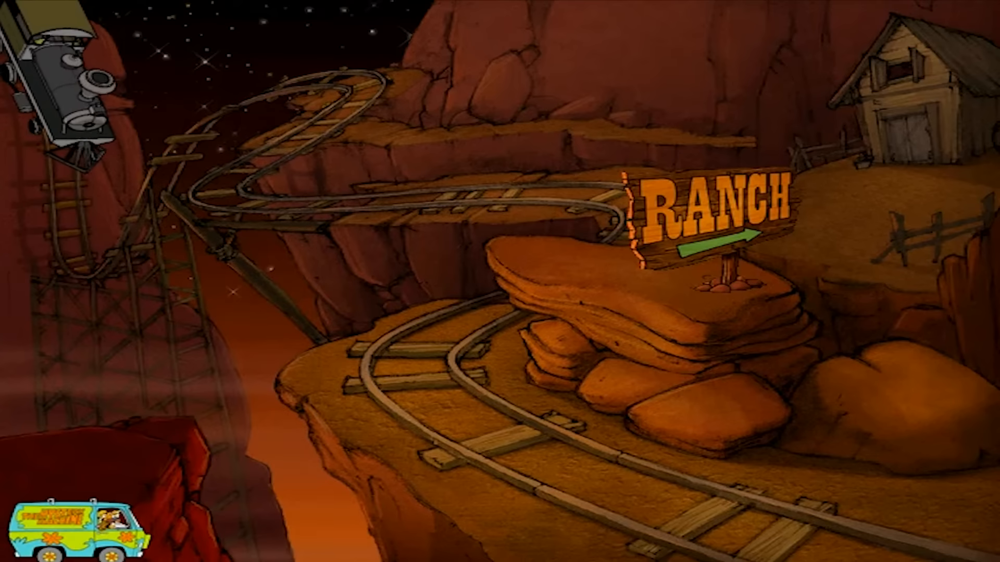](ROOM_P28_Chase_B5.png) | `ROOM_P28_Chase_B5` | [YT](https://www.youtube.com/watch?v=aR2PP0EMDSw&t=2950s) | 0:49:10.0 | Canonical | Scene block 34 (`probe_art.py --scene 34`); background match 0.96 |
| [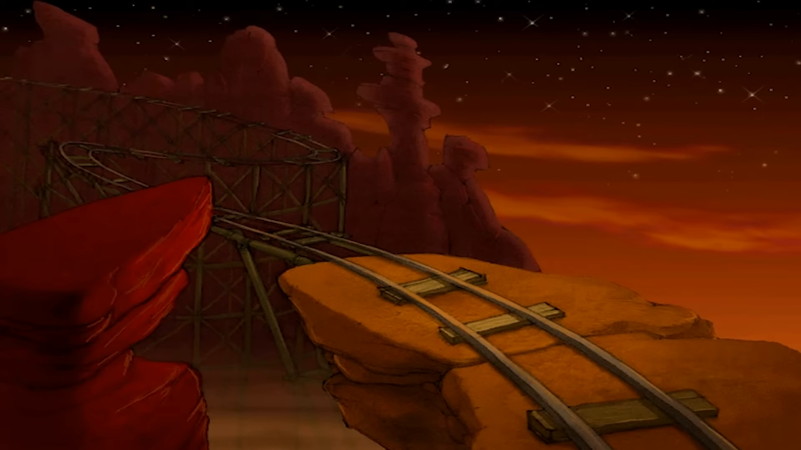](ROOM_P33_Chase_C1.png) | `ROOM_P33_Chase_C1` | [YT](https://www.youtube.com/watch?v=aR2PP0EMDSw&t=2788s) | 0:46:28.0 | Canonical | Scene block 36 (`probe_art.py --scene 36`); background match 1.00 |
| [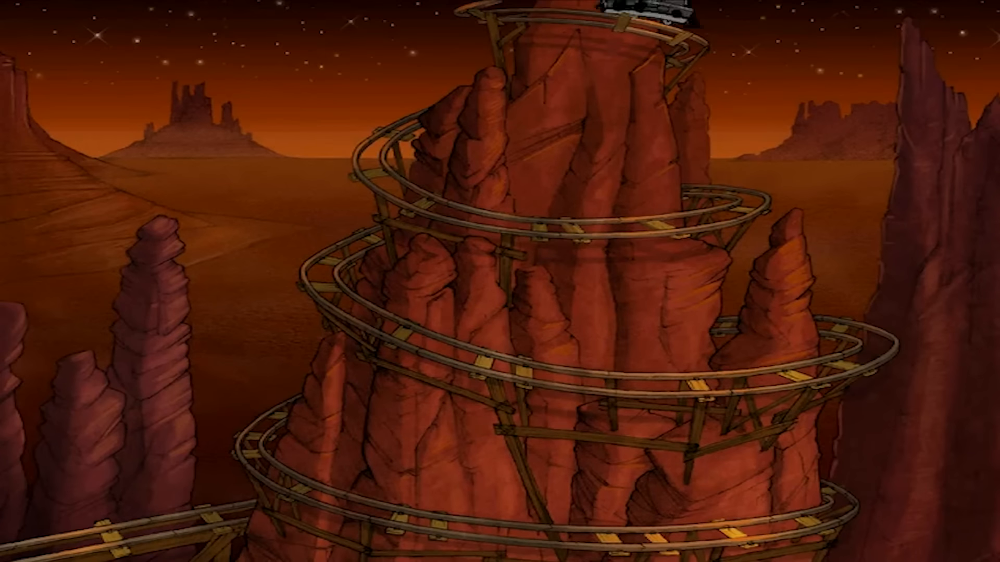](ROOM_P34_Chase_C5.png) | `ROOM_P34_Chase_C5` | [YT](https://www.youtube.com/watch?v=aR2PP0EMDSw&t=3898s) | 1:04:58.0 | Canonical | Scene block 38 (`probe_art.py --scene 38`); background match 0.99 |
| [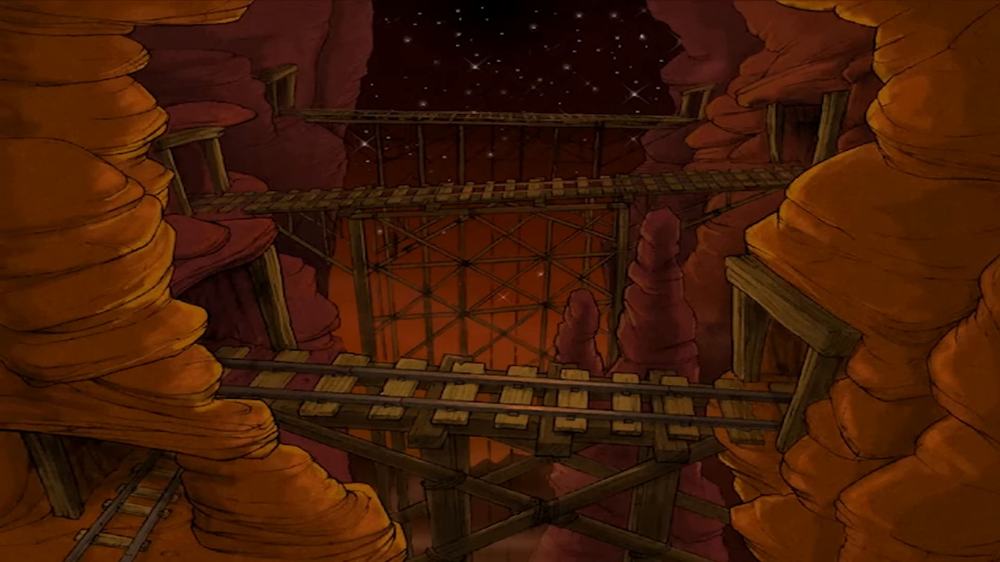](ROOM_P35_Chase_C6.png) | `ROOM_P35_Chase_C6` | [YT](https://www.youtube.com/watch?v=aR2PP0EMDSw&t=3101s) | 0:51:41.5 | Canonical | Scene block 37 (`probe_art.py --scene 37`); background match 0.99 |
| [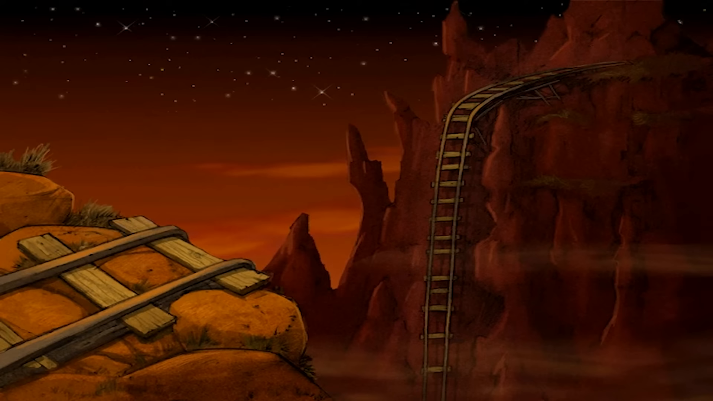](ROOM_P37_Chase_C2.png) | `ROOM_P37_Chase_C2` | [YT](https://www.youtube.com/watch?v=aR2PP0EMDSw&t=3873s) | 1:04:33.0 | Canonical | Scene block 39 (`probe_art.py --scene 39`); background match 0.99 |
| [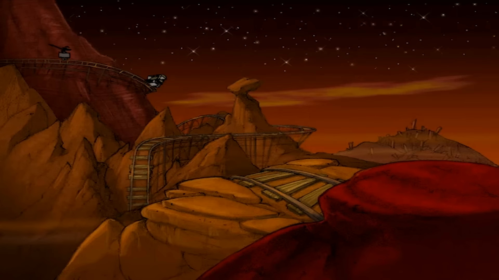](ROOM_P38_Chase_C3.png) | `ROOM_P38_Chase_C3` | [YT](https://www.youtube.com/watch?v=aR2PP0EMDSw&t=2939s) | 0:48:59.0 | Canonical | Scene block 40 (`probe_art.py --scene 40`); background match 1.00 |
| [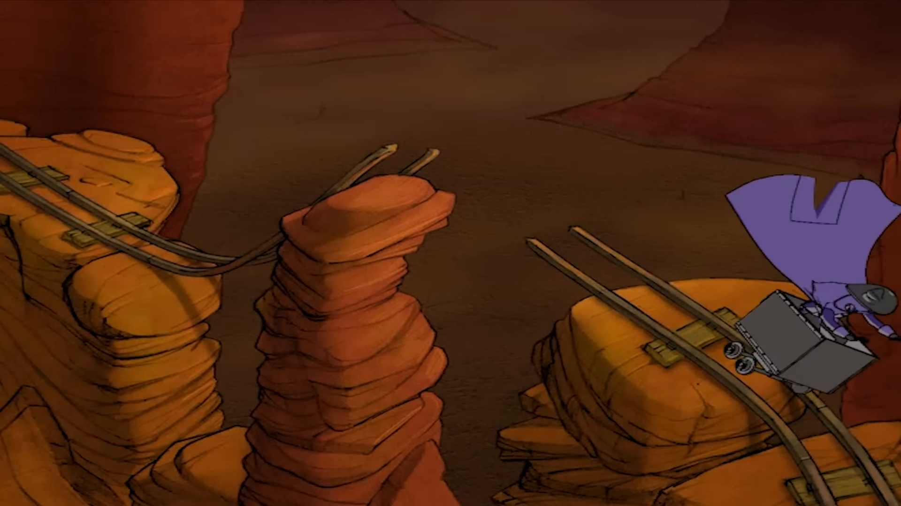](ROOM_P39_Chase_C4.png) | `ROOM_P39_Chase_C4` | [YT](https://www.youtube.com/watch?v=aR2PP0EMDSw&t=3884s) | 1:04:44.0 | Canonical | Scene block 41 (`probe_art.py --scene 41`); background match 0.95 |

## Minigames

| Preview | Room ID | Source Video | Timestamp | Match Status | Notes |
|---|---|---|---|---|---|
| [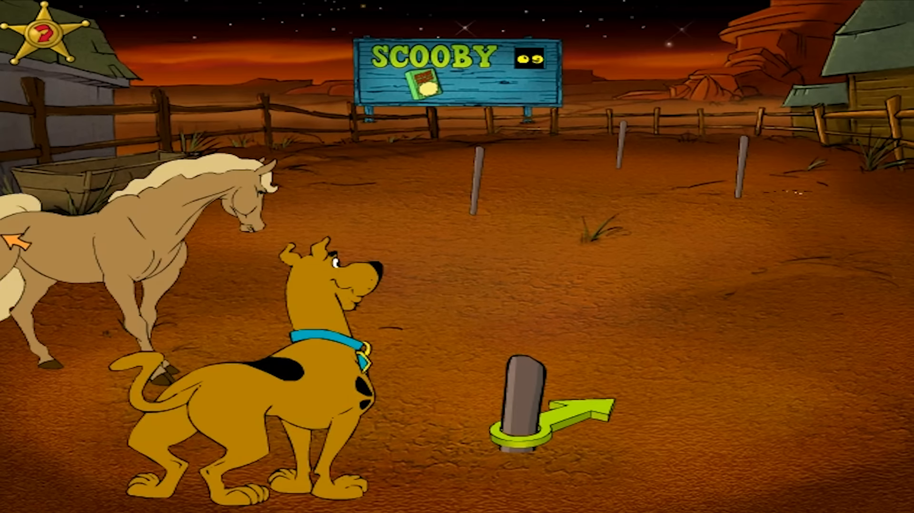](ROOM_P30_Horseshoe_Corral.png) | `ROOM_P30_Horseshoe_Corral` | [YT](https://www.youtube.com/watch?v=aR2PP0EMDSw&t=3093s) | 0:51:33.5 | Canonical | Scene block 6 (`probe_art.py --scene 6`); background match 0.82 |
| [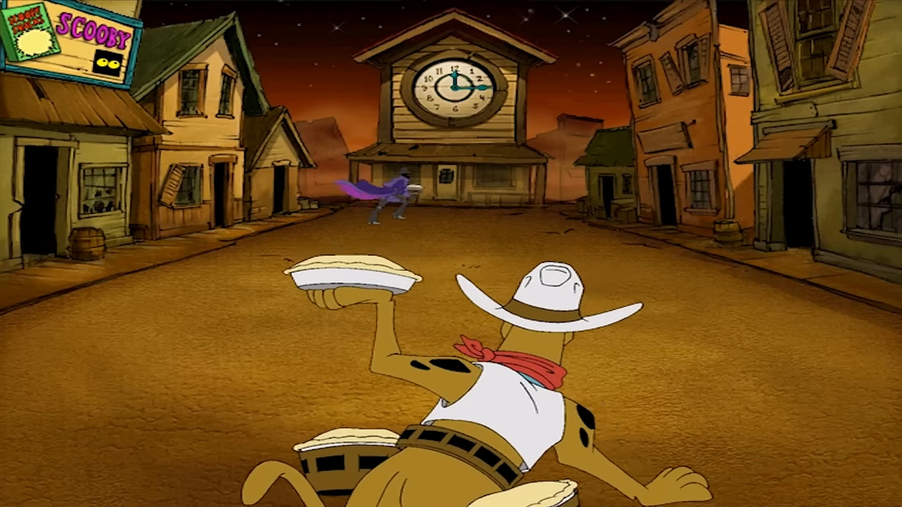](ROOM_P32_Pie_Noon.png) | `ROOM_P32_Pie_Noon` | [YT](https://www.youtube.com/watch?v=aR2PP0EMDSw&t=605s) | 0:10:05.0 | Canonical | Scene block 4 (`probe_art.py --scene 4`); background match 0.87 |

## Engine / menu rooms

| Preview | Room ID | Source Video | Timestamp | Match Status | Notes |
|---|---|---|---|---|---|
| | `ROOM_Main_Menu` | | | Gap | Not reached in longplay. The video goes from the intro logos straight to the Sign In screen (scene 9) at 0:00:12.5 and on into Town Center. Background decodes as scene 11. |
| [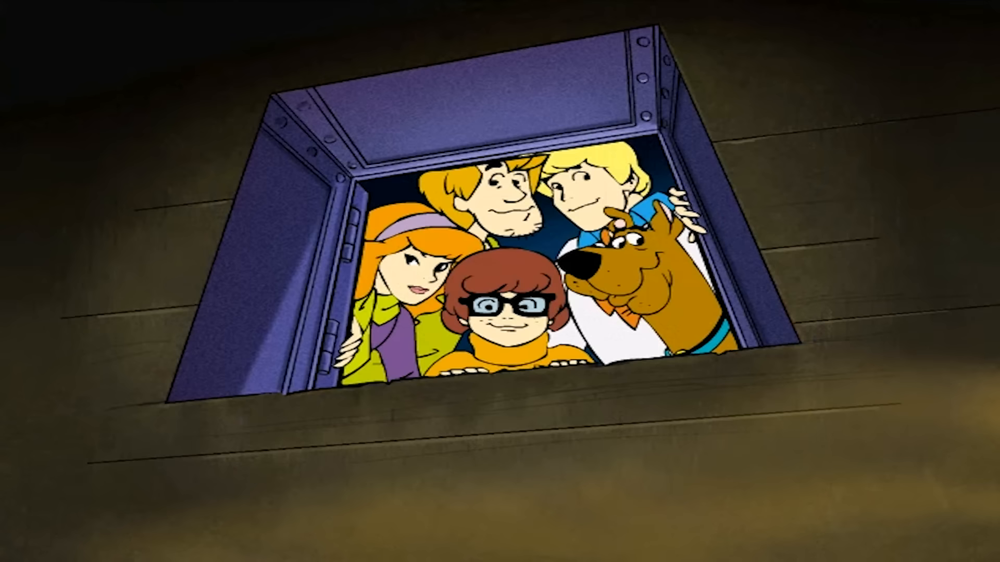](ROOM_Open_Safe.png) | `ROOM_Open_Safe` | [YT](https://www.youtube.com/watch?v=aR2PP0EMDSw&t=3175s) | 0:52:55.5 | Canonical | Scene block 62 (`probe_art.py --scene 62`); background match 0.87 |

## Character sprites (WP-002 first-decode reference)

`entry[0]` of TGIFILE.ART is `OBJ_DAPHNE_A` — a character sprite, not a
background. This capture is the in-game comparison target for WP-002's
first decode, and it matches: same pose (hands on hips) and same colors as
decoded cel 0.

| Preview | Object ID | Source Video | Timestamp | Match Status | Notes |
|---|---|---|---|---|---|
| [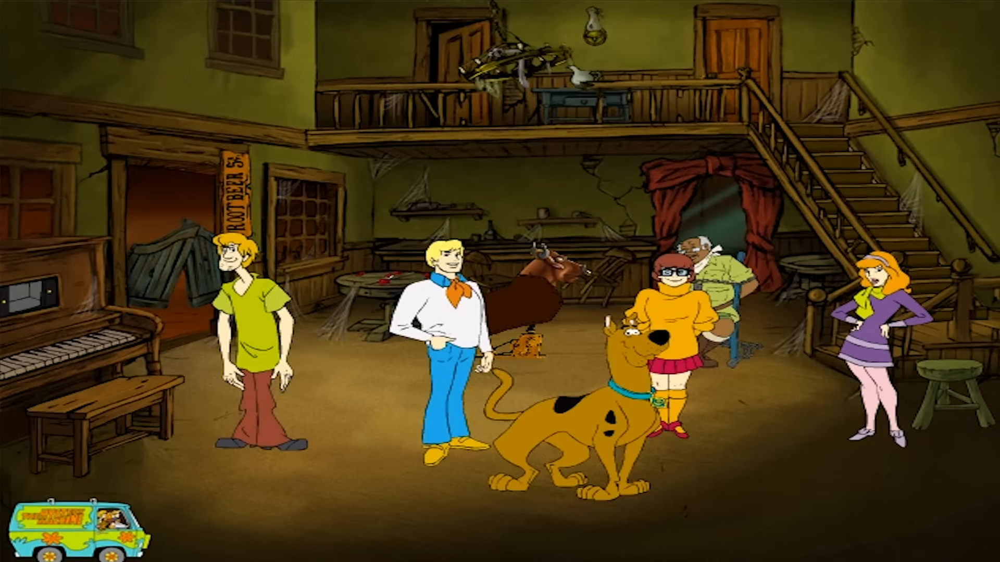](OBJ_DAPHNE_A.png) | `OBJ_DAPHNE_A` | [YT](https://www.youtube.com/watch?v=aR2PP0EMDSw&t=476s) | 0:07:56.0 | Canonical | Daphne at right, hands on hips: the pose and colors of decoded `OBJ_DAPHNE_A` cel 0 (`probe_art.py --obj 0 --cel 0`). Same frame as `ROOM_P12_Saloon`, which places `OBJ_DAPHNE_A`. |

## Unmatched captures

Add rows here for any `UNMATCHED_*.png` files committed. Each row gets
the same 6-column schema as the canonical tables above; Match Status is
`Unmatched`, and Notes carries the justification (why no canonical ID
applies — frame is between rooms, room not in WP-008 catalog, etc.).

| Preview | Filename | Source Video | Timestamp | Match Status | Notes |
|---|---|---|---|---|---|
| *(none yet)* | | | | | |

---

## Source-of-truth note

The 37 room IDs above were enumerated from `tools/samples/asset-catalog.json`
(`rooms` map) on 2026-06-03. The catalog is regenerable from the
SHA-256-locked source binaries via the command in [WP-008 §Notes](../../../work-packets/WP-008-object-ini-catalog.md#notes).
If `object.ini` is reanalyzed and rooms are added/removed, regenerate
and reconcile this list.
