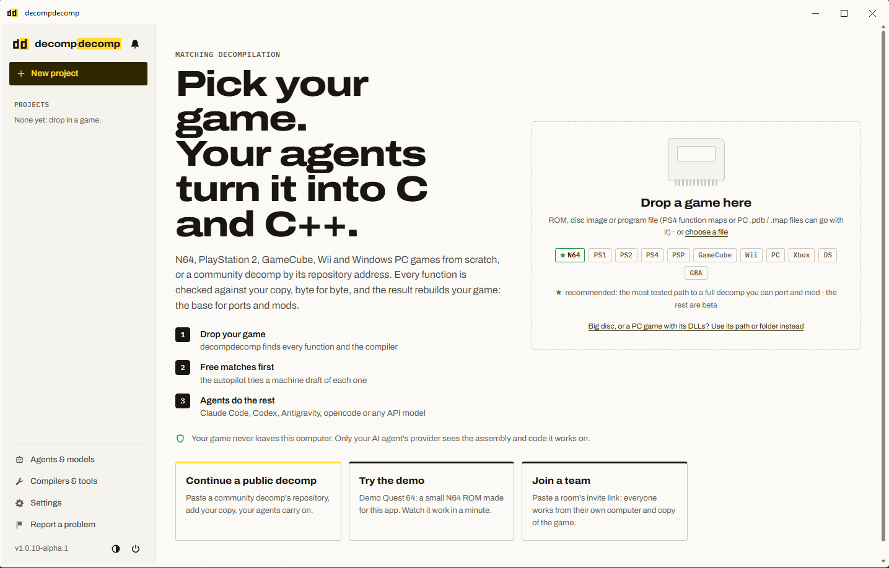
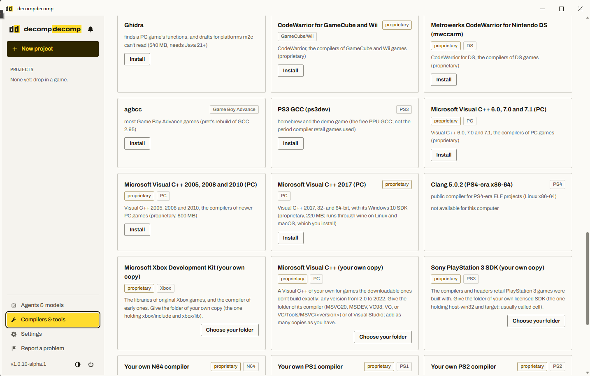

# Setting up decompdecomp on Windows

> **Work packet:** [WP-011: Case File #1 decompdecomp Collaboration](../work-packets/WP-011-casefile-decompdecomp.md) holds the trial's rules, status, checklist and decision log. This page is how to carry them out.

These steps get a Windows 11 PC ready to join the Case File #1 cooperative decompilation room, which is part of [WP-011](../work-packets/WP-011-casefile-decompdecomp.md). There are five installs, then a baseline measurement, then the join.

**What the trial is for.** Matched C rebuilds the original 2002 Windows program. It isn't a port, and it isn't engine code. The project's deliverable is still an independent ScummVM engine, written from documented behavior. The decompilation is research evidence for that engine ([WP-011 §ScummVM integration boundaries](../work-packets/WP-011-casefile-decompdecomp.md#scummvm-integration-boundaries)). The trial asks a narrower question: does decompdecomp produce that evidence faster or more cheaply than Ghidra work alone? decompdecomp's guide marks its Windows PC support as beta, so expect some friction.

## Where each instruction comes from

The page mixes three kinds of instruction. Each one is tagged with its source:

| Tag | Source | What it covers |
|---|---|---|
| **decompdecomp** | The tool's [README](https://github.com/n-delic/decompdecomp) and [GUIDE](https://github.com/n-delic/decompdecomp/blob/main/docs/GUIDE.md), read 2026-11-11 against release `v1.0.10-alpha.1` | How the tool installs, which compilers it supplies, how rooms and agents work |
| **Case File #1 project** | The collaborator's project files: its README, `tools/configure.py` and config | Which compiler this game is matched with, the build commands, where the game files go |
| **WP-011** | This project's [trial rules](../work-packets/WP-011-casefile-decompdecomp.md) | Spend caps, helper count, the baseline, what gets recorded, hygiene |

decompdecomp is young and self-updates, and its docs leave some screens undescribed. Where they don't cover a step, this page says so, so you know to look and write down what you find.

## Before you start

- Windows 10 or 11, x86-64, with an account that can approve an installer. *decompdecomp:* Windows PC games don't need WSL 2.
- Your own legally obtained Case File #1 files: the executable and `libexpat.dll`. This project keeps them in the gitignored `tools/exes/casefile1/` ([tools/exes/README](../../tools/exes/README.md)). *WP-011:* the executable's SHA-256 must match the [WP-007 lock](../formats/scooby-exe.md#binary-identity-wp-007-baseline). *decompdecomp:* every member of a room needs an identical copy.
- *Case File #1 project:* a local clone of [monyarm/scooby-tlr-decomp](https://github.com/monyarm/scooby-tlr-decomp), Mony Armenchev's Case File #1 decompilation, outside this checkout. The repository is private: ask Mony ([@monyarm](https://github.com/monyarm)) for access. Put the game files in the clone's gitignored `orig/` folder as `orig/casefile1.exe` and `orig/libexpat.dll`.

## 1. Install decompdecomp

*Source: decompdecomp.*

1. Open the [latest release](https://github.com/n-delic/decompdecomp/releases/latest) and download `decompdecomp-<version>-windows-x64-setup.exe`. The guide also mentions an MSI; use whichever Windows installer the release actually lists.
2. Run it. Setup also installs WebView2 and .NET Framework 4.8 if they're missing. If Windows SmartScreen stops an unsigned installer, choose **More info → Run anyway**. Then start decompdecomp from the Start menu.
3. Record the version you installed. The app offers one-click updates, and *WP-011* records the tool version with every finding.

## 2. Install the Visual C++ 6.0 compiler

*decompdecomp:* the GUIDE's platform table lists, for Windows PC, "Visual C++ 6.0 · 7.0 · 7.1 · 2005 · 2008 · 2010 · 2017", plus any other version "from your own copy" for 32-bit games. The GUIDE says proprietary compilers install after you accept their licenses in a **Setup** screen, but `v1.0.10-alpha.1` has no Setup entry in its sidebar. The compilers install from **Compilers & tools** instead (observed 2026-11-11).

*Case File #1 project:* the game is matched with **Visual C++ 6.0** by default, with one file on 7.1. Those two are the ones you need.

You don't need to install Visual Studio, old or new. decompdecomp's docs don't mention it. What matters is the period compiler that decompdecomp supplies, because every attempt is rebuilt with that compiler and compared byte for byte.



1. Open **Compilers & tools** from the sidebar.
2. On the **Microsoft Visual C++ 6.0, 7.0 and 7.1 (PC)** card, choose **Install**, and accept the license if it asks. That one card covers both versions this game needs. Skip the 2005–2010 and 2017 cards, and **Microsoft Visual C++ (your own copy)**.
3. The install downloads the three compilers from the decomp.me community's archives (GitHub releases and `files.decomp.dev`) and prints where it put them: `%LOCALAPPDATA%\decompnet\toolchains\msvc`, with a `6.0`, `7.0` and `7.1` folder, each holding `Bin\CL.EXE` (observed 2026-11-11). Step 6 uses that folder.



## 3. Install Java

Ghidra runs on Java, and step 4 uses it twice: for decompdecomp's own Ghidra and for a standalone copy. Ghidra needs a 64-bit Java development kit (JDK), version 21 or newer; its install guide names the minimum for each release (JDK 21 for 11.x and 12.x). A Java runtime alone isn't enough, because decompdecomp looks for `javac.exe` beside `java.exe` ([why](#ghidra-inside-decompdecomp-install-a-windows-jdk-first)). Install the JDK before Ghidra, so decompdecomp finds it instead of reaching for its own Java, which on Windows needs WSL 2.

### On Windows

1. Install a 64-bit Windows JDK, version 21 or newer. Any JDK that meets Ghidra's minimum works; a long-term support (LTS) release, 21 or 25, changes least over the trial.
   - **Oracle JDK:** on [Oracle's Java downloads](https://www.oracle.com/java/technologies/downloads/), pick the version's tab, then **Windows → x64 Installer**.
   - **Eclipse Temurin:** the `.msi` from [adoptium.net](https://adoptium.net/), with **Add to PATH** left on.
2. In a new PowerShell window, check that decompdecomp will accept it. This repeats its own test, and must print `True` and a version of 21 or more:

   ```powershell
   $java = (Get-Command java).Source; $real = (Get-Item $java).ResolvedTarget ?? $java
   Test-Path (Join-Path (Split-Path $real) 'javac.exe'); java -version
   ```

   `False` means the `java` found first is a runtime without `javac`, or an older Java ahead of the new one on the PATH. `(Get-Command java).Source` shows which.
3. If decompdecomp is open, quit it completely and start it again, so it sees the new PATH.
4. Record the JDK's vendor and version for the [trial record](#trial-record-for-wp-011).

### On a Raspberry Pi or other 64-bit ARM Linux

This is for Ghidra only. decompdecomp itself doesn't run on a Pi: its README lists Linux on x86-64 only, `v1.0.10-alpha.1` ships no ARM64 Linux package, and its Visual C++ compilers are 32-bit x86 Windows programs, which it runs on Linux through `wibo` or `wine` (read 2026-11-11). Join the room from the Windows PC, or from an x86-64 Linux machine.

Not part of the Windows setup, but the same rule holds for Ghidra on Linux: a JDK 21 or newer. On a Raspberry Pi 5 with 64-bit Raspberry Pi OS, Oracle's ARM64 archive installs under `/opt/java`. Run each line on its own:

```bash
uname -m
cd /tmp
wget https://download.oracle.com/java/27/latest/jdk-27_linux-aarch64_bin.tar.gz
sudo mkdir -p /opt/java
sudo tar -xzf jdk-27_linux-aarch64_bin.tar.gz -C /opt/java --no-same-owner
ls -d /opt/java/jdk-27*
```

- `uname -m` must print `aarch64`. If it doesn't, the Pi runs a 32-bit OS, and Oracle has no 32-bit ARM build: stop here.
- The `latest` link always serves the newest JDK 27 patch (also on [Oracle's downloads page](https://www.oracle.com/java/technologies/downloads/#jdk27-linux), under Linux → ARM64 Compressed Archive). JDK 27 is a feature release, not LTS; for Ghidra, JDK 25's archive works the same way with `25` in place of `27`.
- `--no-same-owner` makes root the owner; the archive's own owner (`mach5-run`) doesn't exist on the Pi.
- `ls` prints the folder to use below. On 2026-11-11 it was `jdk-27.0.1.0.3`; change the name in each command if yours differs.

Then register it and set `JAVA_HOME`:

```bash
sudo update-alternatives --install /usr/bin/java java /opt/java/jdk-27.0.1.0.3/bin/java 2700
sudo update-alternatives --install /usr/bin/javac javac /opt/java/jdk-27.0.1.0.3/bin/javac 2700
printf 'export JAVA_HOME=/opt/java/jdk-27.0.1.0.3\nexport PATH=$JAVA_HOME/bin:$PATH\n' | sudo tee /etc/profile.d/java.sh
source /etc/profile.d/java.sh
java -version
javac -version
```

Both versions should say 27, and `echo $JAVA_HOME` the folder under `/opt/java`. Oracle's [JDK 27 installation guide for Linux](https://docs.oracle.com/en/java/javase/27/install/installation-jdk-linux-platforms.html) covers the archive install. The studio's Pi test box keeps the full runbook, with troubleshooting, in the Herbs vs. Ailments engineering wiki ([Installing Java on the Raspberry Pi](https://ewiki.herbsvsailments.com/research/pi-test-box/#installing-java-on-the-raspberry-pi), private).

## 4. Install Ghidra

*decompdecomp:* the GUIDE names Ghidra as the analysis tool for Windows PC projects started from scratch. For x86 work it is optional: it writes the C drafts that agents start from ("Ghidra (optional) for x86"). The GUIDE describes no Ghidra step for joining a room.

*Case File #1 project:* the collaborator's function list came from Ghidra, so joining his project doesn't need Ghidra to find functions. This project needs Ghidra anyway for [WP-001](../work-packets/WP-001-ghidra-session.md).

### Ghidra inside decompdecomp: install a Windows JDK first

`v1.0.10-alpha.1` offers Ghidra on its **Compilers & tools** screen (540 MB; see step 2's screenshot). Ghidra needs a Java development kit (JDK), version 21 or newer. decompdecomp uses the computer's own JDK when the `java` on the PATH belongs to one: version 21 or newer, with `javac.exe` beside `java.exe` (a Java runtime alone doesn't count). Otherwise it installs its pinned Eclipse Temurin 21, which on Windows is a Linux build that runs under WSL 2. Without a WSL Linux distribution, that install stops with "WSL has no working Linux distribution yet" (observed 2026-11-11). The README and GUIDE don't mention any of this; it is read from decompdecomp's source (`toolchains.py`, `forks/ghidra.py`).

So give it a Windows JDK first:

1. Install it and run the check in [step 3](#on-windows), then restart decompdecomp.
2. Choose **Install** on the Ghidra card. It should download Ghidra only, with no Java development kit.

The other ways through: install WSL 2 (`wsl --install` in an administrator PowerShell, restart, open Ubuntu once) so decompdecomp's own Temurin can run. Or skip Ghidra: agents then work without Ghidra drafts, and step 6's baseline build doesn't use it either. Record which in the [trial record](#trial-record-for-wp-011), because it changes what the agents start from.

### Ghidra for this project's own analysis

decompdecomp keeps its own Ghidra for the app. For [WP-001](../work-packets/WP-001-ghidra-session.md) and your own reading of the executable, install a Windows copy:

1. Use the JDK from [step 3](#3-install-java). Ghidra's install guide names the minimum for each release (JDK 21 for 11.x and 12.x).
2. Download Ghidra from [ghidra-sre.org](https://ghidra-sre.org/) or its [GitHub releases](https://github.com/NationalSecurityAgency/ghidra/releases). Unzip it to a folder with no spaces in the path, such as `C:\tools\ghidra_<version>`, and start it with `ghidraRun.bat`.
3. Record the Ghidra and JDK versions. The docs don't say whether decompdecomp can use this copy instead of its own, so don't count on it.

## 5. Set up an agent provider and a spend limit

*decompdecomp:* the tool has **no budget cap** of its own. When a provider limit is hit, it waits for the limit to reset and then carries on. It pauses only after five fast failures in a row. The guide reports that a small function cost about 8 cents with Claude Code; that figure is the tool's, not ours.

*WP-011:* the spend limit therefore has to come from the provider.

1. Pick a provider.
   - **API key:** DeepSeek, OpenRouter, OpenAI, or any OpenAI-compatible API, including a local model. decompdecomp recommends this route.
   - **CLI agent:** Claude Code, Codex CLI, and others. The app installs the agent and tells you how to sign in.
2. In the provider's console, set the strongest spending limit it offers before creating the key. Providers differ: some have a hard cap, others only prepaid credit or budget alerts. Prepaid credit equal to the trial's dollar cap works as a hard stop.
3. In decompdecomp, open **Agents & models → API key** and paste the key. Don't put it in any file in any repository.

## 6. Record the pre-agent baseline

*WP-011.* Before any agent touches the project, measure where it stands. This baseline is the "before" that the trial is compared against. Without it, the trial can't show what decompdecomp's agents actually added, and the collaborator's progress stays a reported figure.

*Case File #1 project:* the build needs Python 3.12 and `ninja` on the PATH. Make sure `python` is a real Python install, not one bundled inside another app; `py -3.12` avoids the problem. In the clone:

```powershell
py -3.12 tools/configure.py casefile1 --msvc "$env:LOCALAPPDATA\decompnet\toolchains\msvc"
ninja
ninja rebuild
```

`--msvc` takes the folder that holds `6.0\Bin\CL.EXE`, which is step 2's install folder. The one file built with 7.1 finds its compiler in the same folder.

`ninja rebuild` reassembles the whole program from C where the C matches and from your copy's bytes elsewhere, and reports whether the result is byte-identical. `objdiff.json` gives per-function progress in [objdiff](https://github.com/encounter/objdiff).

Record, with the commit hash of the clone:

- Functions with C, matched byte for byte, and not matched
- Whether `ninja rebuild` reports the program byte-identical
- Build warnings or failures, and which files caused them

## 7. Join the cooperative room and run the trial

*decompdecomp* for the mechanics, *WP-011* for the limits.

1. Ask Mony for the **current** invite link, privately. The room runs over a temporary tunnel, so the link changes every time he restarts decompdecomp, and an old one won't work.
2. In decompdecomp, choose **New project → Join a team's room**. Paste the link, type your display name, and pick your copy of the game (`orig/casefile1.exe`).
3. *WP-011:* before pressing **Start agents**, set a small helper count: 2 for the trial. *decompdecomp:* one start can launch up to 24; the docs don't say where the count is set.
4. *WP-011:* stop when the trial cap is reached (100 functions or your dollar cap, whichever comes first), then rerun step 6's measurements.

## Keep each project's material in its place

There are three separate places. Nothing moves between them except what the [Trial record](#trial-record-for-wp-011) below lists.

| Place | What lives there | Rules |
|---|---|---|
| **This repository** (public) | Docs, evidence, the trial record | Never commit a room link, an API key, the game files, a decompdecomp project, or matched C. `.gitignore` blocks `tools/decomp/`, `decompdecomp/`, `.env` files and the game data, but those rules are a backstop, not the process. |
| **Mony's repository**, [monyarm/scooby-tlr-decomp](https://github.com/monyarm/scooby-tlr-decomp) (private) | Matched C, project config, the game files in gitignored `orig/` | Its contents stay off this public site ([WP-011 §Legal and repository hygiene](../work-packets/WP-011-casefile-decompdecomp.md#legal-and-repository-hygiene)). Commit there only by his workflow. |
| **decompdecomp's own folder** (`Decomp` under your user folder, `~/Decomp` in its docs) | The app's projects, logs and room state | Already outside both repositories. Leave it there. |

Run `git status` before every commit, in both repositories.

## Trial record for WP-011

Record these in the WP-011 decision log and trial metrics.

**Setup (once):**
- decompdecomp version
- Compiler versions and the toolchain path
- decompdecomp's Ghidra: installed (with your own JDK, or its Temurin under WSL 2) or not used. Plus the JDK version, and the version of any standalone Ghidra
- Provider, model and spending limit

**Pre-agent baseline (step 6):**
- The clone's commit hash
- Functions with C, matched, and not matched
- Rebuild result

**Post-trial (step 7):**
- The same counts as the baseline, rerun
- Functions attempted, matched, near misses and failures
- Helper count, agent cost and wall time
