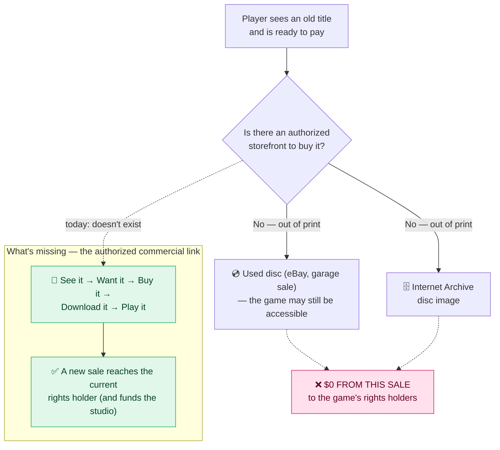

# Strategy note: the distribution + compatibility layer (and the licensing it needs)

> **Status:** A strategy framework — it captures a direction and **decides
> nothing**. Layer 1 (the engine) proceeds regardless; Layer 2 (the storefront)
> gates entirely on licensing. **Date:** 2026-11-22. **Author:** Jeff (with AI
> assistance).

## The problem, in one picture

**The customer is not refusing to buy the game. The customer _cannot_ buy the
game.**

For an out-of-print title such as *Scooby-Doo! Showdown in Ghost Town*, a player
may want the game, have money ready to spend, and still lack a current authorized
digital storefront where a new copy can be purchased.

Preservation can keep a game accessible. Compatibility software can make it run on
modern hardware. What is missing is the **authorized commercial link** that lets
the customer pay for the game and immediately play it.

**Vision: See it → Want it → Buy it → Download it → Play it.**

> **A note on precision.** The diagram says "$0 from this sale to the game's
> rights holders," not "impossible to pay anyone." The original developer may no
> longer be the entity entitled to sales revenue, while a current rights holder or
> licensee could be. What's broken is specifically the **normal new-sale
> transaction** — not the existence of a payee.

## The reframe

The product may not be a retro "game console." It is the missing **distribution +
compatibility layer** between discovering an old game and actually playing it.

The modern game funnel is: Discover → Evaluate → Platform check → **Purchase →
Download → Play**. For a current title on a PC that is short — see it → buy →
install → play. For a 2000–2002 Learning Company Scooby CD-ROM it balloons into:
find a legitimate copy → determine Windows compatibility → obtain a disc/image →
install → troubleshoot old dependencies → configure a compatibility layer →
launch. **That gap is the opportunity.**

Design goal: **See it → Want it → Buy it → Download it → Play it** — without the customer ever
needing to understand ScummVM, ISO mounting, Windows versions, Raspberry Pi
setup, or engine internals.

## Why the gap is real (not hypothetical)

These titles are out of print. No storefront still sells them, and they never got
a digital re-release — confirmed for *Showdown in Ghost Town*: it is not on Steam,
where the only Scooby *game* is the unrelated 2014 WayForward title. The demand
side is not "people won't pay"; it is that **no one will take their money.** Today
the only way to actually play is a preserved disc image (Internet Archive) run
under an engine/emulator. That is a **stranded market** — real demand, no
legitimate supply.

ScummVM already solves the *compatibility* half: one engine runs on Windows,
macOS, Linux, Raspberry Pi, **Android TV, and Apple TV** — the screens already
under people's televisions. The `terraglyph` engine extends that to these titles.

## Two layers — keep them separate

**Layer 1 — Engine / preservation (where we are today).** The clean-room fork, in
ScummVM's "bring your own data" posture: the user supplies the game, the engine
plays it. **Needs no license.** This is the beachhead — it proves the technology,
grows the list of supported titles, and costs nothing legally.

**Layer 2 — Licensed storefront (the opportunity).** "Buy it → Play it." Here the
project is a **distributor**, and that needs rights locked **first**. The moat is
the license, not the code — anyone can compile ScummVM; nobody else has the right
to *sell* these titles plus the one-tap install that makes them play on a TV.

Do not blur the two to a customer. Layer 1's honesty ("bring your own disc") must
never be dressed up as Layer 2 before the rights actually exist.

## The real homework — the rights chain, per title

The hard, valuable, defensible work is earning the right to say "Buy it." Each
title is its own rights puzzle, usually two-sided:

- **Character / brand license** — *Scooby-Doo* sits with the Warner Bros. lineage
  (Hanna-Barbera → Warner Bros.).
- **Game / software IP** — the Learning Company lineage (The Learning Company →
  Riverdeep → Houghton Mifflin Harcourt, per public acquisition history —
  **to confirm**).

A checklist to run down before counting on any one title:

1. Who owns the **character / brand** rights today?
2. Who owns the **game code / engine IP** today?
3. Is it in print or licensable anywhere now, or is it genuinely dormant?
4. Is there any existing digital-distribution grant that would conflict?
5. Who is the actual contact to license from, and at what scale — a single title,
   or a catalog?

**A better anchor than Scooby may be Humongous Entertainment** (Putt-Putt, Freddi
Fish, Pajama Sam): ScummVM already runs those titles well, and their rights have
changed hands in more trackable ways. A licensed edutainment *catalog* on
hardware people already own is a more concrete v1 than a single Scooby title.

## Hardware: fallback, not headline

Selling the customer another box (a dedicated mini-console) should be the
**fallback**, not the primary experience. The wedge is "it runs on the screen
already under your TV." If the compatibility layer installs licensed classic
titles on hardware families people already own, that removes the biggest piece of
friction in the chain — and the hardware play becomes optional upside, not the
product.

## What this note is, and isn't

A framework, not a commitment. **Layer 1 (the engine) continues regardless.**
Layer 2 (the storefront) is gated entirely on the rights work above; nothing here
commits the project to it, and no licensing contact has been made.

This note is published openly as the project's thinking-out-loud. Genuinely
confidential specifics — deal terms, named contacts, numbers — belong in the
private `scooby-engine-private` repo, not here.
