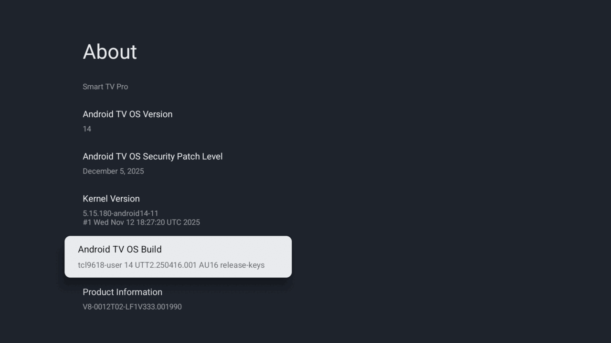
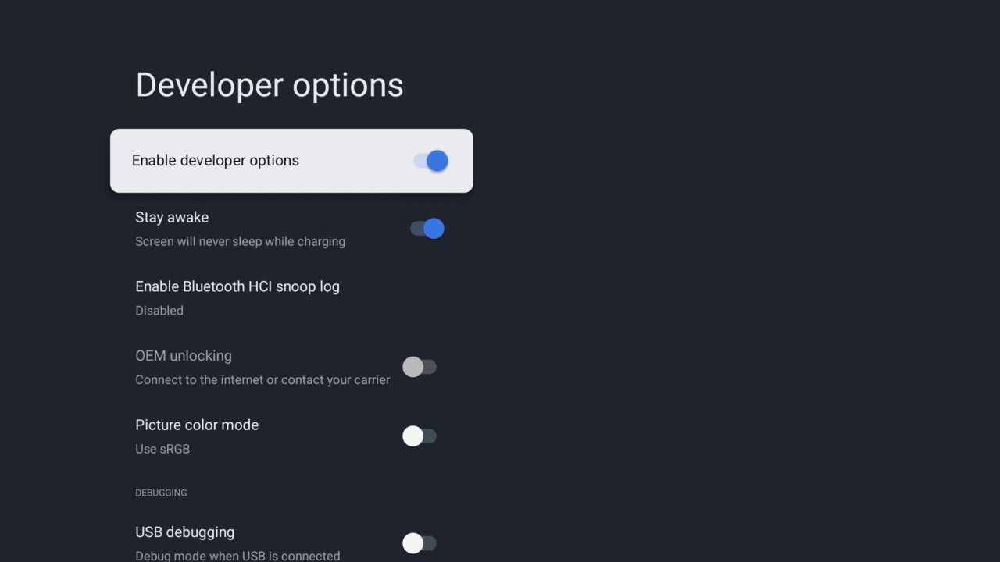
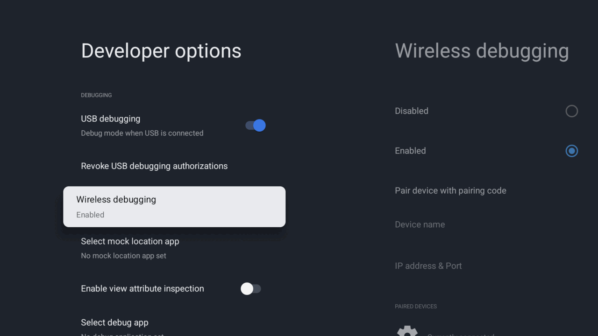
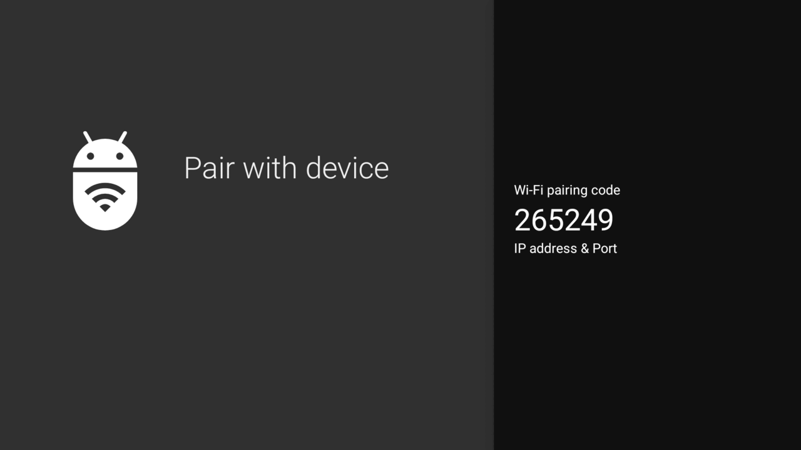
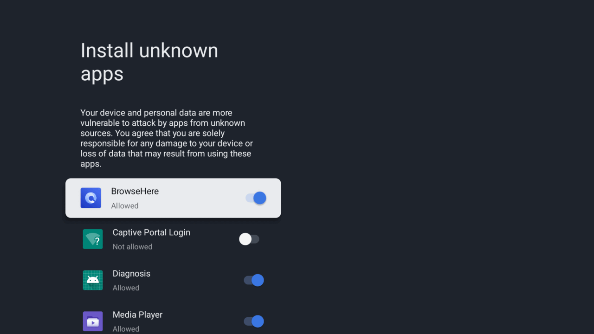
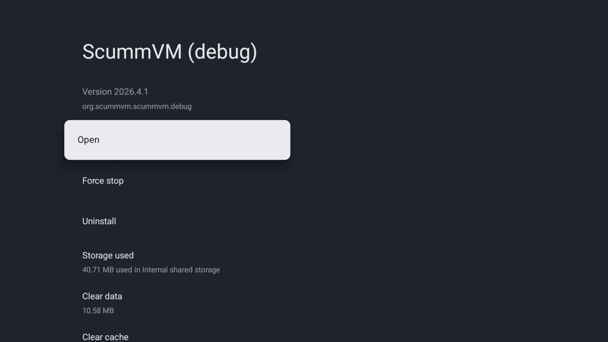
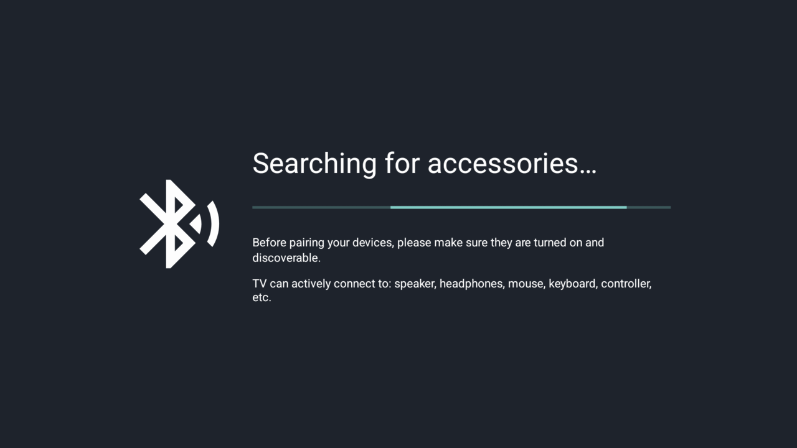

# Installing ScummVM on a smart TV

How to run ScummVM on a smart TV itself, with no console, Raspberry Pi or
mini-PC plugged in.

There are two ScummVM builds you could put on a TV, and only one of them plays
the Scooby games:

| Build | Where it comes from | Plays the Scooby games? |
|---|---|---|
| **Our build** | Compiled from our fork, [barefootbetters/scummvm](https://github.com/barefootbetters/scummvm) (branch `scooby-engine`): standard ScummVM plus the TerraGlyph engine | **Yes** |
| **The standard ScummVM app** | Downloaded from [scummvm.org](https://www.scummvm.org/downloads/) or the Play Store | **No.** It plays the games ScummVM itself supports, but it has no TerraGlyph engine |

We don't publish a ready-made TV download of our build yet (the only download is
the [Windows preview](download-and-install.md#download-windows)). On a Google TV
or other Android TV you **compile it yourself as an Android app (APK)** for the
TV's processor, then install it on the TV. That's the main path on this page:
[Build our APK](#build-our-apk-with-the-terraglyph-engine).

> **You supply the games.** This project distributes no game data. You point
> ScummVM at files you're entitled to: your own disc, or a legally obtained copy.

> **Checked 2026-11-22; first run on a TV 2026-11-24.** The build steps come from
> our fork's own Android build files ([Sources](#sources)), which track ScummVM
> 2026.4, and were followed end to end to build arm64-v8a and armeabi-v7a APKs
> ([build record](#build-record)). ScummVM has no official TV support. On Android
> TV it was never a Play Store TV app, so every route here is a sideload. **The
> armeabi-v7a build has now been built, installed and played on a real TV** — a
> TCL 65Q77K (Google TV, Android 14), with a USB mouse ([smoke test](#tv-smoke-test)).
> Many Google TV sets are 32-bit only, so
> **[check the TV's ABI](#pick-the-processor-type-abi) before you build.**

---

## Which TV do you have?

| TV platform | How to get the Scooby games on it |
|---|---|
| **Google TV / Android TV / Fire TV** | [Build our APK](#build-our-apk-with-the-terraglyph-engine) for the TV's processor and sideload it |
| **LG webOS** | No Scooby build yet. A community webOS package of the standard app exists ([webOS](#lg-webos)) |
| **Samsung Tizen and other browser-only TVs** | No Scooby build. The standard app's web version runs some games ([other TVs](#samsung-tizen-and-other-tvs)) |

---

## Google TV / Android TV / Fire TV

Google TV, Android TV and Fire TV all run Android apps, so one APK built for the
TV's processor installs on any of them.

### Pick the processor type (ABI)

An Android APK is compiled for one processor type. Our build's `configure`
accepts these four:

| `--host=` value | Processor | Use it for |
|---|---|---|
| `android-arm64-v8a` | 64-bit ARM | **Most current TVs** — use it if `getprop` lists `arm64-v8a` (below) |
| `android-arm-v7a` | 32-bit ARM | Older or low-end TVs and Fire TV Sticks, or a TV whose Android is 32-bit even on a 64-bit chip, like the [TCL 65Q77K](#your-tv-the-tcl-65q77k) |
| `android-x86_64` | 64-bit Intel/AMD | Rare on TVs. Mainly the Android emulator |
| `android-x86` | 32-bit Intel/AMD | Rare on TVs |

**Check the ABI before you build — many TVs are 32-bit only.** Plenty of Google
TV / Android TV sets, including MediaTek-based models like the
[TCL 65Q77K](#your-tv-the-tcl-65q77k), run a **32-bit (armeabi-v7a) Android even
on a 64-bit chip**. A 64-bit APK won't install on them — `adb install` fails with
`INSTALL_FAILED_NO_MATCHING_ABIS`. [Connect with `adb`](#connect-adb-over-the-network)
and run:

```bash
adb shell getprop ro.product.cpu.abilist
```

- If the list includes `arm64-v8a`, build `--host=android-arm64-v8a` (the default below).
- If it's `armeabi-v7a,armeabi` only — with an empty `ro.product.cpu.abilist64` —
  build `--host=android-arm-v7a`.

A 64-bit APK that installs but opens to a white screen is the other sign of a
32-bit TV; rebuild for `android-arm-v7a`.

For your own TV, build the one ABI it lists. A Google Play release needs both
arm64-v8a and armeabi-v7a, with the 64-bit libraries 16 KB-aligned, and our
build already meets that rule ([16 KB pages](#google-play-16-kb-pages)).

### Build our APK (with the TerraGlyph engine)

#### 1. Set up a build machine

The build runs `configure` and `make` in a Unix shell. On Windows, use **WSL 2
with Ubuntu** (`wsl --install -d Ubuntu`) and do every step below inside it.
Linux and macOS work directly. Our `configure` also accepts the NDK's Windows
toolchain, but building from MSYS2 hasn't been tried.

You need:

- **A JDK, 17 or newer.** The Android Gradle Plugin our build uses (9.3.2)
  needs at least Java 17.
- **The Android SDK command-line tools** and, through them, the platform tools,
  the Android 37 platform, and **NDK 23.2.8568313 exactly**. Our `configure`
  compares the NDK version with the one pinned in `dists/android/build.gradle`
  and stops if they differ.
- **Google's [Oboe](https://github.com/google/oboe) audio library, added to the
  NDK.** Our Android audio code includes `oboe/Oboe.h` and links `-loboe`, but
  neither the repo nor the NDK provides it, so `make` stops on that header
  without it. (ScummVM's own release builds use a prebuilt toolchain that already
  has it.) Building it takes about a minute: [step 2](#2-add-oboe-to-the-ndk).
- **`git`, `make`, a C++ compiler for the build machine, `pkg-config`, `cmake`
  and `ninja`.**

On Ubuntu (in WSL), with the SDK command-line tools unzipped into
`~/android-sdk/cmdline-tools/latest/`:

```bash
sudo apt update
sudo apt install -y --no-install-recommends openjdk-17-jdk git make build-essential \
    pkg-config unzip cmake ninja-build

export ANDROID_SDK_ROOT="$HOME/android-sdk"
export ANDROID_NDK_ROOT="$ANDROID_SDK_ROOT/ndk/23.2.8568313"
"$ANDROID_SDK_ROOT/cmdline-tools/latest/bin/sdkmanager" \
    "platform-tools" "platforms;android-37" "ndk;23.2.8568313"
```

The command-line tools come from the "Command line tools only" downloads on
[developer.android.com/studio](https://developer.android.com/studio). Put the two
`export` lines in `~/.bashrc` so later shells keep them. `configure` stops with
"Please set ANDROID_SDK_ROOT" (or `ANDROID_NDK_ROOT`) if either is missing.

Current command-line tools (build 16111833 on 2026-11-22) print a notice that
`sdkmanager` is deprecated in favour of a new `android sdk` command. `sdkmanager`
still works and installs the packages above. It no longer needs a separate
`--licenses` step. If the Android 37 platform doesn't install, Gradle downloads
it during the first build.

#### 2. Add Oboe to the NDK

This builds Oboe as a static arm64-v8a library and copies it into the NDK's
sysroot, where our build looks for it. The 32-bit commands come after it.

```bash
git clone --depth 1 --branch 1.11.0 https://github.com/google/oboe.git ~/oboe
cmake -S ~/oboe -B ~/oboe-build -G Ninja \
    -DCMAKE_TOOLCHAIN_FILE="$ANDROID_NDK_ROOT/build/cmake/android.toolchain.cmake" \
    -DANDROID_ABI=arm64-v8a -DANDROID_PLATFORM=android-21 \
    -DCMAKE_BUILD_TYPE=Release -DBUILD_SHARED_LIBS=OFF
cmake --build ~/oboe-build

sysroot="$ANDROID_NDK_ROOT/toolchains/llvm/prebuilt/linux-x86_64/sysroot"
mkdir -p "$sysroot/usr/include/oboe"
cp ~/oboe/include/oboe/*.h "$sysroot/usr/include/oboe/"
cp ~/oboe-build/liboboe.a "$sysroot/usr/lib/aarch64-linux-android/"
```

For a 32-bit (`android-arm-v7a`) build, build Oboe a second time against API
level 16 and copy it into the 32-bit library folder. Our 32-bit build targets
API level 16 (Android 4.1) and up, so an Oboe built against API 21 fails to link
with `undefined symbol: __vsprintf_chk`.

```bash
cmake -S ~/oboe -B ~/oboe-build-v7a -G Ninja \
    -DCMAKE_TOOLCHAIN_FILE="$ANDROID_NDK_ROOT/build/cmake/android.toolchain.cmake" \
    -DANDROID_ABI=armeabi-v7a -DANDROID_PLATFORM=android-16 \
    -DCMAKE_BUILD_TYPE=Release -DBUILD_SHARED_LIBS=OFF
cmake --build ~/oboe-build-v7a
cp ~/oboe-build-v7a/liboboe.a "$sysroot/usr/lib/arm-linux-androideabi/"
```

Building the 32-bit Oboe against API level 16 is what keeps it clear of the
`__vsprintf_chk` link error. Disabling FORTIFY does the same job if you hit that
symbol another way: add `-DCMAKE_C_FLAGS="-U_FORTIFY_SOURCE -D_FORTIFY_SOURCE=0"`
and the matching `-DCMAKE_CXX_FLAGS` to the `cmake -S ~/oboe ...` configure line.

Because it's static, Oboe ends up inside the app. The TV doesn't need anything
extra.

#### 3. Get the source

```bash
git clone https://github.com/barefootbetters/scummvm.git
cd scummvm
git checkout scooby-engine
```

#### 4. Configure

```bash
./configure --host=android-arm64-v8a --disable-all-engines --enable-engine=terraglyph \
    --disable-debug --enable-release
```

Swap the `--host` value for a [different processor](#pick-the-processor-type-abi).
The TerraGlyph engine is off by default, so `--enable-engine=terraglyph` is required.
Check that `configure`'s engine summary lists TerraGlyph before you build. Leaving
out `--disable-all-engines` builds every default engine as well, but see the
next paragraph for why that doesn't get you a full ScummVM.

**This makes a Scooby build, not a full ScummVM.** `configure` looks for about
thirty optional libraries built for Android, and a plain build machine has none
of them: no Ogg Vorbis, FLAC, MP3, JPEG, PNG, FreeType, FluidSynth or SDL_net.
Without them it switches off the engines that need them (26 on 2026-11-22,
including Wintermute, Myst 3, The Longest Journey, Broken Sword 2.5, Nancy Drew
and Thimbleweed Park), and the remaining engines can't play compressed audio or
use TrueType menu fonts. The local web server is left out too. Cloud saves still
work, through Android's own HTTP code.

The Scooby games need none of those libraries: their audio is plain PCM and
their video is Bink, both decoded by ScummVM itself. That's why the command
above builds Scooby only: smaller and faster. Keep the standard ScummVM app for
other games. The
two install side by side ([below](#next-to-the-standard-app-or-instead-of-it)).
ScummVM's own releases get the full feature set from a Docker toolchain that
cross-compiles those libraries
([scummvm/dockerized-bb](https://github.com/scummvm/dockerized-bb)). This page
hasn't used it.

#### 5. Build the APK

```bash
make -j"$(nproc)"
make androiddistdebug
```

The APK is `debug/ScummVM-debug.apk`: about 15 MB for the Scooby-only build
(66 MB with every default engine). The first run downloads Gradle and its
plugins, so it takes a while.

To build the other processor type in the same folder, run `configure` with the
other `--host`, then `make clean` before `make`. Each build overwrites
`debug/ScummVM-debug.apk`, so copy the first APK somewhere else before you start
the second.

**`make clean` isn't enough when you switch ABI.** `make`'s rule for
`libloader.so` depends only on `loader.cpp`, so it keeps the stale copy from the
previous ABI. The APK then installs but crashes on launch with
`UnsatisfiedLinkError: ... is 64-bit instead of 32-bit` (or the reverse). Delete
the library and the generated Android project before repackaging:

```bash
rm -f libloader.so && rm -rf android_project
make androiddistdebug
```

To confirm an APK really is the ABI you meant, check its native library with
`file`:

```bash
unzip -p debug/ScummVM-debug.apk 'lib/armeabi-v7a/libscummvm.so' | file -
```

The *debug* here is the APK's signing, not the C++ build: Gradle signs it with a
local debug key, so it installs on a TV as it is. That's the right APK for
your own TV.

`make androiddistrelease` makes `release/ScummVM-release-unsigned.apk` instead.
A TV won't install an unsigned APK. Sign it first with your own key (the SDK's
`apksigner`). You only need that to hand the APK to other people.

#### Next to the standard app, or instead of it

The debug APK's app id is **`org.scummvm.scummvm.debug`**: the debug build type
in `dists/android/build.gradle` adds a `.debug` suffix. That's a different app
from the standard ScummVM (`org.scummvm.scummvm`), so both can be installed on
the TV at once, each with its own settings and saves.

The release APK keeps `org.scummvm.scummvm`. Signed with your key, it can't
install over a standard app signed by ScummVM, so uninstall the standard app
first (its settings and saves go with it).

### Prepare the TV

1. **Turn on developer options.** **Settings → System → About**, then click the
   **Android TV OS build** row seven times.

   

2. **Allow the install.** Either:
   - for `adb` from the build machine: **Settings → System → Developer
     options → USB debugging** (some sets call the network version **Network
     debugging** or **Wireless debugging**), then
     [connect over the network](#connect-adb-over-the-network), or
   - for a file on the TV: install a file manager such as **X-plore** or
     **Downloader by AFTVnews** from the Play Store, then allow it to install
     apps. Older Android TVs have one **Settings → Apps → Security &
     restrictions → Unknown sources** switch; Android 12 and later — including
     the TCL 65Q77K's Android 14 — grant it **per app** instead, so the first
     time the file manager tries to install you're sent to **Settings → Apps →
     Special app access → Install unknown apps** to allow that one app.

The menu names vary by TV maker and Android version.









### Connect `adb` over the network

The PC and the TV must be on the same network. The TV's IP address is under
**Settings → Network & Internet**. The commands below are the same in WSL,
Linux, macOS and Windows PowerShell; in WSL, either put
`$ANDROID_SDK_ROOT/platform-tools` on your `PATH` or type the full path to `adb`.

A Google TV offers two network routes, and the TCL 65Q77K accepts both (checked
2026-11-26):

| Route | Port | First time |
|---|---|---|
| **Wireless debugging** (Android 11 and later) | A random port that changes when Wireless debugging is turned off and on, or the TV restarts | Pair once with a six-digit code |
| **Network debugging** (the older route) | `5555` | Accept the "Allow debugging?" prompt on the TV |

The older route is one command, if the TV answers on 5555:

```bash
adb connect <tv-ip>:5555
```

Wireless debugging is the route Android itself now documents. Pair once, then
connect:

1. **Open the pairing dialog.** On the TV: **Developer options → Wireless
   debugging → Pair device with pairing code**. It shows an `IP address & port`
   and a six-digit code (the [screenshot above](#prepare-the-tv)).
2. **Pair, while the dialog is still open:**

   ```bash
   adb pair <tv-ip>:<pairing-port> <six-digit-code>
   ```

3. **Connect, on a different port.** The pairing port is only for pairing. The
   connect port is the `IP address & port` on the main **Wireless debugging**
   screen, not in the pairing dialog:

   ```bash
   adb connect <tv-ip>:<connect-port>
   ```

If you can't read the ports off the TV, `adb mdns services` lists them. On the
TCL it shows three entries, all at the TV's IP:

```text
adb-<serial>            _adb._tcp               <tv-ip>:5555
adb-<serial>-<id>       _adb-tls-connect._tcp   <tv-ip>:<connect-port>
adb-<serial>-<id>       _adb-tls-pairing._tcp   <tv-ip>:<pairing-port>
```

**After the first pairing, don't pair again.** The PC stays trusted. When the
`adb` server starts, it finds the TV through mDNS and reconnects on its own, even
though the ports have changed: `adb devices` lists it as
`adb-<serial>-<id>._adb-tls-connect._tcp`, and no `connect` is needed. Running
`adb pair` against the already-paired TCL failed twice on 2026-11-26 with
`error: protocol fault (couldn't read status message): No error` while the TV was
already connected. So when `pair` fails, run `adb devices` first. If the TV isn't
listed, close the pairing dialog, open it again for a fresh code, and retry.

**Connected twice?** With both routes up, `adb devices` lists the TV twice, and
plain `adb install` or `adb shell` stops with `more than one device/emulator`.
Name one with `-s` (`adb -s <tv-ip>:5555 install …`), or drop one with
`adb disconnect <tv-ip>:5555`.

**Reading the TV's model.** `adb shell getprop ro.product.model` doesn't give the
retail model on the TCL: it returns `Smart TV Pro`, with product `G08_4K_US`
(`ro.product.name`) and chip `mt5896` (`ro.boot.hardware`). The retail number
(65Q77K) is on the sticker on the back of the TV. `adb shell getprop
ro.product.cpu.abilist` is the property that matters for the build
([pick the ABI](#pick-the-processor-type-abi)).

### Install it on the TV

With `adb` [connected](#connect-adb-over-the-network):

```bash
adb install -r debug/ScummVM-debug.apk
```

Without `adb`, copy the APK to a USB stick, or send it with **Send Files to
TV**, and open it in the file manager.

The APK declares a TV launcher entry with its own banner, so it should show in
the TV's apps list like any other TV app. If it doesn't, look under **Settings →
Apps → See all apps**.



### Add your game data

> **Use ScummVM's own *Add Game…* folder picker.** Recent ScummVM-for-Android
> builds reach external storage through Android's Storage Access Framework: the
> in-app picker ends with **Use this folder → Allow**, and that grant is what lets
> the engine read the files. A path typed or pushed in outside that flow comes
> back as **"Game data not found"** even when the files are right there.

- **USB stick (simplest):** a **FAT32 or exFAT** stick with the disc's
  `\scooby\` folder (or every file on the disc). In ScummVM, choose **Add Game…**
  and pick that folder. Google TV has no file browser of its own, so ScummVM's
  own folder picker on a USB stick is the easy route.

  **Copy the files, not a disc image.** The TerraGlyph engine reads the game's files
  from a plain folder. It can't open an `.iso` (or `.bin`/`.cue`) file, so a
  disc image copied to the stick won't be detected. Unpack it first: on Windows,
  double-click the `.iso` to mount it as a drive, then copy its `scooby` folder
  to the stick. Check that the copy has the 42 `BK.NNN` cutscene files along with
  the files on the [status page](scummvm-wiki-scooby.md#required-game-data-files).

  **Stick size and FAT32.** FAT32 itself allows drives up to 2 TB, but
  File Explorer's Format dialog offers FAT32 only on drives of 32 GB or less,
  which is why bigger sticks usually come as exFAT. Windows 11 Insider builds
  from August 2024 raised the command-line `format` limit to 2 TB, but not every
  Windows install has that change. Where it doesn't, a free tool such as
  [Rufus](https://rufus.ie/) formats a larger drive as FAT32. Any FAT32
  file must be under 4 GB. *Showdown*'s largest file, `TGIFILE.ART`, is 145 MB
  and the whole `\scooby\` folder is about 531 MB, so a 32 GB FAT32 stick is
  plenty. For a larger drive, exFAT has no practical size limit. Google TV sets
  generally read it, but that's not yet checked on the TCL 65Q77K.
- **Over the network:** the standard ScummVM app can run a **local web server**
  (Global Options → Cloud → LAN) for uploading files from a browser. Our APK, as
  built on this page, doesn't include it (no SDL_net). Use a USB stick, or
  [copy the game onto the TV](#keep-the-stick-in-or-copy-the-game-to-the-tv)
  with `adb push`.
- The files the TerraGlyph engine reads are listed on the
  [status page](scummvm-wiki-scooby.md#required-game-data-files).

#### Keep the stick in, or copy the game to the TV

ScummVM doesn't import a game. It reads the art, sound and cutscenes from the
folder you added the whole time you play, so a game added from a USB stick needs
the stick plugged in. Saves and settings are stored inside the app on the TV,
not on the stick, so they survive either way.

**Copying the game to the TV also frees its USB ports.** Google TV sets often
have only one or two, and a wired USB mouse wants one of them
([Controls on a TV](#controls-on-a-tv)). With the game on internal storage the
stick comes out after setup — it's then just a delivery and backup medium — and,
paired with a Bluetooth controller or mouse, you can have a pointer and a
keyboard with no cable plugged in at all. Copy the game once during setup and
every input method can coexist.

To play without the stick, copy the game onto the TV's built-in storage and add
it from there:

1. **Check for room.** The `\scooby\` folder is about 531 MB. Google TV sets have
   fairly small built-in storage, so check **Settings → System → Storage** first.
2. **Copy the folder.** Either:
   - **On the TV:** install a file manager that can copy between folders, such as
     **X-plore** or **File Commander**, from the Play Store. With the stick
     plugged in, copy its `scooby` folder to built-in storage, for example into
     **Download**.
   - **From a PC with `adb`** (set up under [Connect `adb` over the network](#connect-adb-over-the-network)):

     ```bash
     adb push scooby /sdcard/Download/scooby
     ```

3. **Add it in ScummVM.** Choose **Add Game…**, go to built-in storage →
   **Download** → `scooby`, and add it. Newer Android versions may ask you to
   allow ScummVM access to the folder the first time. Allow it.
4. **Unplug the stick.** ScummVM now reads the game from the TV.

If you'd added the game from the stick before, remove that launcher entry (select
it, then **Remove Game**) so you don't start the copy that's no longer there.

Playing from internal storage is confirmed to work: *Showdown in Ghost Town* ran
from the TCL 65Q77K's own internal storage (2026-11-24). What's not yet verified
is this exact route on the TCL — copying into **Download** and granting access
through ScummVM's **Add Game…** picker (the Storage Access Framework step). If
**Add Game…** can't see the Download folder, play from the stick.

*Showdown in Ghost Town* shows in the launcher normally. *Phantom of the Knight*
is still in development. Turn on **Show games marked as unstable** (Global
Options → Misc) to see it.

If the on-screen touch controls cover the game, turn them off under **Global
Options → Backend**.

### Or: the standard ScummVM app

If you only want the games ScummVM itself supports, skip the build. Download the
standard APK for your processor from
[scummvm.org/downloads](https://www.scummvm.org/downloads/) (`arm64-v8a` or
`armeabi-v7a`), then [prepare the TV](#prepare-the-tv), install it, and add
your games the same way. It won't play the Scooby games.

### Your TV: the TCL 65Q77K

The [TCL 65Q77K](https://www.displayspecifications.com/en/model/8c134688) runs
**Google TV** (it reports itself as "Smart TV Pro"), Android 14 (SDK 34), so it
takes the APK above. Its chip is a MediaTek Pentonic 700, a 64-bit part — but its
Android is **32-bit only**: `getprop ro.product.cpu.abilist` returns
`armeabi-v7a,armeabi`, with an empty `ro.product.cpu.abilist64`. The 64-bit APK
fails to install on it (`INSTALL_FAILED_NO_MATCHING_ABIS`), so build
**`--host=android-arm-v7a`**, not arm64. The 64-bit chip doesn't help here; the
OS image is what decides.

The Scooby games are light — 2D art and Bink cutscenes, both decoded by ScummVM —
and the armeabi-v7a build of *Showdown in Ghost Town* **built, installed and
played on this TV with a USB mouse** (2026-11-24). Results are in the
[build record](#build-record) and [smoke test](#tv-smoke-test) below.

### Build record

The steps above, followed on 2026-11-22 (arm64-v8a) and 2026-11-23 (armeabi-v7a).
The armeabi-v7a APK was then installed and played on a TCL 65Q77K (Google TV,
Android 14) on 2026-11-24; the arm64-v8a build is still TV-untested.

These builds predate the engine's rename. At commit `e52f35c2ffd` the engine's
id was `scooby`, so the configure rows below read `--enable-engine=scooby`; it was
later renamed to `terraglyph`, the id the [Configure step](#4-configure) above
uses for current builds.

| Item | Result |
|---|---|
| Build machine | Windows 11, WSL 3.0.5 with Ubuntu 26.04.1 LTS (x86_64) |
| Toolchain | OpenJDK 17.0.21, Android command-line tools 16111833, NDK 23.2.8568313 (r23c), Oboe 1.11.0 |
| Source | `barefootbetters/scummvm` branch `scooby-engine`, commit `e52f35c2ffd` (ScummVM 2026.4.1 base) |
| Configure | `--host=android-arm64-v8a --disable-all-engines --enable-engine=scooby --disable-debug --enable-release`. Engine summary: Scooby-Doo (TerraGlyph) only |
| Build time | 41 s for `make` plus `androiddistdebug` on 32 cores, after Gradle's first-run downloads |
| APK | `ScummVM-debug.apk`, 14,738,976 bytes, SHA-256 `f1501a860b3b6d2fb8b926c1cc3bdd59b31fd2a1c6c1707df7ce77b18bc2cf4b` |
| Native code | `lib/arm64-v8a/libscummvm.so` and `libloader.so` only. 64-bit ARM, Android 21+. Oboe and the C++ runtime are linked in; it needs only Android system libraries |
| App | `org.scummvm.scummvm.debug`, version 2026.4.1, target SDK 37, TV launcher entry with banner, touchscreen not required |
| Signature | Android Debug certificate; `apksigner verify` passes |
| 16 KB pages | Ready: every `LOAD` segment of both libraries is 16 KB-aligned (`0x4000`), and `zipalign -c -P 16` passes. Checked 2026-11-26 ([16 KB pages](#google-play-16-kb-pages)) |

The 32-bit build, made on 2026-11-23 from the same commit and toolchain (Oboe
built for Android 16 as described in [step 2](#2-add-oboe-to-the-ndk)):

| Item | Result |
|---|---|
| Configure | `--host=android-arm-v7a --disable-all-engines --enable-engine=scooby --disable-debug --enable-release`. Engine summary: Scooby-Doo (TerraGlyph) only |
| Build time | 53 s for `make clean`, `make` and `androiddistdebug` |
| APK | `ScummVM-debug.apk`, 14,537,120 bytes, SHA-256 `59588745bb183bc4cf445f54bb0a2744d1d86035348a89a227b81e4ef9f95607` |
| Native code | `lib/armeabi-v7a/libscummvm.so` and `libloader.so` only. 32-bit ARM with NEON, Android 16+ |
| App | `org.scummvm.scummvm.debug`, version 2026.4.1, target SDK 37 |
| Signature | Android Debug certificate; `apksigner verify` passes |
| 16 KB pages | Same result as the 64-bit build: `0x4000` alignment, and `zipalign -c -P 16` passes. Checked 2026-11-26 |

Both APKs use the same app id, so a TV holds one or the other, not both.

The every-engine build from the same commit was 65,991,765 bytes, with the
optional libraries and 26 engines missing as described in
[step 4](#4-configure).

### Google Play: 16 KB pages

A sideload doesn't need this, but a Google Play release does. Since
2026-08-01, a Google TV or Android TV app with native code must ship 64-bit
(arm64-v8a) libraries **alongside** its 32-bit (armeabi-v7a) ones. The 64-bit
libraries must also work on devices with 16 KB memory pages
([Google, August 2025](https://android-developers.googleblog.com/2025/08/64-bit-app-compatibility-for-google-tv-android-tv.html);
[TV app quality](https://developer.android.com/docs/quality-guidelines/tv-app-quality),
TV-G6). Play still delivers the 32-bit build to 32-bit-only TVs like the
[TCL 65Q77K](#your-tv-the-tcl-65q77k), so a Play release carries both.

**Our build already meets the 16 KB rule.** ScummVM's `configure` links every
Android build with `-Wl,-z,max-page-size=16384`, whatever the NDK version
(upstream commit
[`fd3410ddd84`](https://github.com/scummvm/scummvm/commit/fd3410ddd84),
"ANDROID: Align sections on 16K", 2024-11-02), and our fork keeps it. The
APK stores its native libraries compressed, so Android extracts them at
install, and there's no zip alignment to get wrong.

Checked on 2026-11-26 against both APKs in the [build record](#build-record),
matched by SHA-256:

| APK | `LOAD` segment alignment (`libscummvm.so`, `libloader.so`) | Libraries in the APK | `zipalign -c -P 16` |
|---|---|---|---|
| arm64-v8a, `f1501a86…` | `0x4000` (16 KB), every segment | Compressed | Passes |
| armeabi-v7a, `59588745…` | `0x4000` (16 KB), every segment | Compressed | Passes |

A rebuild of the arm64-v8a APK from `e52f35c2ffd` the same day came out the
same size (14,738,976 bytes), and its `config.mk` carries the flag.

To check an APK yourself, with the exports from [step 1](#1-set-up-a-build-machine)
set:

```bash
rd="$ANDROID_NDK_ROOT/toolchains/llvm/prebuilt/linux-x86_64/bin/llvm-readelf"
unzip -o -q debug/ScummVM-debug.apk 'lib/*' -d /tmp/apk-libs
for so in /tmp/apk-libs/lib/*/*.so; do echo "$so"; "$rd" -lW "$so" | grep LOAD; done
"$ANDROID_SDK_ROOT"/build-tools/*/zipalign -c -P 16 -v 4 debug/ScummVM-debug.apk | tail -1
```

Every `LOAD` line should end in `0x4000`, and `zipalign` should print
`Verification successful`. An alignment of `0x1000` means the library was
linked for 4 KB pages only.

The alignment is done. A Play release still needs an App Bundle carrying both
ABIs, a release signing key, and a store listing, and none of those exists yet.

### TV smoke test

Run this the first time our APK goes on a TV. Each check passes or fails, and TV
support is done only when all of them pass.

| # | Check | Pass when |
|---|---|---|
| 1 | `adb shell getprop ro.product.cpu.abilist` | Lists the ABI you built for |
| 2 | `adb install -r debug/ScummVM-debug.apk` | Prints `Success` |
| 3 | Start ScummVM from **See all apps** | The launcher opens, full screen |
| 4 | **Add Game…** on the USB stick's `\scooby\` folder | Detects *Showdown in Ghost Town* |
| 5 | Start it and play past the intro | Bink video and audio play in sync, without stutter |
| 6 | Move the cursor with a Bluetooth controller or mouse (not the D-pad remote) | The cursor moves, clicks work, and the ScummVM menu opens |
| 7 | Save, quit ScummVM, start it again, load | The game resumes where it was saved |

**Run on the TCL 65Q77K (Google TV, Android 14, armeabi-v7a), 2026-11-24:**
checks 1–5 passed — the ABI matched, the APK installed, the launcher opened,
*Showdown in Ghost Town* was detected from a USB stick, and it played past the
intro with Bink video and audio in sync. Check 6 passed with a **USB mouse**. The
D-pad remote on its own moves the cursor, but not finely enough to click a
button or object ([Controls on a TV](#controls-on-a-tv)). Check 7 (save and reload on the TV) isn't
separately logged yet. Record other TVs' results here.

### Troubleshooting

| Symptom | Cause | Fix |
|---|---|---|
| `adb pair` fails with `protocol fault (couldn't read status message)` | Seen when the PC was already paired and connected; a closed pairing dialog is the other likely cause | Run `adb devices` first. If the TV isn't listed, reopen the pairing dialog for a fresh code ([Connect `adb`](#connect-adb-over-the-network)) |
| `adb` stops with `more than one device/emulator` | The TV is connected on both port 5555 and Wireless debugging | Add `-s <serial>` from `adb devices`, or `adb disconnect <tv-ip>:5555` |
| `adb install` fails with `INSTALL_FAILED_NO_MATCHING_ABIS` | APK built for the wrong CPU | Build `android-arm-v7a`; check `adb shell getprop ro.product.cpu.abilist` first |
| Launch crash `UnsatisfiedLinkError: ... is 64-bit instead of 32-bit` | Stale `libloader.so` left from the previous ABI | `rm -f libloader.so && rm -rf android_project`, then repackage |
| Link fails with `undefined symbol: __vsprintf_chk` | 32-bit Oboe built with FORTIFY on | Rebuild Oboe for `android-16` ([step 2](#2-add-oboe-to-the-ndk)), or with `-D_FORTIFY_SOURCE=0` |
| `ERROR: JNI::initSurface failed!` | App launched while backgrounded, or the screensaver took the surface | Launch with the screen awake and ScummVM in the foreground |
| `Error running game: Game data not found` | External path not granted through the Storage Access Framework | Add the game with the in-app **Add Game…** picker and allow access |
| The remote moves the cursor but can't land it on a button or object | The D-pad has no fine pointer movement yet | Use a Bluetooth controller or a mouse ([Controls on a TV](#controls-on-a-tv)) |

---

## LG webOS

LG TVs run webOS, not Android, so an APK doesn't install on them. A community
port, [RF1705/scummvm-webos](https://github.com/RF1705/scummvm-webos), packages
the **standard** app as a webOS `.ipk`: a 32-bit ARM (ARMv7) build on ScummVM's
SDL2 backend, announced on the ScummVM developer list in August 2026 against
ScummVM 2026.3.0. Its author tested it on an LG OLED65B19LA (webOS 6.5.3). It
installs through LG **Developer Mode**, **webOS Dev Manager**, `ares-install`, or
the **webOS Homebrew Channel**. ScummVM itself doesn't need root.

It has no TerraGlyph engine. Because it's an SDL2 build, rebuilding it from our fork
with `--enable-engine=terraglyph` should be possible in principle, but nobody has
tried it. Don't confuse this port with ScummVM's old
[WebOS wiki page](https://wiki.scummvm.org/index.php/WebOS), which is the
long-dead HP/Palm webOS.

> The Legendary Arena ewiki's
> [webOS TV Port](https://ewiki.legendary-arena.com/webos-tv-port/) note covers
> the LG platform in depth (Magic Remote, `appinfo.json`, Developer Mode, the
> store). It's about a different product, a web game, but the LG facts carry
> over.

---

## Samsung Tizen and other TVs

Samsung's old SamsungTV and Tizen ports were dropped, and there's no current
native port. On Tizen and other TVs that only run web apps, the option is
ScummVM's **web (Emscripten) version** of the standard app, opened in the TV's
browser or packaged through the maker's developer mode. It runs demos and
freeware, with weaker file access and speed than a native app, and no
TerraGlyph engine.

---

## Controls on a TV

These are point-and-click games, so you need something that moves a cursor
precisely, and on a TV that isn't the remote yet. On the TCL 65Q77K the D-pad
**can move the pointer**, but it lacks the small, fine movement needed to click
a button or object (Jeff, 2026-11-26). Fine D-pad control is the open
remote-first item. Until it exists, pair a real pointer device:



| Device | USB ports | Notes |
|---|---|---|
| **Bluetooth game controller** (recommended) | 0 | Left stick moves the pointer, **A** left-clicks, **B** right-clicks. No cable, no USB port |
| **Bluetooth mouse** | 0 | The most direct point-and-click |
| **Bluetooth keyboard + mouse** | 0 | The keyboard helps with naming saves |
| **Wired USB mouse** | 1 | Works, but uses a port — see [freeing the USB ports](#keep-the-stick-in-or-copy-the-game-to-the-tv) |

The **remote** is still fine for the launcher and ScummVM's menus (arrows and
OK), just not for playing. **Global Options → Keymaps** maps controller or remote
buttons to left click, right click, skip and the menu; **Game Options → Keymaps**
does the same for one game.

The Scooby games are single-player point-and-click, so one pointer is all they
need. Herbs vs. Ailments' ewiki covers TV controllers in its
[smart TV platforms](https://ewiki.herbsvsailments.com/research/smart-tv-platforms/)
note.

---

## Sources

- Our fork's Android build files, branch `scooby-engine` of
  [barefootbetters/scummvm](https://github.com/barefootbetters/scummvm):
  [`configure`](https://github.com/barefootbetters/scummvm/blob/scooby-engine/configure)
  (the four `android-*` hosts, the `ANDROID_SDK_ROOT` / `ANDROID_NDK_ROOT`
  checks, the NDK version check),
  [`backends/platform/android/android.mk`](https://github.com/barefootbetters/scummvm/blob/scooby-engine/backends/platform/android/android.mk)
  (`androiddistdebug`, `androiddistrelease`, the APK names), and
  [`dists/android/build.gradle`](https://github.com/barefootbetters/scummvm/blob/scooby-engine/dists/android/build.gradle)
  (NDK 23.2.8568313, compile SDK 37, Android Gradle Plugin 9.3.2, app id
  `org.scummvm.scummvm`, version 2026.4.1).
- [ScummVM docs: Android](https://docs.scummvm.org/en/latest/other_platforms/android.html):
  installing the standard app, unknown sources, adding games. The ScummVM wiki's
  Android compiling page blocks automated reads, so the build steps above come
  from the build files, not the wiki.
- [ScummVM downloads](https://www.scummvm.org/downloads/): the standard APKs.
- Google Play's 64-bit and 16 KB rules for TV, read 2026-11-26:
  [64-bit app compatibility for Google TV and Android TV](https://android-developers.googleblog.com/2025/08/64-bit-app-compatibility-for-google-tv-android-tv.html)
  (Android Developers Blog, August 2025),
  [TV app quality](https://developer.android.com/docs/quality-guidelines/tv-app-quality)
  (criterion TV-G6, which since May 2026 includes 16 KB pages), and
  [Support 16 KB page sizes](https://developer.android.com/guide/practices/page-sizes).
- ScummVM's 16 KB link flag: upstream commit
  [`fd3410ddd84`](https://github.com/scummvm/scummvm/commit/fd3410ddd84)
  ("ANDROID: Align sections on 16K", 2024-11-02).
- ScummVM tracker and forums on TVs:
  [the dropped Play Store TV listing](https://bugs.scummvm.org/ticket/11932) and
  [64-bit APK install and white-screen reports](https://forums.scummvm.org/viewtopic.php?p=62545).
- [RF1705/scummvm-webos](https://github.com/RF1705/scummvm-webos) and its
  [developer-list announcement](https://lists.scummvm.org/pipermail/scummvm-devel/2026-August/013079.html).
- ScummVM wiki: [WebOS](https://wiki.scummvm.org/index.php/WebOS) (old HP/Palm)
  and [SamsungTV](https://wiki.scummvm.org/index.php/SamsungTV) (dropped).
- This repo: [Download & install](download-and-install.md),
  [Installing ScummVM on the Raspberry Pi](scummvm-raspberry-pi.md),
  [status page](scummvm-wiki-scooby.md),
  [Why the engine is a ScummVM fork](why-forked-scummvm.md).
- [TCL 65Q77K specs](https://www.displayspecifications.com/en/model/8c134688)
  (DisplaySpecifications).
