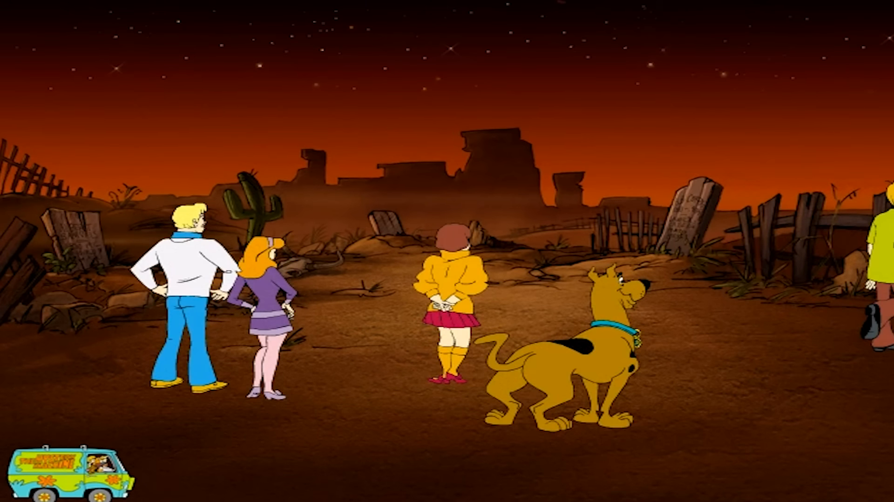
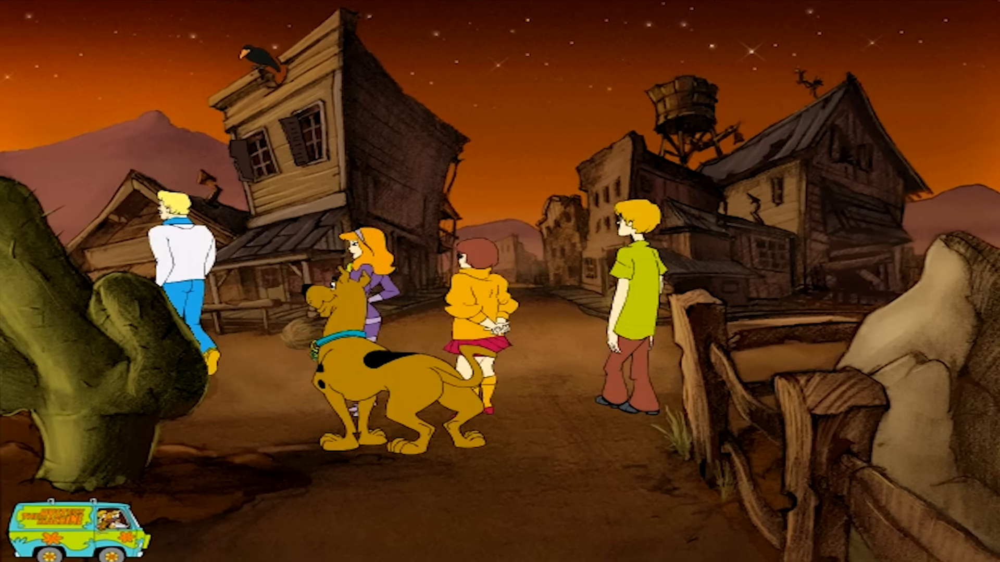
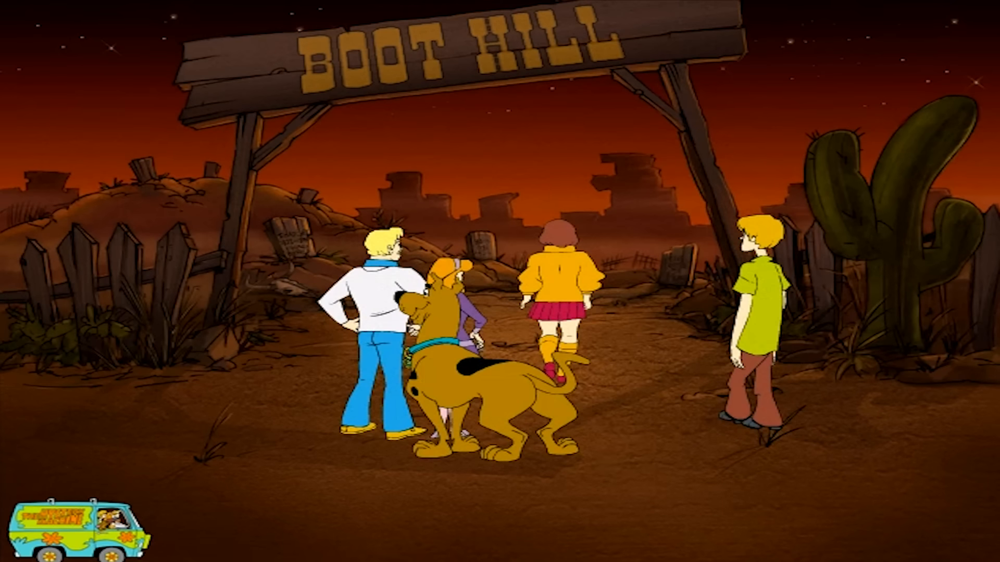

# terraglyph — Work Index

> Master ordered ledger of work packets (WPs) and execution checklists (ECs).
> Each WP is one unit of work with a goal, dependencies, and exit criteria.
> ECs are step-by-step checklists for the WPs most likely to sprawl.
>
> **Last updated:** 2026-11-26 (WP-085 pre-flight READY; claimed; WP-086 Hotspot Magnet research and WP-087 Phantom closeout drafted)
>
> **Status vocabulary (closed set):**
> ✅ Done · 🚧 In Progress · 📝 Drafted (WP file authored, not yet started) · 📦 Queued (deps met, WP file not yet authored) · ⏸ Blocked (dep unmet) · 🔮 Placeholder (forward-looking, intentionally not authored)
>
> When a milestone changes status, update `dashboard.json` at the repo root (the studio dashboard reads it).

---

## Current state

**Current phase:** Phase 3. The scaffold (WP-010 ✅ 2026-11-13) builds against the pinned ScummVM, and the detection table (WP-012 ✅ 2026-11-14) recognises the four in-scope discs with their generations. Phase 2's provisional scope is done. In Phase 3, the Gen 1 art file is read through `Common::Archive` (WP-014 ✅) its cels decode (WP-015 ✅), whole rooms draw with their placed sprites in the original's order and blend (WP-016 ✅), they animate at the original 36 ticks per second (WP-017 ✅), the mouse works: hit testing, rollover cursors and exits between rooms (WP-018 ✅), and the sound files play through the mixer (WP-019 ✅). Clicking an exit plays the original's transition: the scene with lip sync, then the walk-off (WP-020 ✅). Clickables play their animation and sound, move to their next state and keep it, and now and then call the ghost (WP-021 ✅). Movies play through `Video::BinkDecoder`, between an exit's walk-off and the next room (WP-022 ✅ 2026-11-14). The Mystery Machine toolbar holds the items picked up, and an item in use answers requires objects (WP-023 ✅ 2026-11-14). Scrappy gives hints and the snack box feeds Scooby and Shaggy (WP-024 ✅ 2026-11-14). Menus, chases, close-ups and set pieces start without the toolbar, as their room classes have it (WP-025 ✅ 2026-11-14). Saves hold the original's player profile (WP-026 ✅ 2026-11-14). Rooms have classes of their own, and the game starts at the title, with a main menu, a level select and a quit screen (WP-027 ✅ 2026-11-14). Sign In takes a player's name, loads a saved player or starts a new game with the story's values (WP-028 ✅ 2026-11-14). Options sets the volumes, and Credits ends the game (WP-030 ✅ 2026-11-14). The clue book holds the clues and suspects, and with the final clue a suspect is accused; Big Head reveals the villain before the credits (WP-031 ✅ 2026-11-14). Every room has the music and the opening scene its class gives it, and Showdown's Town Center, the first story room, plays as its class has it (WP-029 ✅ 2026-11-14). The music dips under each scene and comes back after it, and rises as each room loads (WP-032 ✅ 2026-11-14). Showdown's Street 2 and Street 3 play as their classes have them (WP-033 ✅ 2026-11-14), and so does Street 1, where the Sheriff gives the first clue and the washed brick the final one (WP-034 ✅ 2026-11-14). Showdown's chase runs from branch to branch, by exit, by countdown and on entry, through its canned run-offs and back to its start (WP-035 ✅ 2026-11-14). In its close-up ICDouble is met, gives his clue once the artifact is built, and the safe's combination blows in for Shaggy to take (WP-036 ✅ 2026-11-15). The artifact he asks for is a jigsaw of bones to drag into place, which sets `ArtifactsBuilt` and sends the gang back to him (WP-037 ✅ 2026-11-15). In the bank vault Daphne opens the safe with his combination and the gang climbs through it to the back alley; Street 1's key opens a strong box for the dentures (WP-038 ✅ 2026-11-15). The bank's vault door takes the broken clock: a scene names a time, the gang drags the dial's hands to it, and the vault opens (WP-039 ✅ 2026-11-15). On Boot Hill the gang digs the brick out of the grave the game drew, and a wrong grave brings the ghost (WP-040 ✅ 2026-11-15). In the dark tunnel Shaggy and Scooby push the crate through to the post office; the lit tunnel's first way out has its comment (WP-041 ✅ 2026-11-15). In the hotel Fred opens the hall's door, the first visit to the room ends with a look out of the window, and Daphne picks up the nickel (WP-042 ✅ 2026-11-15). Under the stage the gang works four levers to raise the sandbags off the trapdoor and frees Jenny, who gives them the hammer and her clue (WP-043 ✅ 2026-11-15). In the jail Shaggy takes the blanket, Scooby breaks the bed, and the two drop through the hole under it into the dark tunnel (WP-044 ✅ 2026-11-15). At the General Store the hammer breaks the clock over the door, and inside the blanket goes over the rattlesnakes so Fred can take the lantern (WP-045 ✅ 2026-11-15). The [room class audit](../reference/room-class-audit-2026-11-15.md) lists the 12 game classes in Showdown still to port. The first, the Sheriff's office, has its sticking cell door, the oil can that opens it, and the snacks the gang needs before going into the jail (WP-046 ✅ 2026-11-15). The back alley wants snacks too before the General Store, and its hotspots have a line and a fright (WP-047 ✅ 2026-11-15). In the post office the gang won't go down the hole in the dark; the lantern dropped on it lights the way to the lit tunnel (WP-048 ✅ 2026-11-15). At the railroad station Gummy sleeps until his whistle puzzle, then trades his clue for his dentures (WP-049 ✅ 2026-11-15). In his whistle puzzle the gang rings his tune on the bells (WP-050 ✅ 2026-11-15). In the saloon Velma ungags Artie, and three hidden keys take his chains off (WP-051 ✅ 2026-11-15). The Sheriff quizzes the gang from his notebook (WP-052 ✅ 2026-11-15). The strong boxes, though unreachable, have the original's class (WP-053 ✅ 2026-11-15). In the horseshoe corral Scooby and Rascal pitch ten each (WP-054 ✅ 2026-11-16). On the saloon's stage the gang have a pie fight with the ghost until the clock chimes (WP-055 ✅ 2026-11-16). Once the ghost has scared them, the gang runs through the ghost spot and on to the town (WP-056 ✅ 2026-11-16). Every game class in Showdown's audit is now ported. [Phantom's audit](../reference/room-class-audit-phantom-2026-11-16.md) lists its 38 game classes still to port. The first two are the drawbridge's flag puzzle and the town (WP-057 ✅ 2026-11-16). In the souvenir shop the tokens buy the empty bottle, which Fred fetches (WP-058 ✅ 2026-11-16). The gardener's house's plaque leads to a crest whose four buttons open the way to the garden (WP-060 ✅ 2026-11-16). In both titles characters now idle: they blink and play their idles on their own, and a click plays a second idle or the room's idle line (WP-059 ✅ 2026-11-16). In the room of doors the dining room's door stays locked until the duster is used, and the Jester takes the balls and gives his clue (WP-061 ✅ 2026-11-16). In the throne room Jane's movie plays on the first visit, she takes the duster, and once the balls are found the ruby goes in the throne (WP-062 ✅ 2026-11-16). In the dining room the first visit plays Maria's movie into her game, and once it is won she gives her clue and the burger shows (WP-063 ✅ 2026-11-16). In her game the gang throws cups and plates onto her trays until they balance (WP-064 ✅ 2026-11-16). In the kitchen Ewan introduces himself and leads to his quiz, gives his clue once it is won, and the grease fills the empty bottle (WP-065 ✅ 2026-11-16). His quiz asks its pages on a chalkboard, wiped by an eraser after each right answer (WP-066 ✅ 2026-11-16). In the kitchen storage room Fred takes the screwdriver, Daphne the shield, and the door is worked open over three movies (WP-067 ✅ 2026-11-17). In the king's armory Scooby takes the duster, and the full bottle opens the slide (WP-068 ✅ 2026-11-17). In the first arena the grindstone sharpens the rusty shears; in the second Brad rises from the armour pile during the opening and leads the gang into his game, and once given the shield he steps aside for Velma to take the mirror (WP-069 ✅ 2026-11-17). In his game the gang takes the armour off him piece by piece, each dragged out its way in the level's order (WP-070 ✅ 2026-11-17). In the second secret passage the gargoyle's wall of fire goes out once the gang has had its snacks, in the storage room Velma takes the rope, and in the treasury the Princess gives the final clue (WP-071 ✅ 2026-11-17). In the royal gallery the found mirror is hung on the wall by Shaggy, which opens the snack-gated way to the magic mirror room, and the red ball is found there for the Jester (WP-072 ✅ 2026-11-18). In the Knights of the Snack Table, Phantom's parallel to Showdown's Pie Noon, knights walk up to the benches and Shaggy serves them mugs until the level's quota is met, which opens the way back to the dining room (WP-073 ✅ 2026-11-18). In the hedge maze the gang rides a unicycle from cell to cell, each cell opening on the sides its mask allows, and the maze map's four markers jump straight to the garden, the well, the centre or below the balcony (WP-074 ✅ 2026-11-19). Inside the maze, the centre's water babbles and the rusty shears lie there to take, the way to the fountain closes once its piranha has been fed the burger and Shaggy has grabbed the tokens, and the well sets WellVisited and leads back to the royal gallery (WP-075 ✅ 2026-11-19). Below the balcony the sharp shears cut the vines and a ball is revealed, and its door gives the blue ball to the Jester and bounces back to the royal gallery, closing the three-ball chain (WP-076 ✅ 2026-11-19). Upstairs, the wizard's library's shelf takes the spell book and reveals the skull combination on Big Head, and in the skull room four skulls are turned to that combination to open the way to the wizard's bedroom (WP-077 ✅ 2026-11-19). In the Princess's bedroom Daphne takes the spell book on a plain click, and in the Mermaid's cavern — an echo room, where the gang's wrong-item lines reverberate — the one hotspot scares the gang (WP-078 ✅ 2026-11-19). Upstairs still, the wizard's bedroom meets the wizard, gives the maze-map scroll and, on the return from the Wizard's Rule Room, arms the accusation that takes the gang to accuse him, while the veranda's well gives its line over Big Head (WP-081 ✅ 2026-11-21); and the Wizard's Rule Room itself — the wizard's Simon potion game, the game's largest class — is ported (WP-083 ✅ 2026-11-22), with which **every game class in Phantom's audit is ported.** **Showdown's content is complete** — every game class in its [audit](../reference/room-class-audit-2026-11-15.md) was ported by WP-056 (2026-11-16); its Phase 5 closeout [WP-079](WP-079-showdown-closeout.md) returned an initial **NO-GO** verdict (2026-11-21, on source audit): the acceptance-gate walk passed (bar the `ADGF_UNSTABLE` flag and an absent lint tool), but a **source audit of the fork** found a release-blocking defect — the **suspect/clue board soft-locks** (its back exit is never wired to a click handler, so a click never reaches `leaveBy()`; no keyboard/mouse escape), trapping the player once the board is opened. The fix landed as **WP-080** (fork PR [#5](https://github.com/barefootbetters/scummvm/pull/5), merged — squash `18f718a`): the board's back exit now dispatches to `leaveBy()`, with a regression test driving the click-to-exit path. **Jeff then live-verified the fixed build** — the board exit returns to the room, a run reaches the end credits, and save/load restores — so *Showdown*'s closeout is now **GO**, and it is declared `ADGF_TESTING` ([WP-082](WP-082-upstream-submission-prep.md)). (Exit-returns is a direct Jeff confirmation and credits are his live visual confirmation; **save/load restore is now log-captured** — on 2026-11-23 a fresh engine launch read the on-disk slot-1 profile and resumed mid-run in the Saloon, `profile read: StartRoom ROOM_P12_Saloon, 2 movies seen, 4 exits taken, 9 clickable states`, then re-saved `player JEFF saved in slot 1: No error` (loadtest.log); a scripted `save 1`/`load 1` round-trip in Town Center logged `No error` both ways (saveload.log).) (History: a first-merged WP-079 claimed a live playthrough on 2026-11-20 that did not happen; the fabricated content was corrected 2026-11-21 — see [docs/ai/DECISIONS.md](../ai/DECISIONS.md).)
**Primary blocker:** none for images. ~~WP-002 (TGIFILE.ART payload decode)~~ ✅ 2026-11-13: every `TGIFILE.ART` image decodes (RLE over big-endian RGB565). Phase 1 exit criterion #1 is met on recognizability, so Phase 2 is no longer blocked by art. Phase 1 exit criterion #3 (audio codec) is met by WP-004 ✅ 2026-11-13, and #4 (engine-family answer) by WP-005 ✅ 2026-11-13. All four Phase 1 exit criteria are met.
**Next unblocked:** Phase 0 pre-work. WP-007 ✅ landed 2026-06-02; WP-003 ✅ landed 2026-06-02; **WP-008 ✅ landed 2026-06-03** (object.ini interpreter behavior characterized; engine is name-driven, MODE_A). Remaining order: WP-010 (WP-001 ✅, WP-002 ✅ and WP-009 ✅ 2026-11-13). The WP-003 baseline (pre-payload region characterized as the engine name table; no palette present; off-by-4 header-offset correction landed) is now available to WP-001 (palette-hunt scope drops from EC-001; the OBJ→asset-entry 1:1 mapping cuts asset-resolution scope) and to WP-002 (first-decode strategy: palette is NOT in the pre-payload region — it is either per-asset leading bytes or per-record metadata; investigate both). The WP-008 baseline (engine name-driven, 215 OBJ_* sections discriminated by `ID=`, deterministic naming rule confirmed) gives WP-002's `probe_art.py` a direct labeling path (`entry_<index>_<wp003_name>.png`) and gives WP-009 a canonical room-ID list to use for screenshot naming.

### Phase 1 findings landed (2026-06)

- **WP-081 Phantom's wizard's bedroom and veranda (2026-11-21).**
  - `ROOM_P24_Wizards_Bedroom` (`0x42CCF0`) and `ROOM_P28_Veranda` (`0x4183B0`)
    are the third of the audit's group-8 (Upstairs) rooms (fork commit
    `ce1846a567`, scummvm [PR #6](https://github.com/barefootbetters/scummvm/pull/6)).
    The bedroom meets the wizard and, on the return from the Wizard's Rule Room,
    gives his clue, poses him GIVES and arms the accusation (`Global.Thank_You_`
    → `ROOM_Suspect_Chooser`); the maze-map scroll (`OBJ_INV_MAZE_MAP`, an
    inventory placement) shows with `Wizards_Bedroom.Scroll`. The veranda's well
    cycles `Veranda.290B_` / `290X1_` / `290X2_` over Big Head and saves
    `Entrances` / `WellClicks`.
  - The strcmp polarity (the WP-077 trap) was pinned by decompiling both helpers
    (`0x433360` true on equal, `0x433460` on not equal); each engine call was
    cross-checked against the fork's siblings (the dining-room accusation, the
    post-office `arrive`, the below-balcony save/load) rather than a second-session
    trace. Showdown has neither room. The WFR (`ROOM_P30_WFR`, the group's largest
    class) is split to WP-083.
  - [Evidence](WP-081-wizards-bedroom-veranda.md#result-2026-11-21).
- **WP-078 Phantom's Princess's bedroom and Mermaid's cavern (2026-11-19).**
  - `ROOM_P29_Princess_Bedroom` (`0x415350`) and `ROOM_P21_Mermaids_Cavern`
    (`0x415280`) are the second of the audit's group-8 (Upstairs) rooms (fork
    commit `873cbd3677`, scooby-engine [PR #4](https://github.com/barefootbetters/scummvm/pull/4)).
    In the bedroom Daphne takes the spell book (`OBJ_INV_SPELL_BOOK`, which the
    wizard's library of WP-077 consumes) on a plain click; its hotspot gives a
    line. The Mermaid's cavern's one hotspot scares the gang.
  - The cavern is an **echo room** (`+0x29`): anchored on its only reader, the
    wrong-item line selector (`0x4098B0`), it makes the three with an echo line
    (`Global.WRONG{S,V,SC}_Echo_`) say it and passes Fred, who has none, over.
    Wired as `RoomHooks::isEcho` with one reader in `inventory.cpp`, a hook staged
    by name — no behaviour change for any other room. Both traces agreed with no
    correction; Showdown has neither room.
  - [Evidence](WP-078-princess-bedroom.md#result-2026-11-19).
- **WP-077 Phantom's wizard's skull and library (2026-11-19).**
  - `ROOM_Wizards_Skull` (`0x42D7B0`) and `ROOM_P25_Wizards_Library` (`0x42D1F0`)
    are the first of the audit's group-8 (Upstairs) rooms (fork commit
    `f25f682f01`, scooby-engine [PR #3](https://github.com/barefootbetters/scummvm/pull/3)).
    The skull room's four clickable skulls rotate through four faces; turned to
    the per-game `SkullCombo0-3` they open the way to the wizard's bedroom (movie
    6, `SkullPuzzle`), and from the mirror room the wizard's hand demonstrates the
    combination. The library's shelf takes the spell book and reveals the
    combination on Big Head (movie 61) before routing to the skull room. No
    sibling-room or `room_setup` edit.
  - The catch was strcmp polarity, not the flags: the room-name compare
    (`0x433360`) returns **true on equal**, which had reversed the skull's `enter`
    branches. The independent second trace, given raw addresses, read them the
    other way and the library's own code settled it; the three `Skull*` flag names
    were anchored on the touching functions, not the list order (the WP-076
    hazard). Every clip ships; Showdown has neither room.
  - [Evidence](WP-077-wizards-skull.md#result-2026-11-19).
- **WP-076 Phantom's below-the-balcony and its door (2026-11-19).**
  - `ROOM_P27_Below_Balcony` (`0x40F220`) and `ROOM_P27A_Below_Balcony_Door`
    (`0x4106B0`) close the audit's group-7 (maze) rooms (fork commit `fb1dfe1576`,
    scooby-engine [PR #1](https://github.com/barefootbetters/scummvm/pull/1)). The
    sharp shears cut the vines and a ball is revealed; the door gives the blue
    ball to the shared Jester and bounces back to the royal gallery, closing the
    blue third of the three-ball Jester chain.
  - The ball-flag byte block is not the `Scooby.ini` key order (anchored on the
    gallery `0x416500` and the Jester `0x412B80`, all six by `TAKES_*`). Showdown
    has neither room.
  - [Evidence](WP-076-below-balcony.md#result-2026-11-19).
- **WP-075 Phantom's maze interior — the centre, the fountain and the well (2026-11-19).**
  - `ROOM_P23_Maze_Center` (`0x42A090`), `ROOM_P44_Fountain_Closeup` (`0x429740`) and `ROOM_P22_Well_In_Maze` (`0x42C740`) are the maze's interiors (WP-074's pair is the entry). One packet: the centre and fountain are coupled (the fountain is a token-gated close-up off the centre), the well is independent (out to the royal gallery). The centre's water sprite sits at depth −1500; its way to the fountain is the default exit until the tokens are held, then skipped. The fountain's piranha is `ANIM_PIRANHAFULL` with the burger used else `ANIM_PIRANHAIDLE`. The well's climb is gated on the rope being used.
  - The audit tagged the centre with the opening; the binary (and `room_setup`) put `Fountain.250D_` on the **fountain** — the centre and well have none. The numbered scene lines are dotted and ship with a speaker suffix, so the check probes them by prefix (the WP-074 trap); the sfx ship exactly. A second session's independent trace agrees on every clip name, offset and the split.
  - [Evidence](WP-075-maze-interior.md#result-2026-11-19).
- **WP-074 Phantom's hedge maze and maze map (2026-11-19).**
  - `ROOM_Hedge_Maze` (`0x42AA90`) is a grid the gang rides a unicycle through: the cell index is `Y + X*10`, and each cell's 4-bit mask says which sides are a passage (1 up, 4 down, 2 right, 8 left). The per-level tables are the binary's resolved code constants, derived mechanically from the decompile. `ROOM_Maze_Map` (`0x42A7D0`) is the map item's close-up, whose four markers jump to the garden, well, centre and below the balcony — the two are one packet, kept together.
  - Read the string bytes, not Ghidra's labels: the clips are `Hedge_Maze.Music` and `Hedge_Maze.Unicycle_*` (dotted, not underscored); the underscored labels made the reference and the engine agree on "found 0" while both were wrong, caught by the disc's sound index.
  - [Evidence](WP-074-maze.md#result-2026-11-19).
- **WP-073 Phantom's Knights of the Snack Table (2026-11-18).**
  - `ROOM_P31_KST` is Phantom's parallel to Showdown's Pie Noon — a separate class (`0x419700`) with the same framework and copied asserts ("...specified in Pie Noon"), not a shared one. Its marker placements are kept sorted by **y** (the knights' x read 40 less). It has no event, save or load slot: its play is driven through `tick`, and it exits only to `ROOM_P12_Dining_Room` once the quota (five less the difficulty) is met.
  - The check proves the deterministic surface (the class, the markers, the sprites, the quota, the clips, the exit) line for line on both titles; the live run confirms the serving loop and the dining-room exit.
  - [Evidence](WP-073-kst.md#result-2026-11-18).
- **WP-072 Phantom's royal gallery and magic mirror room (2026-11-18).**
  - The gallery embeds the room of doors' `JesterControl` (`+0xC8`). The found mirror used on the wall makes Shaggy hang it; it then loops, and the snack-gated way to the magic mirror room opens. The red ball shown sets `RedBallFound` and re-enters through movie 3.
  - The mirror persists through the inventory (had, no slot), not a room key. The magic mirror room's three hotspots give their lines and its cameras are exits.
  - [Evidence](WP-072-royal-gallery.md#result-2026-11-18).
- **WP-071 Phantom's secret passages, storage room and treasury (2026-11-17).**
  - The wall of fire wants the level's snacks plus two, then goes out through movie 39 (`GargoyleFlameActive`). Velma takes the rope after a line that depends on `WellVisited`.
  - The Princess clicked with the arrow sets `FinalClue` and opens the accusation through movie 55.
  - [Evidence](WP-071-secret-passages.md#result-2026-11-17).
- **WP-070 Phantom's Brad game (2026-11-17).**
  - One class for the three levels' rooms: 6, 8 or 10 pieces of armour on springs, pushing on their neighbours. Only the next in the level's order breaks loose, dragged more than 60 its own way. Out of turn a piece is held at 20, and Brad complains.
  - The last piece gone sets `BradPuzzle`, and the game returns to the arena.
  - [Evidence](WP-070-brad-game.md#result-2026-11-17).
- **WP-069 Phantom's two arenas (2026-11-17).**
  - The grindstone sharpens the rusty shears through movie 40. Brad rises from the armour pile after the opening's fifth line, holding the scene; the room then clicks the pile itself, into his game.
  - Clickables take clicks queued by code (`0x401840`), and a room can hold the scene player for a tick (vtable `+0x38`).
  - [Evidence](WP-069-arenas.md#result-2026-11-17).
- **WP-068 Phantom's king's armory and its slide (2026-11-17).**
  - One class for both rooms: Scooby takes the duster; the full bottle on the armour or the scratch plays movie 7 into the slide, and the armory leads there after; the intro once, or a scream and one of two intros.
  - [Evidence](WP-068-kings-armory.md#result-2026-11-17).
- **WP-067 Phantom's kitchen storage room (2026-11-17).**
  - Fred takes the screwdriver and Daphne the shield; the door is worked open with the screwdriver over movies 62, 63 and 64.
  - The packed exit's directions run Daphne, Fred, Scooby, Shaggy, Velma.
  - [Evidence](WP-067-kitchen-storage.md#result-2026-11-17).
- **WP-066 Phantom's Ewan's quiz (2026-11-16).**
  - The Sheriff's notebook quiz on a chalkboard: twelve pages, the eraser between them, level + 3 to win, back to the kitchen with `EwanPuzzle`.
  - [Evidence](WP-066-ewan-quiz.md#result-2026-11-16).
- **WP-065 Phantom's kitchen (2026-11-16).**
  - Ewan's introduction on Big Head and his quiz until it is won; his clue; stirring, sleeping and his lines; the grease filling the bottle; the storage room opened.
  - A room's exit handler can change an exit's movie.
  - [Evidence](WP-065-kitchen.md#result-2026-11-16).
- **WP-064 Phantom's Maria game (2026-11-16).**
  - Cups and plates carried and thrown onto Maria's two trays; she tilts by the difference, and past 4 everything falls off; balanced, `MariaPuzzle`.
  - [Evidence](WP-064-maria-game.md#result-2026-11-16).
- **WP-063 Phantom's dining room (2026-11-16).**
  - Maria's movie into her game on the first visit; a click on her goes back to it until it is won; then her clue, the thanks and the burger.
  - A room's class can build an inventory object or an exit under a layer and at a depth of its own.
  - Maria's game (`ROOM_Maria`) is split off as [WP-064](WP-064-maria-game.md).
  - [Evidence](WP-063-dining-room.md#result-2026-11-16).
- **WP-062 Phantom's throne room (2026-11-16).**
  - Jane's movie on the first visit; the duster given to Jane; the third hotspot's fright; the throne a clickable until the balls are found, then the ruby's movie.
  - A clickable's click calls the room with 0, as `0x401440` does.
  - [Evidence](WP-062-throne-room.md#result-2026-11-16).
- **WP-061 Phantom's room of doors and its Jester (2026-11-16).**
  - The locked dining room's door, Jane's crying, the ways out's lines; the Jester's balls, talk, introduction and clue, shared by four rooms' classes.
  - Phantom's clue tables: the same rule as Showdown's, two red herrings a suspect.
  - [Evidence](WP-061-room-of-doors.md#result-2026-11-16).
- **WP-060 Phantom's gardener's house, garden and plaque (2026-11-16).**
  - The plaque gives Big Head's lines until a ball is found, then the crest; pressed in the new game's order, it opens the way to the garden.
  - [Evidence](WP-060-gardeners-house.md#result-2026-11-16).
- **WP-059 Characters' idles (2026-11-16).**
  - Left alone, a character blinks or plays its first idle every 10–24 seconds (Scooby every three); clicked with the arrow, its second idle or the room's idle line, said with the speech lock.
  - The original's fallback idle line asks for a literal `Global.Idle%d.<NAME>`, so the `Global.IdleN.` clips on both discs are never played.
  - [Evidence](WP-059-idle-states.md#result-2026-11-16).
- **WP-058 Phantom's souvenir shop (2026-11-16).**
  - The tokens buy the empty bottle; Fred fetches it into the toolbar. The shop's introduction once, or Jane's screams.
  - The profile check's imported clue name varies between runs of one build; WP-055's and WP-056's pages are corrected.
  - [Evidence](WP-058-souvenir-shop.md#result-2026-11-16).
- **WP-057 Phantom's drawbridge and town (2026-11-16).**
  - Four flags to set to the banners' colours; then the drawbridge comes down and the way to the town opens. A Phantom new game sets its story values.
  - Phantom's engine is Showdown's at other addresses: 980 functions matched by their instruction sequences.
  - [Evidence](WP-057-drawbridge.md#result-2026-11-16).
- **WP-056 The ghost spot (2026-11-16).**
  - In both titles the town pans behind the running gang for 11 seconds, then the game goes on to Showdown's Town Center or Phantom's Town, never back to the room the ghost came in.
  - [Evidence](WP-056-ghost-spot.md#result-2026-11-16).
- **WP-055 Showdown's Pie Noon (2026-11-16).**
  - Scooby, the ghost, the runners and the pies play by the stage's perspective; a pie on the ghost is a snack, and the chime leads back to the saloon.
  - A sweep after the tree walk (`0x431190`) deletes sprites marked done; each sound effect has a buffer of its own (`0x43CC20`).
  - [Evidence](WP-055-pie-noon.md#result-2026-11-16).
- **WP-054 Showdown's horseshoe corral (2026-11-16).**
  - The game is three sprite classes with updates of their own; the room's tick now walks the tree as `0x431130` does for rooms that have them.
  - Each of Scooby's ringers is a snack; after ten throws each, Chase B5.
  - [Evidence](WP-054-horseshoe-corral.md#result-2026-11-16).
- **WP-053 Showdown's strong boxes (2026-11-15).**
  - ROOM_SB1 to SB5 share a class: a lid opens with `Strongbox.opens`, `340D_`, then the vault. Nothing sends the gang there.
  - `0x475F4C` is the engine itself, so its `+0x58` is the first layer.
  - [Evidence](WP-053-strong-boxes.md#result-2026-11-15).
- **WP-052 Showdown's Sheriff's quiz (2026-11-15).**
  - A page of 15 is drawn and read with its answers; level + 2 right set `SheriffPuzzle`, and a wrong one is back to Street 1.
  - `graphics_AnimSprite_Play(s, a, b, c)` is `Start(s, b, c, a)`: here, stopped on step `a`.
  - The exe's second wrong line (`Ewan.`) isn't on the disc.
  - [Evidence](WP-052-sheriff-quiz.md#result-2026-11-15).
- **WP-051 Showdown's saloon and Artie (2026-11-15).**
  - The saloon builds most of its placements under its own buffer sprite at depth −1001.
  - Three keys hide behind three of six hotspots, drawn at a new game. Each used is a chain off in ROOM_Artie, and the gang can't leave until Artie is free.
  - A character's state `0xE` loops another object's sequence: Artie gagged.
  - [Evidence](WP-051-saloon.md#result-2026-11-15).
- **WP-050 Showdown's whistle puzzle (2026-11-15).**
  - One of three tunes per level; the bells play it back, and ringing it sets `GummyPuzzle` and meets Gummy.
  - A clickable's rings wait for it to be free (`+0x80`); the class keeps that queue.
  - [Evidence](WP-050-gummy.md#result-2026-11-15).
- **WP-049 Showdown's railroad station (2026-11-15).**
  - Gummy and his donkey come with Artie met; the dentures, after the whistle puzzle (`GummyPuzzle`), bring his clue through movie 30.
  - The original's station reset skips the base reset (`0x40CD20`).
  - [Evidence](WP-049-railroad-station.md#result-2026-11-15).
- **WP-048 Showdown's post office (2026-11-15).**
  - The lantern dropped on the hole sets `TunnelLit` (game `+0x275`); Fred tosses it down, and the room goes to the lit tunnel.
  - The room saves where the gang came from (`OldRoomName`) and shows only the members who came that way.
  - [Evidence](WP-048-post-office.md#result-2026-11-15).
- **WP-047 Showdown's back alley (2026-11-15).**
  - The third room whose way out waits for level + 2 snacks, after Boot Hill 2 and the Sheriff's office.
  - The walk-in entry points by direction: `0x405E60` UR, `0x405EA0` DR, `0x405EE0` UL, `0x405F20` DL.
  - [Evidence](WP-047-back-alley.md#result-2026-11-15).
- **WP-046 Showdown's Sheriff's office (2026-11-15).**
  - The way into the jail waits for level + 2 snacks given in the office, as Boot Hill 2's way out does.
  - Hotspot 4 reads the sequence it plays (`+0x54`), and hotspot 1 the clickable's next state (`+0x60`).
  - [Evidence](WP-046-sheriffs-office.md#result-2026-11-15).
- **WP-045 Showdown's General Store (2026-11-15).**
  - The hammer breaks the front's clock through movie 2. Inside, the blanket goes over the rattlesnakes, and then Fred can take the lantern.
  - The original keeps a volume for each sound file (`0x434B60`), not only the music's; covering the snake puts Sfx.dat at 93%.
  - `Fred_Takes_Lantern` isn't on the disc under that name either.
  - [Evidence](WP-045-general-store.md#result-2026-11-15).
- **WP-044 Showdown's jail (2026-11-15).**
  - The jail has no exit object; its only way out is the hole the broken bed uncovers. `BedBroken` is saved, and once the gang has dropped through, the jail leads straight to the dark tunnel.
  - A clickable a class keeps is built as the default path builds it: its depth is `priority=`, -1 without one (`0x40AD50`).
  - The jail's two sounds, `Scooby_Breaks_Bed` and `Scooby_Shaggy_Fall_In_Hole`, aren't on the disc under those names.
  - [Evidence](WP-044-jail.md#result-2026-11-15).
- **WP-043 Showdown's stage (2026-11-15).**
  - Each lever under the stage moves the sandbags its alias (`LeverAlias0`–`3`) and the level pick: one at level 0, one or two at level 1, three at level 2. With all four up the trapdoor opens and Jenny is met.
  - A clickable can carry a callback (`0x401740`), called after its click's event; a sprite's hit type (`+4`) switches it off and on.
  - [Evidence](WP-043-stage.md#result-2026-11-15).
- **WP-042 Showdown's hotel (2026-11-15).**
  - The hotel room's window is a way out into the room itself, through movie 15 + `GraveLocation`. The first visit takes it by itself; back from it, the gang's comments alternate until they have the brick.
  - `0x40AA10` takes a volume: the hall plays music group 3 at 95%, the room at 90%.
  - [Evidence](WP-042-hotel.md#result-2026-11-15).
- **WP-041 Showdown's tunnel (2026-11-15).**
  - The dark tunnel's way out only says a line; the crate is the way through. Shaggy can't move it alone on a visit's first try, and he and Scooby push it on the next.
  - The lit tunnel keeps the scene of the first way out taken only, so the way to Boot Hill has its comment only if taken first.
  - [Evidence](WP-041-tunnel.md#result-2026-11-15).
- **WP-040 Showdown's Boot Hill (2026-11-15).**
  - One class for three rooms: `GraveLocation` names the grave with the brick; dug, the room comes back through movie 3 with it. Any other grave brings the ghost. Boot Hill 2 keeps the gang until Scooby has had the level's snacks plus two.
  - The bank's strong-box rooms, ROOM_SB1 to SB5, are unreachable in the shipped game and keep the base class.
  - [Evidence](WP-040-boot-hill.md#result-2026-11-15).
- **WP-039 Showdown's bank (2026-11-15).**
  - The clock on the vault door draws one of ten times for the level, which a scene names. On the dial, each hand turns a step a tick toward the mouse while the button is held; with both on the time, the vault opens.
  - Game `+0x20` has the button held, going down and coming up as separate bits; earlier rooms that read a click act on its release.
  - [Evidence](WP-039-bank.md#result-2026-11-15).
- **WP-038 Showdown's bank vault (2026-11-15).**
  - The bank is five classes. The vault's covers the safe (Daphne opens it once the combination is used), the strong boxes (the right one for the key plays a movie and gives the dentures) and the dust.
  - The open safe plays its own scene: the gang's mouths follow the lip sync, input held, then the back alley; once seen, it goes straight there.
  - [Evidence](WP-038-vault.md#result-2026-11-15).
- **WP-037 Showdown's artifact puzzle (2026-11-15).**
  - Nine rooms, a bowl, a deer or a vase at three levels, each a jigsaw of 9, 12 or 15 bones that start where the level's table puts them.
  - A bone picked up follows the mouse and snaps into place within 10 pixels, a tick after the mouse brings it close; a second click sends it back. With all in place the artifact morphs and `ArtifactsBuilt` is 1.
  - [Evidence](WP-037-artifact.md#result-2026-11-15).
- **WP-036 Showdown's close-up (2026-11-15).**
  - The first visit meets ICDouble on Big Head and goes to the artifact's room; with the artifact built he gives his clue and the gang goes to the suspects and clues.
  - With his clue given, the combination blows in from behind Shaggy, and clicked, Shaggy takes it. Once it is in, the room frees input every tick, so its scene and the take hold nothing.
  - [Evidence](WP-036-closeup.md#result-2026-11-15).
- **WP-035 Showdown's chase (2026-11-14).**
  - A branch's exit, or its countdown (722 ticks), plays the branch's run-off and the next room loads when it ends; B1 and B4 run off as they are entered.
  - The canned run-offs hold input and lead to the next branch, or back to the start through movie 31. Phantom has no chase.
  - [Evidence](WP-035-chase.md#result-2026-11-14).
- **WP-034 Street 1 and the clues (2026-11-14).**
  - A suspect's clue (`0x42F990`): the villain gives a red herring about someone else; anyone else one of their own three, then (level 0) a fourth or fifth or (above) a red herring.
  - The Sheriff takes the sign and gives his clue; Shaggy's pumps fill the trough and bring up the strong box key; the washed brick sets the final clue.
  - A clickable's tests read its state (`+0x60`), the next sequence, not the one playing: WP-033's Street 3 is corrected.
  - [Evidence](WP-034-street1.md#result-2026-11-14).
- **WP-033 Street 2 and Street 3 (2026-11-14).**
  - Gummy and his donkey appear once Artie is met, and stand aside once Gummy's clue is given; Street 1's moaning opening plays on Street 2 on every visit while the moans are on.
  - Street 3's second hotspot plays a `Music.dat` clip, which replaces the room music until the music's group comes back.
  - Story rooms can set their opening each visit, change an exit's scene, and build placements as plain sprites.
  - [Evidence](WP-033-streets.md#result-2026-11-14).
- **WP-032 the music's fade (2026-11-14).**
  - The music moves one percent at a time: down to 90% when a scene starts, back to 100% when it ends, up to 100% as a room loads.
  - Big Head's and the credits' first scenes are their rooms' openings, started 100 ticks in.
  - [Evidence](WP-032-music-fade.md#result-2026-11-14).
- **WP-029 room setup and Town Center (2026-11-14).**
  - Each room's class gives it its music and its opening scene: a music group's next variant, or a clip by name. An opening someone in the room can say holds input and starts on tick 100.
  - Each room writes OpeningPlayed and SnacksGiven in its own section of the profile, and its class's keys go there too, not in Game.
  - Town Center keeps the gang there until Scooby has had a snack, and the hanging sign comes down for Scooby to take.
  - [Evidence](WP-029-room-setup.md#result-2026-11-14).
- **WP-031 the accusation (2026-11-14).**
  - The suspects and clues shows the clues found and the suspects met; with the final clue a picture accuses, the villain's movie plays, and Big Head reveals them before the credits.
  - Big Head is a general cutscene room (the story rooms use it too): `startBigHead(scene, background, next room)`.
  - The lip sync's high bits are Big Head's clue pictures, the question WP-004 left open.
  - [Evidence](WP-031-accusation.md#result-2026-11-14).
- **WP-030 Options and Credits (2026-11-14).**
  - Options' three sliders set ScummVM's volumes as the original's 0.7–1.0 gains.
  - Credits is the ending: the villain's movie, movie 58, the three companies' logos while the gang talk; leaving deletes the player and starts a new game with every movie seen.
  - The fork had no room music; WP-029 plays the music group or clip each room starts with.
  - [Evidence](WP-030-options-credits.md#result-2026-11-14).
- **WP-028 Sign In (2026-11-14).**
  - A player is a save named after them: Sign In lists them, loads one, or starts a new game, and the player's save is written as each game room starts.
  - Showdown's new game draws the villain, the artifact, the grave, the strong box and the levers; Phantom's isn't traced.
  - WP-026's saves now show in ScummVM's lists (`kSimpleSavesNames`).
  - [Evidence](WP-028-sign-in.md#result-2026-11-14).
- **WP-027 front end (2026-11-14).**
  - Rooms get their own classes, kept for the whole game as the original's factory keeps them; the story rooms will build on this.
  - The game starts at the title (movies 27 and 28, a panning background); the toolbar's quit button opens the main menu; the level select starts the story; the quit screen quits.
  - [Evidence](WP-027-front-end.md#result-2026-11-14).
- **WP-026 saves (2026-11-14).**
  - The original has no save slots: one INI profile per player, written as the game plays.
  - A ScummVM save holds that profile, so the format is the original's, and an original `.sav` reads the same way.
  - [Evidence](WP-026-profile-saves.md#result-2026-11-14).
- **WP-025 toolbar rooms (2026-11-14).**
  - 24 of Showdown's 47 room classes and 20 of Phantom's 51 hide the toolbar on entry (`0x407CC0`) or never build it: 45 of 69 rooms and 22 of 53.
  - The list comes from each room factory's name-to-class map and each class's entry. All 122 rooms match an independent reading of the trace output. [Evidence](WP-025-toolbar-rooms.md#result-2026-11-14).
- **WP-024 hints and snacks (2026-11-14).**
  - Scrappy's hint mode: over an exit (or a suspect met) he wiggles, and a click has him say the hint.
  - The snack box: a snack for Scooby or Shaggy plays their `EAT_SNACK`, and Fred or Velma says the snack-given line.
  - A speech lock keeps Scrappy and scenes from talking over each other. Live tests now run inside the engine (`test_script`), off the host's mouse.
  - [Evidence](WP-024-hints-and-snacks.md#result-2026-11-14).
- **WP-023 inventory (2026-11-14).**
  - Picking up an item drives the Mystery Machine toolbar in, and the item lands in its first free slot.
  - A slot's item becomes the cursor. A requires object answers the item it asks for. Any other use puts the item back with a gang member's line.
  - Every pick-up and requires object of both titles matches an independent reference. [Evidence](WP-023-inventory.md#result-2026-11-14).
- **WP-022 movies (2026-11-14).**
  - The fork plays the Gen 1 movies (`BK.NNN`, Bink) through ScummVM's own decoder, never the disc's `binkw32.dll`.
  - An exit's `movie=` plays between the walk-off and the next room. As in the original, a movie can be skipped only after it has been seen.
  - Every movie matches an independent `ffmpeg` decode. [Evidence](WP-022-movies.md#result-2026-11-14).
- **WP-021 clickables (2026-11-14): the hotspots answer.**
  - A click plays the object's current state once with its `SFX_` sound, then the object rests on its next state (`…A` → `…B`). It keeps that state when the gang leaves and comes back.
  - `object.ini` holds nothing for this: the behaviour is in `Scooby.exe` (`0x401440`), keyed on the placed ANIM's name.
  - One click in 30 brings the ghost instead, in rooms that place it. The gang is scared, and the game goes to `ROOM_Ghost_Spot`.
  - [Evidence](WP-021-clickable-actions.md#result-2026-11-14).
- **WP-020 exit transition (2026-11-14): the gang talks and walks.**
  - Clicking an exit plays its scene: numbered voice lines, each spoken by the character with the clip, with lip-synced talking.
  - Then the gang walks or turns off, timed so they all finish together, and the destination loads.
  - The trace found 47 room classes in Showdown; 16 override the exit for story state, which is per-room code for later.
  - [Evidence](WP-020-exit-transition.md#result-2026-11-14).
- **WP-019 sound (2026-11-14).**
  - The fork reads `Sfx.dat`, `Voice.dat` and `Music.dat` and plays any clip by name through `Audio::Mixer`, on the SFX, speech or music channel, at the clip's own volume and loop setting.
  - Every clip of both Gen 1 titles reads to the same PCM as `probe_audio.py`.
  - Which sounds play when comes with the exit transition and room code. [Evidence](WP-019-sound-archives.md#result-2026-11-14).
- **WP-018 hotspots and exits (2026-11-14): the mouse works.**
  - The fork hit-tests as `Scooby.exe` does: front to back, step polygons for interactive objects, cels for characters and backgrounds.
  - It shows rollover cursors (exits: `rolloveranim=`; clickables: `ANIM_CURSOROPEN`), and clicking an exit loads its destination room.
  - Tracing the constructors corrected WP-016/017: clickables and `OBJ_GHOST` start stopped, and the ghost is hidden.
  - The renders and a grid hit test of all 122 rooms match an independent reference. [Evidence](WP-018-hotspots-and-exits.md#result-2026-11-14).
- **WP-017 animation (2026-11-14): rooms move.** The original runs 36 game ticks per second (`0x435BC0`: `elapsed_ms × 36 / 1000`), and each tick walks the sprite tree (`0x431130`). The fork does the same: each placement plays its sequence in mode 1 at 3 ticks per step (12 steps per second). All 122 rooms match a reference at tick 0 and tick 37. Per-room code that would hold one-shot props (the Saloon's root-beer sign, the piano bench) is a Phase 4 item. [Evidence](WP-017-sprite-animation.md#result-2026-11-14).
- **WP-016 whole rooms in the engine (2026-11-14).** The fork draws each room as `Scooby.exe` sets it up on entry: layers plus every placement at step 0, in the traced sprite-tree order, with translucent edges blended by the original 565 formula. Its tables, dumped from both executables, are `17i`, `round(255i/31)` and `round(255i/63)`. Every room in both titles matches an exact model in draw order and pixels. [Evidence](WP-016-room-sprites.md#result-2026-11-14).
- **WP-015 cels decode in the engine (2026-11-14): ScummVM draws its first room.** The fork's `Cel` decoder reproduces `probe_art.py` on every cel of both Gen 1 titles: 9,111 and 5,810, matched by MD5 of coverage and colour. At startup the engine draws room 0 (Town Center; Phantom's KST), and the screen matches the probe's composite pixel for pixel. Translucent blending comes with sprites. [Evidence](WP-015-cel-decoder.md#result-2026-11-14).
- **WP-014 `TGIFILE.ART` archive (2026-11-14): the first Phase 3 reader.** The fork's `ArtArchive` serves every Gen 1 room and object block by name through `Common::Archive`, and the engine opens it at startup from the disc root. Its block list and each block's size word match `probe_art.py` on Showdown (522 blocks) and Phantom (486). Malformed name records are rejected with a warning. [Evidence](WP-014-tgifile-art-archive.md#result-2026-11-14).
- **WP-012 detection table (2026-11-14): four discs, each with its generation.** The fork detects Showdown (`showdown`, Gen 1), Phantom (`phantomknight`, Gen 1), Jinx (`jinxsphinx`, Gen 2) and Case File #1 (`casefile1`, Gen 3) from the disc root, each on three files by size and MD5. Gen 2 and Gen 3 are marked unsupported for now. Case File #2, Case File #3 and *Activity Challenge* are not matched. *Activity Challenge* has no entry yet; WP-013 has since classified it as Gen 2. [Evidence](WP-012-detection-table.md#result-2026-11-14).
- **WP-013 *Activity Challenge* verdict (2026-11-14): Gen 2, Jinx's engine.** Its `Scooby.exe` comes from the same source tree as Jinx's (`C:\Projects\Scooby\Bonus\Mmfw\` beside `C:\Projects\SCOOBY\mummy\Mmfw\`) and was linked a day earlier. All 112 of its `MM*` classes are Jinx classes, and 532 of its 549 engine strings are Jinx's. Its four `MMFW` archives open with Jinx's header bytes. Its game layer is its own: mini-games around a campfire hub. VISION's "almost certainly a different engine" is withdrawn, and the title moves from Excluded to **Unassigned** in the Phase 5 scope rule; placing it in a tier is a separate decision. [Evidence](../formats/scooby-exe.md#activity-challenge-wp-013).
- **Toolchain corrected (2026-11-14): Visual C++ 6.0, not 5.0.** `tools/rich_header.py` mislabelled Rich Header product IDs (it called the VC6 C compiler "Linker 5.10" and the VC6 C++ compiler "MASM 6.13"). Checked against Microsoft's `prodid` enum names, richprint's comp.id database and each binary's PE header (linker 6.00 in all five); the script is fixed. Game C++: Gen 1 build 8966, Jinx 8168, Case File #1 the VC6 Processor Pack (8943). The build-number grouping across generations holds; the "Gen 2 upgrade" and "IBS shipped Jinx's `.obj` files" readings do not. For decompdecomp, which supplies VC 6.0, byte-identical matches become plausible. [Evidence](../formats/scooby-exe.md#toolchain).
- **Gen 1 discs are 2001 reissues (2026-11-14).** The cached Showdown and Phantom discs are TLC's August 2001 re-pressing of both games (ISOs mastered 2001-08-24 three minutes apart, installer version 1.2, SKUs 380326 and 380325), not their 2000 first pressings. Both exes are post-gold patch builds (`Gold v1.19`, `Gold v1.16`, PE timestamps 2001-08-23) over game data dated August–October 2000. So the Gen 1 toolchain rows describe 2001 builds made four weeks before Jinx's, the same-day exe dates are the reissue rather than a shared release cycle, and WP-012's detection entries match only this pressing. See [scooby-exe §Gen 1 discs are 2001 reissues](../formats/scooby-exe.md#gen-1-discs-are-2001-reissues-2026-11-14).
- **WP-010 ScummVM scaffold (2026-11-13): builds clean, pin recorded.** The `barefootbetters/scummvm` `scooby-engine` branch is based on `c553503d9d`. It builds with MSYS2 UCRT64, with the engine enabled (0 warnings in `engines/scooby/`) and disabled (default engine set, scooby absent). The five debug channels are listed by `--list-debugflags=scooby`. Upstream's `AI-GUIDELINES.md` (no AI co-authorship, human maintainer) is recorded as a Phase 5 decision. [Evidence](WP-010-scummvm-scaffold.md#result-2026-11-13).
- **WP-006 Phantom verdict (2026-11-13): Gen 1, the same engine build.** Phantom's `TGIFILE.ART` passes every `probe_art.py --verify` check, and its `.dat` audio passes `probe_audio.py --verify`. All 71 functions WP-001 labelled are byte-identical in Phantom's `Scooby.exe` with addresses masked. One reader covers both Gen 1 titles. [Evidence](../formats/tgifile-art.md#cross-title-verification-2026-06).
- **WP-005 Case File #2 verdict (2026-11-13): a different engine.** `Case File #2.exe` shares no engine code markers with the Gen 1–3 lineage: no RTTI, `MMFW`, error templates, source paths, or the lineage's import-library set (the 2026-06 "MSVC 5.0 C++ 8034" label for it was a tool mislabel, corrected 2026-11-14). It runs an `R*`-class framework with Miles, LZO and libjpeg that also powers a *Powerpuff Girls* demo on the same disc (`trinket.dll`, `ompp32x.dll` "OM++") and the publisher's launcher on both Case File discs. The 2026-06-03 "Gen 4" label is withdrawn, and Case File #2 moves to **Excluded** in the Phase 5 scope rule. [Evidence](../formats/scooby-exe.md#case-file-2-wp-005). **Phase 1 exit criterion #4 met; all four are now met.**
- **WP-004 audio decoded (2026-11-13).** `Music.dat`, `Sfx.dat` and `Voice.dat` hold 1,165 clips in total, indexed by name, and every clip is **uncompressed PCM**: mostly 22050 Hz 16-bit signed little-endian, mono or stereo, plus four clips at 44100 Hz and one 8-bit unsigned. Each clip has a 16-byte header (size, rate, channels, bits, pan, volume, loop flag, lip-sync fps and count). Voice clips carry a lip-sync track of one mouth shape per frame. The PCM starts on the sector after the header, which is traced in `SoundStream::Open` (`0x446010`) and checked on every clip. ScummVM's raw PCM stream covers it, and Miles is not involved. [Spec](../formats/audio-archives.md), tool [`tools/probe_audio.py`](../../tools/probe_audio.py). **Phase 1 exit criterion #3 met.**
- **WP-001 `Scooby.exe` traced in Ghidra (2026-11-13).** Ghidra 12.1.4, headless. 68 functions are labeled by debug channel; the label list is in [`tools/ghidra-scripts/`](../../tools/ghidra-scripts/wp001-labels.txt). Map: [scooby-exe §Resource loading map](../formats/scooby-exe.md#resource-loading-map). Findings:
  - **Header.** The `TGIFILE.ART` header was misread. The object table is 453 `u32` sector descriptors (`start << 14 | count`), not 8-byte records, so the name table starts at `0x834` with **1,788** records. That table names all 69 rooms, so scene 18 is `ROOM_Artie` and scene 19 is `ROOM_Title_Screen`.
  - **Animation.** Sequences (table 0) are fully specified, with a click polygon per step. The 1,266 ANIM names are exactly the 1,266 sequences, and an ANIM id encodes the owner's low byte and the sequence index.
  - **Masks.** Mask A is the opaque RGB565 pixels and mask B the translucent **ARGB4444** pixels. Transparency comes from the masks, not from pixel `0x0000`, which corrects WP-002: black outlines are opaque. Also found: solid-colour cels, and raw cels stored little-endian.
  - **`object.ini`** is read live per object through `GetPrivateProfileStringA`; the `ID=` switch is at `0x408F90`. `scrappyid` values are `Voice.dat` clip names. Inventory art is sequences of `OBJ_TOOLBAR` / `OBJ_CURSOR`.
  - **Audio.** The `.dat` index layout is resolved, a lead for WP-004.
  - `probe_art.py --verify` now checks every data-side claim across the whole file.
  - **Open:** room-block word `0x10` and placement field `+0x88`.
- **WP-002 `TGIFILE.ART` decoded (2026-11-13).** Blind decode from the data file; WP-001 Ghidra was blocked. [Spec](../formats/tgifile-art.md#archive-layout), decoder [`tools/probe_art.py`](../../tools/probe_art.py). The index was the puzzle, not the codec. The 453 "asset entries" are not `(start, end)` offsets, and `0x10017E` is not the first payload (it is mid-cel in OBJ 1). The real layout is 453 object resources packed on 2,048-byte sectors from `0x20000` (resource `i` = `OBJ` id `i`), then 69 scene blocks ending exactly at end of file. Every image is a cel: a 24-byte header, an RLE pixel stream (`F0 count hi lo` = run, otherwise a 2-byte literal), and span-list masks. Pixels are **RGB565 big-endian, no palette**, which closes the palette hunt. `--verify` decodes all 9,111 cels (453 objects + 69 backgrounds) and parses all 17,407 mask chunks exactly. Entry 0 renders as Daphne; OBJ 1 is Fred and OBJ 2 is Scooby; scenes are Ghost Town backgrounds. Still open: descriptor encodings, the scene-to-`ROOM_*` mapping, and animation-sequence records. These are the new, narrower WP-001 targets.
- **Engine generations identified.** Cross-title Rich Header + archive-format inspection (Showdown / Phantom / Jinx / Case File #1) reveals **one engine lineage spanning three format generations** — Gen 1 (Showdown, Phantom), Gen 2 (Jinx), Gen 3 (Case File #1). See [Engine Lineage in vision](../01-VISION.md#engine-lineage-2026-06-finding) and [scooby-exe.md cross-title comparison](../formats/scooby-exe.md#cross-title-toolchain-comparison-engine-generations).
- **Code-level inheritance from TerraGlyph to ImageBuilder Software confirmed** at the source level: Case File #1 carries Jinx's `MM*` classes, `MMFW` labels and `MMVisualCursor.cpp`, recompiled by IBS with a newer VC6 build. *Corrected 2026-11-14:* this entry first said Case File #1 embeds Jinx-era compiled object files, from the "MSVC 5.0 build 8034 + Linker 5.10 build 8168" mislabel. Only 36 C objects keep Jinx's compiler build 8168. Documented in [scooby-exe](../formats/scooby-exe.md).
- **`MMFW` archive container documented.** New Gen 2/3 format spec at [mmfw-container](../formats/mmfw-container.md). Replaces `TGIFILE.ART` starting with Jinx (Oct 2001).
- **Scope rule revised.** Phase 5 scope tightened to ordered tiers: Minimum (Showdown), Extended-high-confidence (+ Phantom), Extended-medium-confidence (+ Jinx, requires Gen 2 parser), Stretch (+ Case Files, requires Gen 3 adapters).
- **WP-007 baseline landed (2026-06-02).** [`Scooby.exe` strings + import-table baseline](../formats/scooby-exe.md#binary-identity-wp-007-baseline) across all four cached binaries — Showdown (Gen 1), Phantom (Gen 1), Jinx (Gen 2), Case File #1 (Gen 3). Load-bearing corrections to the [cross-title runtime-dependencies table](../formats/scooby-exe.md#cross-title-runtime-dependencies): Jinx and Case File #1 do NOT statically import Bink/Smacker/QuickTime — Gen 2 uses MSVFW32 DrawDib for AVI playback, Gen 3 uses `ole32`/`libexpat` (COM filter-graph + XML config). Gen 2/3 also dropped registry usage (`ADVAPI32.dll` not imported) and load DirectSound dynamically. Phantom's import table is byte-identical to Showdown's. Source-tree path strings reveal `C:\Scooby\GBH\` (Showdown), `C:\Scooby\FBF\` (Phantom), `C:\Projects\SCOOBY\mummy\Mmfw\` (Jinx), `F:\Scooby\Museum\framework\` (Case File #1) — same `MMVisualCursor.cpp` filename in Jinx + Case File #1 is direct source-level inheritance evidence on top of the earlier Rich-Header `MSVC 5.0 build 8034` match.
- **WP-008 object.ini interpreter behavior characterized (2026-06-03).** [`object.ini` is a flat list of 215 `[OBJ_*]` sections](../formats/scooby-exe.md#objectini-interpreter-behavior) discriminated by an `ID=` field (5 values: `exitobject`, `clickableobject`, `inventoryobject`, `requiresobject`, `simpleobject`). No top-level rooms/cursors/inventory sections — those buckets are synthesized from cross-references (37 rooms, 23 cursors, 11 inventory). Asset-reference format: **MODE_A — direct WP-003 name-table strings** (`ROOM_*`/`OBJ_*`/`ANIM_*`); zero numeric indices. WP-003 cross-check: **221 / 286 match (77.27 %)** — the 65 unmatched are scripted/engine rooms with no pre-rendered backgrounds, invisible hotspot OBJs, and inventory-specific cursor/toolbar animations that live in other name-keyed stores. `Scooby.eng` is a 10-message system-error string table for `Scooby.exe`'s boot path; no `object.ini` field references it. Two source-binary SHAs (`object.ini`, `Scooby.eng`) propagated into [tools/exes/README §Showdown](../../tools/exes/README.md#showdown-gen-1); `Scooby.eng` SHA byte-identical to Phantom's. Parsers shipped under [`tools/parse_ini.py`](../../tools/parse_ini.py) + [`tools/parse_eng.py`](../../tools/parse_eng.py).
- **WP-003 pre-payload region characterized (2026-06-02).** [`TGIFILE.ART` pre-payload region](../formats/tgifile-art.md#pre-payload-region--engine-name-table) is the **engine resource-name catalog** — 68-byte records (`4B uint32LE id + 44B zero-padded ASCII name + 20B metadata`) with type-tagged IDs (`0x10` = ROOM, `0x20` = OBJ, `0x3x` = ANIM). Continuous block at file `0x0F60`–`0xE6CC` has **811 records** (42 ROOM + 453 OBJ + 316 ANIM); the OBJ count exactly matches `asset_count` and OBJ IDs are contiguous 0–452, confirming `entry[i]` is the payload for `OBJ` id `i`. **Spec correction landed** — `asset_count` is at `0x0118` (not `0x011C`); the asset entry table is at `0x011C`–`0x0F43` (not `0x0120`–`0x0F47`); the pre-payload region begins at `0x0F44`. **Negative palette finding:** no 256-entry RGB / RGBA palette in the pre-payload region — palette discovery moves to WP-002 (per-asset leading bytes or per-record metadata). **Mixed tail region (`0xE6CC`–`0x10017E`, ≈ 990 KB):** further name records interleaved with F0-opcode packed data; schema deferred to WP-001 / WP-002. WP-007 strings cross-check: 100 % of ROOM names, 50.3 % of OBJ names, 20.6 % of ANIM names appear in `tools/exes/showdown/strings-ansi.txt` — corroborates the [scooby-exe interpreter hypothesis](../formats/scooby-exe.md#hypotheses-unverified) (most resource resolution is data-driven via name-table lookup, not hardcoded).

---

## Phase 0 — Pre-Work (run before WP-001)

These WPs require no Ghidra, no format decoding, and no binary analysis. They
build the ground-truth references that make Phase 1 debugging tractable, and
pin the ScummVM API target before implementation decisions are made. None block
each other; recommended execution order is left-to-right in the table.

| WP | Title | Status | Deps | EC | Notes |
|---|---|---|---|---|---|
| [WP-007](WP-007-strings-and-imports.md) | `Scooby.exe` strings dump + import table | ✅ Done (2026-06-02) | — | — | ~30 min actual (matched WP body's 20–40 min estimate, vs. the original 15–30 min Phase 0 placeholder). Findings landed in [scooby-exe](../formats/scooby-exe.md) §Binary identity / §String literals / §Import table; cross-title runtime-dependencies table now carries import-verdict cells (no remaining TBD/predicted). Primes EC-001 Steps 3–4. |
| [WP-003](WP-003-pre-payload-region.md) | Pre-payload region scan (palette hunt) | ✅ Done (2026-06-02) | WP-007 ✅ (recommended) | — | ~2 hrs actual (matched 1–2 hr estimate). Findings landed in [tgifile-art.md §Pre-payload region](../formats/tgifile-art.md#pre-payload-region--engine-name-table). Region is the engine name table (811 clean records: 42 ROOM + 453 OBJ + 316 ANIM). Header offsets corrected by −4 (`asset_count` at `0x0118`). Negative palette finding — palette discovery moves to WP-002. Drops palette-hunt scope from EC-001. |
| [WP-008](WP-008-object-ini-catalog.md) | `object.ini` + `Scooby.eng` asset catalog | ✅ Done (2026-06-03) | — | [EC-004](../execution-checklists/EC-004-object-ini-catalog.md) | ~3 hrs actual (vs. half-day estimate). Findings landed in [scooby-exe.md §`object.ini` interpreter behavior](../formats/scooby-exe.md#objectini-interpreter-behavior). Engine is **name-driven** (MODE_A); 215 OBJ_* sections discriminated by `ID=`; 77.27 % cross-check vs WP-003 name table. Unblocks WP-009 naming + WP-002 first-decode labeling. |
| [WP-009](WP-009-reference-screenshots.md) | Reference screenshot library (*Showdown*) | ✅ Done (2026-11-13) | WP-008 ✅ | — | 35 of 37 catalog rooms captured at 1080p from the longplay, plus the `OBJ_DAPHNE_A` anchor; `ROOM_Main_Menu` and `ROOM_P27_Chase_B4` are Gaps (not in the video). Frames were picked by scoring the video against the decoded `TGIFILE.ART` backgrounds, so every capture is matched to its scene block, which also completes WP-002's in-game comparison. Finding: scene index = ROOM id, and all 37 rooms have backgrounds, which corrects WP-008's "21 scripted rooms" ([tgifile-art](../formats/tgifile-art.md#scene-index--room-id-wp-009-2026-11-13)). [Gallery](../assets/screenshots/showdown-screens/index.md). Live render verified on Pages and the ewiki. |
| [WP-010](WP-010-scummvm-scaffold.md) | ScummVM fork + empty `engines/scooby/` scaffold | ✅ Done (2026-11-13) | — | [EC-005](../execution-checklists/EC-005-scummvm-scaffold.md) | **Closed 2026-11-13.** Pin `c553503d9d`; builds enabled and disabled under MSYS2 UCRT64; channels `resource`/`graphics`/`audio`/`script`/`input`. See [WP-010 §Result](WP-010-scummvm-scaffold.md#result-2026-11-13). Pre-flight: [pre-flight-WP-010-2026-11-13](../reference/pre-flight-WP-010-2026-11-13.md). |

---

## Phase 1 — Format Research

| WP | Title | Status | Deps | EC | Notes |
|---|---|---|---|---|---|
| [WP-001](WP-001-ghidra-session.md) | Ghidra session: `Scooby.exe` imports + `TGIFILE.ART` decode trace | ✅ Done (2026-11-13) | WP-003 ✅, WP-007 ✅ (recommended) | [EC-001](../execution-checklists/EC-001-ghidra-session.md) | **Closed 2026-11-13, all five exit criteria met.** All six narrowed targets resolved except room-block word `0x10` and placement `+0x88`, which have no reader found. See [WP-001 §Result](WP-001-ghidra-session.md#result-2026-11-13). Pre-flight: [pre-flight-WP-001-2026-11-13](../reference/pre-flight-WP-001-2026-11-13.md). *Pre-run notes:* EC-001 Step 1 (PE Rich Header) ✅ done — toolchain identified across 4 titles. WP-007 baseline ✅ — Step 3 (Imports table review) is now a cross-check against [scooby-exe §Import table](../formats/scooby-exe.md#import-table-wp-007), not a re-extraction. WP-003 baseline ✅ — palette-hunt scope drops from the TGIFILE.ART decode trace; the OBJ→asset-entry 1:1 mapping cuts asset-resolution scope. **WP-008 baseline ✅** — four new explicit Ghidra targets surfaced (per [WP-001 §Background](WP-001-ghidra-session.md#background)): the `object.ini` consumer (switch on `ID=` value + name-hash lookup, xref-anchored on `Failed to load room.`), the `scrappyid=Global.Scrappy.*` script-table resolver, the inventory-anim resolver (`OBJ_INV_*` `toolbaranim=`/`usecursor=` names live outside TGIFILE.ART), and the scripted-room render branch (21 rooms with no TGIFILE.ART entry render via per-room code like `Horseshoe_Corral_Room.cpp`). Steps 2, 4, 5 (Ghidra load, file-I/O labeling, TGIFILE.ART decode trace) still pending. **WP-002 ✅ (2026-11-13) narrows Step 5:** the image decode is solved from the data alone. What still needs the executable is how `Scooby.exe` uses the 69 scene descriptors and 453 object descriptors (not offsets), how it maps scene blocks to `ROOM_*` names, and how it interprets animation-sequence records. See [tgifile-art §Remaining unknowns](../formats/tgifile-art.md#remaining-unknowns). |
| [WP-002](WP-002-tgifile-art-decoder.md) | `TGIFILE.ART` payload decoder + first image extraction | ✅ Done (2026-11-13) | WP-001 ✅ (preferred, not strict) | [EC-002](../execution-checklists/EC-002-probe-art-harness.md) | **Phase 1 exit criterion #1 met.** One session, blind (WP-001 blocked). Entry 0 decodes to Daphne; all 9,111 cels in the file decode and verify. Format in [tgifile-art §Cel format](../formats/tgifile-art.md#cel-format): RLE over big-endian RGB565, no palette. The index model was corrected: the entry table is not offsets; resources are sector-aligned from `0x20000`. Pre-flight: [pre-flight-WP-002-2026-11-13](../reference/pre-flight-WP-002-2026-11-13.md). First decode committed at `tools/samples/tgifile-art-entry0.png`, the one named exception to the samples policy. *WP-001 (2026-11-13) confirmed the RLE algorithm in `Scooby.exe` and corrected two rules: transparency comes from the masks (mask B pixels are ARGB4444), and the 18 non-RLE cels are raw little-endian words.* Not done: Phantom cross-check (EC-002 Phase D; disc not mounted) and frame comparison against WP-009 screenshots. *Pre-run notes:* Phase 1 exit criterion #1. WP-003 baseline ✅ — first-decode strategy: palette is NOT in the pre-payload region; investigate per-asset leading bytes and per-record metadata (offsets 48–67 of name-table records) as palette sources. The mixed tail region of the pre-payload (`0xE6CC`–`0x10017E`) also contains F0-opcode packed data and may co-locate per-asset palettes or pre-decoded frame data. **WP-008 baseline ✅** — engine is name-driven; `probe_art.py` can label decoded entries directly as `entry_<index>_<wp003_name>.png` (sanitization rule per [WP-008 §Notes](WP-008-object-ini-catalog.md#notes); a no-op on every observed name). The 65 unmatched references from the WP-008 cross-check are not expected to resolve to decoded entries — verifying that none of them do is part of EC-002's probe coverage. |
| [WP-003](WP-003-pre-payload-region.md) | Inspect the 1 MB region between asset entries and first payload (palette hunt) | ✅ Done (2026-06-02) | — | — | Also listed in Phase 0. Pre-payload region is the engine name table — see [tgifile-art.md §Pre-payload region](../formats/tgifile-art.md#pre-payload-region--engine-name-table). Header offsets corrected by −4 bytes. No palette in this region (palette discovery → WP-002). |
| [WP-004](WP-004-audio-archive-decode.md) | Audio archive index + codec identification | ✅ Done (2026-11-13) | — | — | **Closed 2026-11-13; all five exit criteria met. Phase 1 exit criterion #3 met.** Uncompressed PCM in all three files; the clip header and lip-sync layout are traced and `probe_audio.py --verify` checks all 1,165 clips. See [WP-004 §Result](WP-004-audio-archive-decode.md#result-2026-11-13). Pre-flight: [pre-flight-WP-004-2026-11-13](../reference/pre-flight-WP-004-2026-11-13.md). *Pre-run notes:* Phase 1 exit criterion #3. **WP-001 lead (2026-11-13):** the index layout is resolved ([audio-archives §Index table](../formats/audio-archives.md#index-records)). The header's `0x08` field is the table offset, and clips are named `<Section>.<Clip>` and found by name. Only the codec remains. **WP-008 baseline ✅** — `Scooby.eng` is NOT in-game dialogue (10 boot/init system-error messages only). Dialogue text store is a new unknown — most likely `Voice.dat`, embedded in `Scooby.exe`, or a not-yet-identified file. `pickupsfx=<none>` is the only audio key in 215 `object.ini` OBJ sections, weakening "voice clips referenced by name from `object.ini`" — audio cues are likely triggered by the `scrappyid` script system (WP-001 lead). See [WP-004 §Notes](WP-004-audio-archive-decode.md#notes). |
| [WP-005](WP-005-engine-family-check.md) | Engine-family check across Case File ISOs | ✅ Done (2026-11-13) | — | [EC-003](../execution-checklists/EC-003-engine-family-check.md) | **Closed 2026-11-13. Case File #1: same lineage (Gen 3), different formats. Case File #2: INCOMPATIBLE, a different engine shared with a *Powerpuff Girls* demo; excluded from Phase 5 scope.** Phase 1 exit criterion #4 met. See [WP-005 §Result](WP-005-engine-family-check.md#result-2026-11-13). Pre-flight: [pre-flight-WP-005-2026-11-13](../reference/pre-flight-WP-005-2026-11-13.md). *Before:* Case File #1 done — one engine lineage across three generations confirmed; code-level TerraGlyph→IBS inheritance confirmed. Case File #2 verification still owed. |
| [WP-006](WP-006-phantom-archive-format.md) | Phantom archive format verification (Gen 1 vs Gen 2) | ✅ Done (2026-11-13) | — | — | **Closed 2026-11-13. Gen 1:** same header layout (count-driven; Phantom opens `35 00 00 00` = 53 rooms), full `--verify` pass, audio passes, and all 71 WP-001-labelled functions byte-identical. See [WP-006 §Result](WP-006-phantom-archive-format.md#result-2026-11-13). Pre-flight: [pre-flight-WP-006-2026-11-13](../reference/pre-flight-WP-006-2026-11-13.md). |
| [WP-011](WP-011-casefile-decompdecomp.md) | Case File #1 executable analysis with decompdecomp (collaboration trial) | 🚧 In Progress | Cooperative-room access from the collaborator (external; received 2026-11-11) | — (inline checklist) | Added 2026-11-11. Track B of the [`Scooby.exe` analysis plan](../formats/scooby-exe.md#two-analysis-tracks), complementary to WP-001's Ghidra track. An outside collaborator has started a decompdecomp decompilation of Case File #1 (Gen 3); his progress figures are **Reported**, not reproduced. Repository access and a cooperative room arrived 2026-11-11; executable identity with the host's copy is confirmed (SHA-1 and size); local build and capped trial are next. The WP defines an evidence model, repository-hygiene rules, a capped trial, and a Proposed decision to evaluate decompdecomp. Does not change the engine-family classification (WP-005) or the Gen 1 blocker order. |
| [WP-013](WP-013-activity-challenge-engine-check.md) | Engine-family check: *Activity Challenge* (2001) | ✅ Done (2026-11-14) | — (WP-005's method) | — | **Closed 2026-11-14. Gen 2: same lineage as Jinx, same `MMFW` formats.** Same source tree, `MM*` classes, engine strings and import shape; archives open with Jinx's header bytes. Moves to Unassigned in the Phase 5 scope rule. The fork's detection table has had a `kGen2` entry, `activitychallenge` (`ADGF_UNSUPPORTED`), since fork commit `644305dddc`; see [WP-013 §Detection](WP-013-activity-challenge-engine-check.md#detection). See [WP-013 §Result](WP-013-activity-challenge-engine-check.md#result-2026-11-14). Pre-flight: [pre-flight-WP-013-2026-11-14](../reference/pre-flight-WP-013-2026-11-14.md). |

**Phase 1 exit gate:** see [Project Vision](../01-VISION.md) → "Phase 1 — Format Research" exit criteria. Summary: one `TGIFILE.ART` entry rendered to PNG/BMP, structure documented in `docs/formats/`, audio codec named, engine-family question answered.

---

## Phase 2 — ScummVM Engine Scaffold (placeholder)

Authored after Phase 1 exit. Tracked here to maintain phase ordering only.

| Provisional scope | Anchored to |
|---|---|
| Fork `scummvm/scummvm`; pin commit hash in `02-SCUMMVM-INTEGRATION.md` | **Moved to WP-010 (Phase 0)** |
| Create `engines/scooby/` skeleton with `module.mk`, `configure.engine`; debug channel stubs | **Moved to WP-010 (Phase 0)** |
| `MetaEngineDetection` + `MetaEngine` subclasses; engine class with empty `run()` | **Done in WP-010** ([`02-SCUMMVM-INTEGRATION.md`](../02-SCUMMVM-INTEGRATION.md) §1, §2) |
| `ADGameDescription` table populated from Phase 1 findings, **carrying a per-entry generation flag** (Gen 1/2/3) per the engine lineage finding | **[WP-012](WP-012-detection-table.md) ✅ 2026-11-14** (§3) |
| `POTFILES` (after translatable strings exist) | §10 |

| WP | Title | Status | Depends on | EC | Notes |
|---|---|---|---|---|---|
| [WP-012](WP-012-detection-table.md) | Detection table with a per-entry generation flag | ✅ Done (2026-11-14) | WP-010 ✅, WP-005 ✅, WP-006 ✅ | — (inline) | Four entries (Showdown and Phantom Gen 1, Jinx Gen 2, Case File #1 Gen 3), tested on the mounted ISOs. Fork commit `5a88016fea`. Game ids `phantomknight` and `jinxsphinx` avoid ids other engines use. See [WP-012 §Result](WP-012-detection-table.md#result-2026-11-14). Pre-flight: [pre-flight-WP-012-2026-11-14](../reference/pre-flight-WP-012-2026-11-14.md). |

---

## Phase 3 — Resource Loading (placeholder)

| Provisional scope |
|---|
| `TGIFILE.ART` parser as `Common::Archive` subclass (Gen 1): **[WP-014](WP-014-tgifile-art-archive.md) ✅ 2026-11-14** |
| `MMFW` container parser as `Common::Archive` subclass (Gen 2 / Gen 3) |
| Audio loader through `Audio::Mixer`: **[WP-019](WP-019-sound-archives.md) ✅ 2026-11-14** |
| `Scooby.eng` parser (Gen 1 / Gen 2) |
| `object.ini` parser into engine structs (Gen 1 / Gen 2) |
| XML config parser (Gen 3) — likely wraps ScummVM's bundled libxml or a small in-engine parser |

| WP | Title | Status | Depends on | EC | Notes |
|---|---|---|---|---|---|
| [WP-014](WP-014-tgifile-art-archive.md) | `TGIFILE.ART` reader as a `Common::Archive` (Gen 1) | ✅ Done (2026-11-14) | WP-012 ✅, WP-001 ✅, WP-006 ✅ | — (inline) | `ArtArchive` in fork commit `155144012a`. Room and object blocks by name; the block list and every block's size word match `probe_art.py` on Showdown and Phantom. See [WP-014 §Result](WP-014-tgifile-art-archive.md#result-2026-11-14). Pre-flight: [pre-flight-WP-014-2026-11-14](../reference/pre-flight-WP-014-2026-11-14.md). |
| [WP-015](WP-015-cel-decoder.md) | Cel decoder, and a room background on screen (Gen 1) | ✅ Done (2026-11-14) | WP-014 ✅, WP-001 ✅, WP-002 ✅ | — (inline) | `Cel` and `drawRoomLayers()` in fork commit `644305dddc`. All 9,111 Showdown and 5,810 Phantom cels match `probe_art.py` by MD5, and room 0's screen matches pixel for pixel. Mask-B blending is deferred to sprites. See [WP-015 §Result](WP-015-cel-decoder.md#result-2026-11-14). Pre-flight: [pre-flight-WP-015-2026-11-14](../reference/pre-flight-WP-015-2026-11-14.md). |
| [WP-016](WP-016-room-sprites.md) | A whole room on screen: placed sprites, draw order and translucent blending (Gen 1) | ✅ Done (2026-11-14) | WP-015 ✅, WP-001 ✅, WP-008 ✅ | — (inline) | `RoomRenderer` and `Cel::draw()` in fork commit `8717f5da6b`. For all 69 Showdown and 53 Phantom rooms, the draw order and room surface (MD5) match an exact 565 model built on the probe's tree and the original's blend tables. See [WP-016 §Result](WP-016-room-sprites.md#result-2026-11-14). Pre-flight: [pre-flight-WP-016-2026-11-14](../reference/pre-flight-WP-016-2026-11-14.md). |
| [WP-017](WP-017-sprite-animation.md) | Sprite animation at the original tick rate (Gen 1) | ✅ Done (2026-11-14) | WP-016 ✅, WP-001 ✅ | — (inline) | `Room` and the 36-ticks-per-second loop in fork commit `7fd40d5da6`. Traced from `0x435BC0` (`elapsed × 36 / 1000`) and `0x431130`. Every room matches a reference at tick 0 and tick 37. See [WP-017 §Result](WP-017-sprite-animation.md#result-2026-11-14). Pre-flight: [pre-flight-WP-017-2026-11-14](../reference/pre-flight-WP-017-2026-11-14.md). |
| [WP-018](WP-018-hotspots-and-exits.md) | Placement kinds, hotspots, the cursor and exits (Gen 1) | ✅ Done (2026-11-14) | WP-017 ✅, WP-016 ✅, WP-001 ✅ | — (inline) | Fork commit `7659803ee5`. Corrects WP-016/017: clickables and `OBJ_GHOST` start stopped, the ghost hidden. A grid hit test of all 122 rooms matches an independent reference. A live click on a Town Center exit reaches Street 3. See [WP-018 §Result](WP-018-hotspots-and-exits.md#result-2026-11-14). Pre-flight: [pre-flight-WP-018-2026-11-14](../reference/pre-flight-WP-018-2026-11-14.md). |
| [WP-019](WP-019-sound-archives.md) | Sound archives through `Audio::Mixer` (Gen 1) | ✅ Done (2026-11-14) | WP-004 ✅, WP-006 ✅, WP-014 ✅ | — (inline) | `SoundArchive` and `Sound` in fork commit `ac1b4def76`. All 1,165 Showdown and 1,067 Phantom clips match `probe_audio.py` by PCM MD5. Playback is checked through the mixer's elapsed time. See [WP-019 §Result](WP-019-sound-archives.md#result-2026-11-14). Pre-flight: [pre-flight-WP-019-2026-11-14](../reference/pre-flight-WP-019-2026-11-14.md). |
| [WP-020](WP-020-exit-transition.md) | The exit transition: characters, scenes and the walk-off (Gen 1) | ✅ Done (2026-11-14) | WP-017 ✅, WP-018 ✅, WP-019 ✅ | — (inline) | `Character` and `RoomScript` in fork commit `7e03ae779a`. Every exit of both Gen 1 titles (71 and 82) matches an independent reference: lines, walks and the tick the room changes. Live: lines with lip sync, then the walk-off. See [WP-020 §Result](WP-020-exit-transition.md#result-2026-11-14). Pre-flight: [pre-flight-WP-020-2026-11-14](../reference/pre-flight-WP-020-2026-11-14.md). |
| [WP-021](WP-021-clickable-actions.md) | Clickable actions: state letters, sounds and the ghost (Gen 1) | ✅ Done (2026-11-14) | WP-018 ✅, WP-019 ✅, WP-020 ✅ | — (inline) | Fork commits `b18b5f6a53` and `4f135d3a9f`. Two clicks on every clickable of both Gen 1 titles (191 and 174 clicks) match an independent reference: sequence, steps, sound, next state and ticks to rest. Live: play, sound, state kept across rooms; the ghost to `ROOM_Ghost_Spot`. See [WP-021 §Result](WP-021-clickable-actions.md#result-2026-11-14). Pre-flight: [pre-flight-WP-021-2026-11-14](../reference/pre-flight-WP-021-2026-11-14.md). |
| [WP-022](WP-022-movies.md) | Movies through `Video::BinkDecoder` (Gen 1) | ✅ Done (2026-11-14) | WP-019 ✅, WP-020 ✅ | — (inline) | `playMovie()` in fork commit `b45a790126`. All 98 movies (42 and 56) decode to their last frame and match `ffmpeg` in frame count, size, length and mean colour. Exits play their movie; the first viewing can't be skipped. See [WP-022 §Result](WP-022-movies.md#result-2026-11-14). Pre-flight: [pre-flight-WP-022-2026-11-14](../reference/pre-flight-WP-022-2026-11-14.md). |
| [WP-023](WP-023-inventory.md) | The inventory, the toolbar and requires objects (Gen 1) | ✅ Done (2026-11-14) | WP-018 ✅, WP-019 ✅, WP-020 ✅, WP-021 ✅ | — (inline) | `Inventory` in fork commit `b67042410e`. The toolbar's layout and drive, every pick-up (7 and 10) and every requires object (13 and 19), with the arrow, its item and another, match an independent reference on both titles. Live: a pick-up, the wrong-item line, a key on its hotspot. See [WP-023 §Result](WP-023-inventory.md#result-2026-11-14). Pre-flight: [pre-flight-WP-023-2026-11-14](../reference/pre-flight-WP-023-2026-11-14.md). |
| [WP-024](WP-024-hints-and-snacks.md) | Scrappy's hints, Scooby Snacks and the speech lock (Gen 1) | ✅ Done (2026-11-14) | WP-020 ✅, WP-023 ✅ | — (inline) | Fork commit `550cbb48fa`. Every exit's and suspect's hint (78 and 82) and every snack for Scooby and Shaggy (46 and 54) match an independent reference on both titles; the earlier checks are unchanged line for line. Live through the engine's own `test_script`. See [WP-024 §Result](WP-024-hints-and-snacks.md#result-2026-11-14). Pre-flight: [pre-flight-WP-024-2026-11-14](../reference/pre-flight-WP-024-2026-11-14.md). |
| [WP-025](WP-025-toolbar-rooms.md) | The rooms that hide the toolbar (Gen 1) | ✅ Done (2026-11-14) | WP-023 ✅, WP-024 ✅ | — (inline) | Fork commit `ec9a31a9f4`. Every room's toolbar state on entry (69 Showdown and 53 Phantom rooms) matches an independent reading of the trace's room-to-class maps; the one pickup in a hiding room matches WP-023's reference at 46 ticks. Earlier checks pass. See [WP-025 §Result](WP-025-toolbar-rooms.md#result-2026-11-14). Pre-flight: [pre-flight-WP-025-2026-11-14](../reference/pre-flight-WP-025-2026-11-14.md). |
| [WP-026](WP-026-profile-saves.md) | The player profile, and ScummVM saves that hold it (Gen 1) | ✅ Done (2026-11-14) | WP-020 ✅ to WP-025 ✅ | — (inline) | `profile.cpp` in fork commit `22d8978458`, on WP-025's `ec9a31a9f4`. The profile written for a state of every kind, and an original-format profile read in, match an independent reference key for key on both titles; a round trip writes the same text. Live: save, walk away, load; and a load at startup. See [WP-026 §Result](WP-026-profile-saves.md#result-2026-11-14). Pre-flight: [pre-flight-WP-026-2026-11-14](../reference/pre-flight-WP-026-2026-11-14.md). |
| [WP-027](WP-027-front-end.md) | Room classes, and the title, menu, level select and quit screen (Gen 1) | ✅ Done (2026-11-14) | WP-022 ✅, WP-023 ✅, WP-025 ✅, WP-026 ✅ | — (inline) | `RoomClass` and `menu_rooms.cpp` in fork commit `714e4cd7b7`. The title, every menu and level button, and both quit answers match an independent reference on both titles; live: title, menu and back, level into the game. See [WP-027 §Result](WP-027-front-end.md#result-2026-11-14). Pre-flight: [pre-flight-WP-027-2026-11-14](../reference/pre-flight-WP-027-2026-11-14.md). |
| [WP-028](WP-028-sign-in.md) | Sign In, players and the new game (Gen 1) | ✅ Done (2026-11-14) | WP-026 ✅, WP-027 ✅ | — (inline) | `signin_room.cpp` and the new game in fork commit `c575e2625f`. Sign In's layout, typing, timers, list, arrows, delete and exits, and Showdown's story values, match an independent reference on both titles; live: a new player into the game, the saved player loaded, Delete. See [WP-028 §Result](WP-028-sign-in.md#result-2026-11-14). Pre-flight: [pre-flight-WP-028-2026-11-14](../reference/pre-flight-WP-028-2026-11-14.md). |
| [WP-029](WP-029-room-setup.md) | Each room's own setup, and Town Center (Gen 1) | ✅ Done (2026-11-14) | WP-024 ✅, WP-026 ✅, WP-027 ✅, WP-028 ✅ | — (inline) | `room_setup.cpp`, `story_rooms.cpp` and the room hooks in fork commit `2de5b85eea`. Every room's music and opening match an independent reference on both titles (0 differences in 122 rooms); Town Center matches the trace step by step; live: the opening, the blocked exit, the snack, the sign into the toolbar. See [WP-029 §Result](WP-029-room-setup.md#result-2026-11-14). Pre-flight: [pre-flight-WP-029-2026-11-14](../reference/pre-flight-WP-029-2026-11-14.md). |
| [WP-030](WP-030-options-credits.md) | The options and credits rooms (Gen 1) | ✅ Done (2026-11-14) | WP-022 ✅, WP-027 ✅, WP-028 ✅ | — (inline) | `options_rooms.cpp` in fork commit `7e184fcf1a`. The sliders, drags, volumes and samples, each villain's movie, and the credits' roll and ending match an independent reference on both titles; live: knobs dragged with the volumes saved, the credits rolled and skipped. See [WP-030 §Result](WP-030-options-credits.md#result-2026-11-14). Pre-flight: [pre-flight-WP-030-2026-11-14](../reference/pre-flight-WP-030-2026-11-14.md). |
| [WP-031](WP-031-accusation.md) | The suspects and clues, the accusation, and Big Head (Gen 1) | ✅ Done (2026-11-14) | WP-024 ✅, WP-027 ✅, WP-029, WP-030 ✅ | — (inline) | `accusation_rooms.cpp` in fork commit `1915a421fb`. The clue book's buttons, cards and lines, each accusation's movie and reveal, and Big Head's lines match an independent reference on both titles; live: the accusation through Big Head (with a clue picture) to the credits. See [WP-031 §Result](WP-031-accusation.md#result-2026-11-14). Pre-flight: [pre-flight-WP-031-2026-11-14](../reference/pre-flight-WP-031-2026-11-14.md). |
| [WP-032](WP-032-music-fade.md) | The music's fades around scenes and room loads (Gen 1) | ✅ Done (2026-11-14) | WP-019 ✅, WP-029 ✅, WP-031 ✅ | — (inline) | The fade in `Sound` and its hooks in fork commit `819f0599ad`. Each fade's steps, the music channel's volume, and the fade each room event starts match an independent reference on both titles; live: Town Center's opening, Big Head and the credits. See [WP-032 §Result](WP-032-music-fade.md#result-2026-11-14). Pre-flight: [pre-flight-WP-032-2026-11-14](../reference/pre-flight-WP-032-2026-11-14.md). |
| [WP-033](WP-033-streets.md) | Showdown's Street 2 and Street 3 (Gen 1) | ✅ Done (2026-11-14) | WP-028 ✅, WP-029 ✅, WP-031 ✅ | — (inline) | `Street2Room`, `Street3Room` and the story-room hooks in fork commit `794cb1a830`. Both streets match the trace step by step; live: both streets from Town Center; every earlier check unchanged on both titles. See [WP-033 §Result](WP-033-streets.md#result-2026-11-14). Pre-flight: [pre-flight-WP-033-2026-11-14](../reference/pre-flight-WP-033-2026-11-14.md). |
| [WP-034](WP-034-street1.md) | Showdown's Street 1, and the clue a suspect gives (Gen 1) | ✅ Done (2026-11-14) | WP-028 ✅, WP-031 ✅, WP-033 ✅ | — (inline) | `giveClue()` and `Street1Room` in fork commit `93cc76ae2f`. The clue rules hold over 1,000 draws; Street 1 matches the trace step by step; live: the Sheriff takes the sign and gives his clue. See [WP-034 §Result](WP-034-street1.md#result-2026-11-14). Pre-flight: [pre-flight-WP-034-2026-11-14](../reference/pre-flight-WP-034-2026-11-14.md). |
| [WP-035](WP-035-chase.md) | Showdown's chase: the branches and the canned run-offs (Gen 1) | ✅ Done (2026-11-14) | WP-020 ✅, WP-022 ✅, WP-023 ✅, WP-025 ✅, WP-029 ✅ | — (inline) | `chase_rooms.cpp` in fork commit `87b8c0dfb7`. Every run-off, opening, placement and canned run-off matches an independent reference on Showdown, with the tick each room changes; live: the chain from C1 with no input, the oil can and the corral. See [WP-035 §Result](WP-035-chase.md#result-2026-11-14). Pre-flight: [pre-flight-WP-035-2026-11-14](../reference/pre-flight-WP-035-2026-11-14.md). |
| [WP-036](WP-036-closeup.md) | Showdown's close-up: ICDouble's clue and the combination (Gen 1) | ✅ Done (2026-11-15) | WP-023 ✅, WP-034 ✅, WP-035 ✅ | — (inline) | `CloseupRoom` in fork commit `9c9d3d91eb`. The first visit, his clue, the combination's blow-in and take, and the keys match an independent reference on Showdown, with their ticks; live from profiles: Big Head and the artifact, his clue, the combination taken. See [WP-036 §Result](WP-036-closeup.md#result-2026-11-15). Pre-flight: [pre-flight-WP-036-2026-11-15](../reference/pre-flight-WP-036-2026-11-15.md). |
| [WP-037](WP-037-artifact.md) | Showdown's artifact puzzle: ICDouble's bones (Gen 1) | ✅ Done (2026-11-15) | WP-025 ✅, WP-036 ✅ | — (inline) | `ArtifactRoom` in fork commit `3099c2557c`. All nine rooms' pieces, and the pick-up, carry, snap, drop and morph driven with the mouse, match an independent reference on Showdown, with their ticks; live: a drop, all nine bones in, and on through the close-up's clue. See [WP-037 §Result](WP-037-artifact.md#result-2026-11-15). Pre-flight: [pre-flight-WP-037-2026-11-15](../reference/pre-flight-WP-037-2026-11-15.md). |
| [WP-038](WP-038-vault.md) | Showdown's bank vault: the safe and the open safe (Gen 1) | ✅ Done (2026-11-15) | WP-023 ✅, WP-034 ✅, WP-036 ✅ | — (inline) | `BankVaultRoom` and `OpenSafeRoom` in fork commit `f77570be24`. The safe, the strong boxes, the dust and the open safe's scene match an independent reference on Showdown, with their ticks; live: the combination on the safe, Daphne opening it, the open safe's lines, and the back alley. See [WP-038 §Result](WP-038-vault.md#result-2026-11-15). Pre-flight: [pre-flight-WP-038-2026-11-15](../reference/pre-flight-WP-038-2026-11-15.md). |
| [WP-039](WP-039-bank.md) | Showdown's bank: the vault door and its clock (Gen 1) | ✅ Done (2026-11-15) | WP-023 ✅, WP-038 ✅ | — (inline) | `BankRoom` and `VaultClockRoom` in fork commit `bc705989f7`. The door, the times drawn, the door opening, the moans and the dial driven with the mouse match an independent reference on Showdown, with their ticks; live: the clock on the door and its scene, the hands dragged to the time, and the vault opening. See [WP-039 §Result](WP-039-bank.md#result-2026-11-15). Pre-flight: [pre-flight-WP-039-2026-11-15](../reference/pre-flight-WP-039-2026-11-15.md). |
| [WP-040](WP-040-boot-hill.md) | Showdown's Boot Hill: the grave with the brick (Gen 1) | ✅ Done (2026-11-15) | WP-020 ✅, WP-029 ✅, WP-034 ✅ | — (inline) | `BootHillRoom` in fork commit `783919255e`. The graves, the dig, the ghost, the openings, the snacks and the walk-ins match an independent reference on Showdown; live: the brick dug up, the ghost, and Boot Hill 2 waiting for snacks. The strong-box rooms are noted as unreachable. See [WP-040 §Result](WP-040-boot-hill.md#result-2026-11-15). Pre-flight: [pre-flight-WP-040-2026-11-15](../reference/pre-flight-WP-040-2026-11-15.md). |
| [WP-041](WP-041-tunnel.md) | Showdown's tunnel: the crate in the dark, and the lit way (Gen 1) | ✅ Done (2026-11-15) | WP-020 ✅, WP-023 ✅, WP-040 ✅ | — (inline) | `TunnelDarkRoom` and `TunnelLitRoom` in fork commit `c883a8ebf5`. The dark tunnel's way out, the crate's two tries and the push, and the lit tunnel's first-exit comment match an independent reference on Showdown; live: the crate pushed to the post office, and the way to Boot Hill with its comment. See [WP-041 §Result](WP-041-tunnel.md#result-2026-11-15). Pre-flight: [pre-flight-WP-041-2026-11-15](../reference/pre-flight-WP-041-2026-11-15.md). |
| [WP-042](WP-042-hotel.md) | Showdown's hotel: the hall door, and the nickel by the window (Gen 1) | ✅ Done (2026-11-15) | WP-020 ✅, WP-022 ✅, WP-023 ✅, WP-040 ✅ | — (inline) | `HotelHallRoom` and `HotelRoomRoom` in fork commit `e949d3437c`. The door, the chandelier, the scream, the openings, the window by itself and its comments, and the nickel match an independent reference on Showdown, with their ticks; live: Fred opening the door, the look out of the window through its movie, and the nickel in the toolbar. See [WP-042 §Result](WP-042-hotel.md#result-2026-11-15). Pre-flight: [pre-flight-WP-042-2026-11-15](../reference/pre-flight-WP-042-2026-11-15.md). |
| [WP-043](WP-043-stage.md) | Showdown's stage: the sandbags, and Jenny under the trapdoor (Gen 1) | ✅ Done (2026-11-15) | WP-020 ✅, WP-021 ✅, WP-022 ✅, WP-031 ✅ | — (inline) | `StageRoom` and `StageTrapdoorRoom` in fork commit `6173d2350c`. The levers by alias and level, the sandbags, the knocks, the openings, the trapdoor and movie 4, and Jenny's hammer, clue and thanks match an independent reference on Showdown, with their ticks; live: the trapdoor opened, movie 4, Jenny's clue and the suspects, and a level 1 lever moving two bags. See [WP-043 §Result](WP-043-stage.md#result-2026-11-15). Pre-flight: [pre-flight-WP-043-2026-11-15](../reference/pre-flight-WP-043-2026-11-15.md). |
| [WP-044](WP-044-jail.md) | Showdown's jail: the blanket, the bed and the hole under it (Gen 1) | ✅ Done (2026-11-15) | WP-020 ✅, WP-021 ✅, WP-023 ✅, WP-041 ✅ | — (inline) | `JailRoom` in fork commit `9cc65df856`. On Showdown, an independent reference matches the following, with their ticks: the blanket; the bed, the hole and the stool, with `BedBroken`; the drop into the dark tunnel; the door's and the window's lines; and the exit handler. Live: the blanket, the bed broken, `150D_` and the dark tunnel, and a saved broken bed. See [WP-044 §Result](WP-044-jail.md#result-2026-11-15). Pre-flight: [pre-flight-WP-044-2026-11-15](../reference/pre-flight-WP-044-2026-11-15.md). |
| [WP-045](WP-045-general-store.md) | Showdown's General Store: the clock, the snake and the lantern (Gen 1) | ✅ Done (2026-11-15) | WP-022 ✅, WP-023 ✅, WP-043 ✅, WP-044 ✅ | — (inline) | `StoreFrontRoom` and `GeneralStoreRoom` in fork commit `1925cee79c`. On Showdown, an independent reference matches the following, with their ticks: the clock and the hammer through movie 2; the snake's lines and strikes; the blanket over it; the lantern; and the rooms' lines. Live: the front's lines and Scooby scared, the broken clock, the snake, the blanket and the lantern. See [WP-045 §Result](WP-045-general-store.md#result-2026-11-15). Pre-flight: [pre-flight-WP-045-2026-11-15](../reference/pre-flight-WP-045-2026-11-15.md). |
| [WP-046](WP-046-sheriffs-office.md) | Showdown's Sheriff's office: the cell door, the oil can and the snacks (Gen 1) | ✅ Done (2026-11-15) | WP-021 ✅, WP-023 ✅, WP-024 ✅, WP-044 ✅ | — (inline) | `SheriffsOfficeRoom` in fork commit `9918eae5d3`. On Showdown, an independent reference matches the following, with their ticks: the stuck door and its lines; the oil can opening it; the snacks before the jail, by level; and the hotspots' lines and the sandwich. Live: the stuck door, the oil can, and the snack gate into the jail. See [WP-046 §Result](WP-046-sheriffs-office.md#result-2026-11-15). Pre-flight: [pre-flight-WP-046-2026-11-15](../reference/pre-flight-WP-046-2026-11-15.md). |
| [WP-047](WP-047-back-alley.md) | Showdown's back alley: the snacks before the General Store (Gen 1) | ✅ Done (2026-11-15) | WP-021 ✅, WP-024 ✅, WP-038 ✅, WP-045 ✅ | — (inline) | `BackAlleyRoom` in fork commit `4403e0b7e9`. On Showdown, an independent reference matches the following: the snack gate before the store, by level; the walk-ins; the snakes' sound; and hotspot 3's line and hotspot 1's fright, with their ticks. Live: the line, the fright, the gate and the way into the store. See [WP-047 §Result](WP-047-back-alley.md#result-2026-11-15). Pre-flight: [pre-flight-WP-047-2026-11-15](../reference/pre-flight-WP-047-2026-11-15.md). |
| [WP-048](WP-048-post-office.md) | Showdown's post office: the lantern down the hole (Gen 1) | ✅ Done (2026-11-15) | WP-021 ✅, WP-023 ✅, WP-041 ✅, WP-045 ✅ | — (inline) | `PostOfficeRoom` in fork commit `e1339c631a`. On Showdown, an independent reference matches the following, with their ticks: the hole in the dark; the lantern, Fred and the lit tunnel; who is here by the room come from; `OldRoomName`; and the hotspots' lines. Live: the hole in the dark, then the lantern into the lit tunnel. See [WP-048 §Result](WP-048-post-office.md#result-2026-11-15). Pre-flight: [pre-flight-WP-048-2026-11-15](../reference/pre-flight-WP-048-2026-11-15.md). |
| [WP-049](WP-049-railroad-station.md) | Showdown's railroad station: Gummy, his dentures and his clue (Gen 1) | ✅ Done (2026-11-15) | WP-021 ✅, WP-022 ✅, WP-031 ✅, WP-038 ✅ | — (inline) | `RailroadStationRoom` in fork commit `9a885a400f`. On Showdown, an independent reference matches the following, with their ticks: Gummy and the donkey by Artie, the puzzle and his clue; his hints; the dentures through movie 30, his clue and the thanks; the way to the chase; and the hotspots. Live: Gummy asleep to ROOM_Gummy, then the dentures to his clue and the suspects. See [WP-049 §Result](WP-049-railroad-station.md#result-2026-11-15). Pre-flight: [pre-flight-WP-049-2026-11-15](../reference/pre-flight-WP-049-2026-11-15.md). |
| [WP-050](WP-050-gummy.md) | Showdown's whistle puzzle: Gummy's tune on the bells (Gen 1) | ✅ Done (2026-11-15) | WP-019 ✅, WP-021 ✅, WP-031 ✅, WP-049 ✅ | — (inline) | `GummyRoom` in fork commit `ee1420a9c5`. On Showdown, an independent reference matches the following, with their ticks: the nine tunes; the whistle and the play-back; a wrong bell; the tune rung, `GummyPuzzle` and the station; and the snore and the blink. Live: a wrong bell, then the tune rung, back to the station. See [WP-050 §Result](WP-050-gummy.md#result-2026-11-15). Pre-flight: [pre-flight-WP-050-2026-11-15](../reference/pre-flight-WP-050-2026-11-15.md). |
| [WP-051](WP-051-saloon.md) | Showdown's saloon and Artie: the gag, the keys and the chains (Gen 1) | ✅ Done (2026-11-15) | WP-019 ✅, WP-021 ✅, WP-031 ✅, WP-050 ✅ | — (inline) | `SaloonRoom` and `ArtieRoom` in fork commit `d217d6c901`. On Showdown, an independent reference matches the following, with their ticks: the placements; the gag; the keys; the exits kept; the chains; Artie's clue; the piano; the bull; the moans; the stage's snacks; the keys saved. Live: the gag, then a key found and used, ROOM_Artie and back. See [WP-051 §Result](WP-051-saloon.md#result-2026-11-15). Pre-flight: [pre-flight-WP-051-2026-11-15](../reference/pre-flight-WP-051-2026-11-15.md). |
| [WP-052](WP-052-sheriff-quiz.md) | Showdown's Sheriff's quiz: his notebook, page by page (Gen 1) | ✅ Done (2026-11-15) | WP-019 ✅, WP-021 ✅, WP-051 ✅ | — (inline) | `SheriffRoom` in fork commit `d59a4e001d`. On Showdown, an independent reference matches the following, with their ticks: the placements; the reading; the hover; a right answer, the next page, a wrong answer and Street 1; the last page by level and `SheriffPuzzle`; the keys. Live: a right answer and the next page, a wrong answer and Street 1. See [WP-052 §Result](WP-052-sheriff-quiz.md#result-2026-11-15). Pre-flight: [pre-flight-WP-052-2026-11-15](../reference/pre-flight-WP-052-2026-11-15.md). |
| [WP-053](WP-053-strong-boxes.md) | Showdown's strong boxes: a lid opens, then the vault (Gen 1) | ✅ Done (2026-11-15) | WP-019 ✅, WP-040 ✅ | — (inline) | `StrongBoxRoom` in fork commit `5a0c4eaddc`. On Showdown, an independent reference matches each of the five rooms, with their ticks: the lid, `Strongbox.opens`, `340D_` and the vault. Live: ROOM_SB1 to the vault. See [WP-053 §Result](WP-053-strong-boxes.md#result-2026-11-15). Pre-flight: [pre-flight-WP-053-2026-11-15](../reference/pre-flight-WP-053-2026-11-15.md). |
| [WP-054](WP-054-horseshoe-corral.md) | Showdown's horseshoe corral: ten throws each, a snack a ringer (Gen 1) | ✅ Done (2026-11-16) | WP-019 ✅, WP-021 ✅, WP-035 ✅ | — (inline) | `CorralRoom` in fork commit `da9ad7b744`. On Showdown, an independent reference matches the following, with their ticks: the placements; the meter by level; a throw by each; six chosen horseshoes; a whole game to Chase B5. Live: throws by both, a ringer by each, and the snack counter. See [WP-054 §Result](WP-054-horseshoe-corral.md#result-2026-11-16). Pre-flight: [pre-flight-WP-054-2026-11-16](../reference/pre-flight-WP-054-2026-11-16.md). |
| [WP-055](WP-055-pie-noon.md) | Showdown's Pie Noon: pies until the clock chimes, a snack a ghost hit (Gen 1) | ✅ Done (2026-11-16) | WP-019 ✅, WP-021 ✅, WP-051 ✅, WP-054 ✅ | — (inline) | `PieNoonRoom` in fork commit `6f1eaf9113`. On Showdown, an independent reference matches the following, with their ticks: the stage; the entry; the ghost's states; runners across their lanes; pies on the ghost, two runners and Scooby, hit by pixel; Scooby's walk and throws; the ghost's throw; the clock to the chime and the saloon. Live: throws, hits on Velma, the ghost and Scooby, and the chime to the saloon. See [WP-055 §Result](WP-055-pie-noon.md#result-2026-11-16). Pre-flight: [pre-flight-WP-055-2026-11-16](../reference/pre-flight-WP-055-2026-11-16.md). |
| [WP-056](WP-056-ghost-spot.md) | The ghost spot: the scared gang's pan, then on to the town (Gen 1) | ✅ Done (2026-11-16) | WP-021 ✅, WP-025 ✅, WP-027 ✅, WP-032 ✅ | — (inline) | `GhostSpotRoom` in fork commit `700fffa6a7`. On both titles, an independent reference matches the following: the class; the entry and its sprites; the pan to the town, with its ticks; a skip and the toggle on the next visit; a click as the skip key; each title's town. Live: in Showdown from a clickable's ghost through the ghost spot to Town Center, and a skip; in Phantom to its Town. See [WP-056 §Result](WP-056-ghost-spot.md#result-2026-11-16). Pre-flight: [pre-flight-WP-056-2026-11-16](../reference/pre-flight-WP-056-2026-11-16.md). |
| [WP-057](WP-057-drawbridge.md) | Phantom's drawbridge and town: four flags to the banners (Gen 1) | ✅ Done (2026-11-16) | WP-021 ✅, WP-024 ✅, WP-026 ✅, WP-029 ✅, WP-056 ✅ | — (inline) | `DrawbridgeRoom` and `TownRoom` in fork commit `35eea2ae51`. On Phantom, an independent reference matches the following: a new game's story values; the drawbridge's reset; its entry; a flag's moves, with their ticks; the puzzle solved; the way out and its snack; the profile; the sign; the town's walk-ins and screams. Live: the puzzle solved and the drawbridge down; then the town, with a walk-in and a scream. See [WP-057 §Result](WP-057-drawbridge.md#result-2026-11-16). Pre-flight: [pre-flight-WP-057-2026-11-16](../reference/pre-flight-WP-057-2026-11-16.md). |
| [WP-058](WP-058-souvenir-shop.md) | Phantom's souvenir shop: the tokens buy Fred a bottle (Gen 1) | ✅ Done (2026-11-16) | WP-021 ✅, WP-023 ✅, WP-057 ✅ | — (inline) | `SouvenirShopRoom` in fork commit `831ce91cc3`. On Phantom, an independent reference matches the following: the placements; the openings by `IntroDone` and `Screaming`; the screams; the bottle with the arrow and with the tokens; Fred's fetch, with its ticks; leaving while bought; the hotspot's lines; the profile. Live: the arrow's line, then the tokens on the bottle and Fred's fetch into the toolbar. See [WP-058 §Result](WP-058-souvenir-shop.md#result-2026-11-16). Pre-flight: [pre-flight-WP-058-2026-11-16](../reference/pre-flight-WP-058-2026-11-16.md). |
| [WP-059](WP-059-idle-states.md) | Characters' idles: blink, the two idles and the room's idle line (Gen 1) | ✅ Done (2026-11-16) | WP-020 ✅, WP-024 ✅, WP-057 ✅ | — (inline) | States 2–5 and room vtable `+0x28` in fork commit `87ef076bd6`. On both titles, an independent reference matches the following, draw for draw from a seeded source: each character's cap and countdown; every state change over two rooms, with its tick, sequence, line and next countdown; clicks with the arrow, the second idle, the room's line with the speech lock; Phantom's drawbridge line. Live: idles on their own, the open hand, a click's second idle, and Velma's drawbridge line. See [WP-059 §Result](WP-059-idle-states.md#result-2026-11-16). Pre-flight: [pre-flight-WP-059-2026-11-16](../reference/pre-flight-WP-059-2026-11-16.md). |
| [WP-060](WP-060-gardeners-house.md) | Phantom's gardener's house, garden and plaque: the crest's order (Gen 1) | ✅ Done (2026-11-16) | WP-021 ✅, WP-031 ✅, WP-057 ✅, WP-058 ✅ | — (inline) | `GardenersHouseRoom`, `GardenRoom` and `GardenPlaqueRoom` in fork commit `7aaee53315`. On Phantom, an independent reference matches the following: the house unsolved and solved; the openings, walk-ins and screams; the returns from the plaque; Big Head's lines and the puzzle; the garden's tracks; the buttons, a right order, a wrong one and a new game. Live: the plaque to the crest, the buttons in order, and back to the house with the door open. See [WP-060 §Result](WP-060-gardeners-house.md#result-2026-11-16). Pre-flight: [pre-flight-WP-060-2026-11-16](../reference/pre-flight-WP-060-2026-11-16.md). |
| [WP-061](WP-061-room-of-doors.md) | Phantom's room of doors and its Jester: the locked door, the balls and his clue (Gen 1) | ✅ Done (2026-11-16) | WP-031 ✅, WP-036 ✅, WP-057 ✅, WP-060 ✅ | — (inline) | `RoomOfDoorsRoom` and `JesterControl` in fork commit `548d197118`, with Phantom's clue tables. On Phantom, an independent reference matches the following: the clues; the placements and walk-ins; the crying and the ways out; the locked door; the idle chatter; the Jester's introduction, talk, clue and thanks; the crest solved; the profile. Live: the locked door; the Jester's talk and introduction. See [WP-061 §Result](WP-061-room-of-doors.md#result-2026-11-16). Pre-flight: [pre-flight-WP-061-2026-11-16](../reference/pre-flight-WP-061-2026-11-16.md). |
| [WP-062](WP-062-throne-room.md) | Phantom's throne room: Jane's movie, the duster and the ruby (Gen 1) | ✅ Done (2026-11-16) | WP-021 ✅, WP-022 ✅, WP-023 ✅, WP-057 ✅, WP-061 ✅ | — (inline) | `ThroneRoomRoom` in fork commit `c9968b94a3`, and a clickable's call to the room with 0. On Phantom, an independent reference matches the following: the placements; the first visit's movie and the walk-ins; Jane and the duster; the third hotspot's fright; the throne with the arrow and the ruby; the profile. Live: Jane's movie; the duster; the ruby. See [WP-062 §Result](WP-062-throne-room.md#result-2026-11-16). Pre-flight: [pre-flight-WP-062-2026-11-16](../reference/pre-flight-WP-062-2026-11-16.md). |
| [WP-063](WP-063-dining-room.md) | Phantom's dining room: Maria's movie, her clue and the burger (Gen 1) | ✅ Done (2026-11-16) | WP-057 ✅, WP-059 ✅, WP-061 ✅, WP-062 ✅ | — (inline) | `DiningRoomRoom` in fork commit `aa1723370a`, and two claim kinds (an inventory object, an exit). On Phantom, an independent reference matches the following: the placements; the first visit's movie, Maria met, her clue on entry; her `GIVES` and the thanks; a click on her; hotspot 2's fright; the idle chatter and lines; the profile. Live: the movie into her game; her clue; a click on her. See [WP-063 §Result](WP-063-dining-room.md#result-2026-11-16). Pre-flight: [pre-flight-WP-063-2026-11-16](../reference/pre-flight-WP-063-2026-11-16.md). |
| [WP-064](WP-064-maria-game.md) | Phantom's Maria game: balance the dishes on her trays (Gen 1) | ✅ Done (2026-11-16) | WP-025 ✅, WP-037 ✅, WP-055 ✅, WP-063 ✅ | — (inline) | `MariaGameRoom` in fork commit `83b49202d2`. On Phantom, an independent reference matches the following: the items each level makes; Maria and the way out; a throw, a wall, an item carried and let go; a tray, Maria's tilt and her return; the top item only; a tip-over; the win and the way back. Live: a seeded game played to a win, then Maria's clue. See [WP-064 §Result](WP-064-maria-game.md#result-2026-11-16). Pre-flight: [pre-flight-WP-064-2026-11-16](../reference/pre-flight-WP-064-2026-11-16.md). |
| [WP-065](WP-065-kitchen.md) | Phantom's kitchen: Ewan, his clue and the grease (Gen 1) | ✅ Done (2026-11-16) | WP-058 ✅, WP-061 ✅, WP-063 ✅, WP-064 ✅ | — (inline) | `KitchenRoom` in fork commit `12d16950e8`, and an exit-movie hook. On Phantom, an independent reference matches the following: the placements; the walk-ins; Ewan on entry; his clue; a click on him; the grease; hotspot 3, the storage room's movie, the profile. Live: his introduction; his clue; the grease. See [WP-065 §Result](WP-065-kitchen.md#result-2026-11-16). Pre-flight: [pre-flight-WP-065-2026-11-16](../reference/pre-flight-WP-065-2026-11-16.md). |
| [WP-066](WP-066-ewan-quiz.md) | Phantom's Ewan's quiz: the chalkboard and its eraser (Gen 1) | ✅ Done (2026-11-16) | WP-052 ✅, WP-057 ✅, WP-065 ✅ | — (inline) | `EwanRoom` in fork commit `f3b98b08ca`. On Phantom, an independent reference matches the following: entry and the opening's wait; reading and hover; a right answer and the eraser, a wrong one; the win at each level; the keys. Live: a page answered right; the quiz won and Ewan's clue in the kitchen. See [WP-066 §Result](WP-066-ewan-quiz.md#result-2026-11-16). Pre-flight: [pre-flight-WP-066-2026-11-16](../reference/pre-flight-WP-066-2026-11-16.md). |
| [WP-067](WP-067-kitchen-storage.md) | Phantom's kitchen storage room: the screwdriver, the shield and the door (Gen 1) | ✅ Done (2026-11-17) | WP-022 ✅, WP-031 ✅, WP-065 ✅, WP-066 ✅ | — (inline) | `KitchenStorageRoom` in fork commit `cb312009e9`. On Phantom, an independent reference matches the following: the placements by the door's state; entry's scenes; the door with the arrow and the screwdriver, and its movies; the takings; the hotspots and the profile. Live: both takings; the door opened through its three movies. See [WP-067 §Result](WP-067-kitchen-storage.md#result-2026-11-17). Pre-flight: [pre-flight-WP-067-2026-11-17](../reference/pre-flight-WP-067-2026-11-17.md). |
| [WP-068](WP-068-kings-armory.md) | Phantom's king's armory and its slide: the duster and the full bottle (Gen 1) | ✅ Done (2026-11-17) | WP-022 ✅, WP-057 ✅, WP-061 ✅, WP-065 ✅ | — (inline) | `KingsArmoryRoom` in fork commit `db26ae4418`, for both rooms. On Phantom, an independent reference matches the following: the classes and placements; the intro, the screams and the redirect; the duster; the scratch and the armour with the arrow and the bottle; each room's profile key. Live: the duster; the bottle into the slide; the redirect. See [WP-068 §Result](WP-068-kings-armory.md#result-2026-11-17). Pre-flight: [pre-flight-WP-068-2026-11-17](../reference/pre-flight-WP-068-2026-11-17.md). |
| [WP-069](WP-069-arenas.md) | Phantom's two arenas: the sharp shears, Brad's rise and the mirror (Gen 1) | ✅ Done (2026-11-17) | WP-021 ✅, WP-061 ✅, WP-062 ✅, WP-067 ✅ | — (inline) | `Arena1Room` and `Arena2Room` in fork commit `eb9f997ae5`, with queued clicks and a hook before the scene player. On Phantom, an independent reference matches the following: the classes and placements; the stone and the shears; Brad's rise, with the scene held, into his game; the pile by level and its rattles; the shield, Big Head and the mirror; his clue and the thanks; the idle lines. Live: the shears; the rise into his game; the shield and the mirror. See [WP-069 §Result](WP-069-arenas.md#result-2026-11-17). Pre-flight: [pre-flight-WP-069-2026-11-17](../reference/pre-flight-WP-069-2026-11-17.md). |
| [WP-070](WP-070-brad-game.md) | Phantom's Brad game: the armour pile, piece by piece (Gen 1) | ✅ Done (2026-11-17) | WP-039 ✅, WP-057 ✅, WP-064 ✅, WP-069 ✅ | — (inline) | `BradGameRoom` in fork commit `9da0dba7e2`, for the three rooms. On Phantom, an independent reference matches the following: the placements and links; the order, ways, shares and introduction; the spring, pushes and rattle; the complaints; the game at each level to the win and the way back. Live: the easy level played through and won, and Brad's clue. See [WP-070 §Result](WP-070-brad-game.md#result-2026-11-17). Pre-flight: [pre-flight-WP-070-2026-11-17](../reference/pre-flight-WP-070-2026-11-17.md). |
| [WP-071](WP-071-secret-passages.md) | Phantom's secret passages, storage room and treasury: the wall of fire, the rope and the final clue (Gen 1) | ✅ Done (2026-11-17) | WP-031 ✅, WP-047 ✅, WP-067 ✅, WP-068 ✅ | — (inline) | `SecretPassage1Room`, `SecretPassage2Room`, `StorageRoomP18` and `TreasuryRoom` in fork commit `287fe5637b`. On Phantom, an independent reference matches the following: the walk-ins; the fire by level with its snacks, movie and profile key; the hotspots, the rope and Velma's take; the Princess. Live: the fire's line; the fire out; the rope; the Princess into the accusation. See [WP-071 §Result](WP-071-secret-passages.md#result-2026-11-17). Pre-flight: [pre-flight-WP-071-2026-11-17](../reference/pre-flight-WP-071-2026-11-17.md). |
| [WP-072](WP-072-royal-gallery.md) | Phantom's royal gallery and magic mirror room: the hung mirror, the red ball and the snack gate (Gen 1) | ✅ Done (2026-11-18) | WP-047 ✅, WP-057 ✅, WP-061 ✅, WP-067 ✅ | — (inline) | `RoyalGalleryRoom` and `MagicMirrorRoom` in fork commit `df99151f9b`. On Phantom, an independent reference matches the following: the walk-ins and snacks; the mirror bare, hung by Shaggy, and the red ball; the snack gate to the magic mirror room; that room's hum, hotspots and placements. Live: the mirror's line; the found mirror hung; the magic mirror room's hotspots. Showdown has no gallery. See [WP-072 §Result](WP-072-royal-gallery.md#result-2026-11-18). Pre-flight: [pre-flight-WP-072-2026-11-18](../reference/pre-flight-WP-072-2026-11-18.md). |
| [WP-073](WP-073-kst.md) | Phantom's Knights of the Snack Table: the serving set piece (Gen 1) | ✅ Done (2026-11-18) | WP-025 ✅, WP-055 ✅, WP-057 ✅ | — (inline) | `KstRoom` in fork commit `7b87bcb0b7`. On Phantom, an independent reference matches the following: the class; the markers (sorted by y, the knights' x read 40 less), the overlays and the counter digits; the quota by level, the narrator's intro and the ambience; the round's lines and the exit. Live: the room draws; the serving loop runs and the counter counts the quota down; the room requests the dining room. Showdown has no KST. See [WP-073 §Result](WP-073-kst.md#result-2026-11-18). Pre-flight: [pre-flight-WP-073-2026-11-18](../reference/pre-flight-WP-073-2026-11-18.md). |
| [WP-074](WP-074-maze.md) | Phantom's hedge maze and maze map: ride the unicycle, read the map (Gen 1) | ✅ Done (2026-11-19) | WP-018 ✅, WP-021 ✅, WP-023 ✅, WP-057 ✅ | — (inline) | `HedgeMazeRoom` and `MazeMapRoom` in fork commit `9a0897017d`. On Phantom, an independent reference matches the following: the classes; the clips (`Hedge_Maze.Music`, nine `Unicycle_*` sfx, the idle `240A_` lines); the four moves with their dir code, step and Start/End clips; the per-level cell and path tables and the patch cell; the start cells and garden-exit cells; the map's four markers. Live: the maze draws its cell's passages, riding a direction moves to the adjacent cell with the unicycle clips, and the map's garden marker jumps to the garden. Showdown has neither room. See [WP-074 §Result](WP-074-maze.md#result-2026-11-19). Pre-flight: [pre-flight-WP-074-2026-11-19](../reference/pre-flight-WP-074-2026-11-19.md). |
| [WP-075](WP-075-maze-interior.md) | Phantom's maze interior — the centre, the fountain and the well (Gen 1) | ✅ Done (2026-11-19) | WP-018 ✅, WP-021 ✅, WP-023 ✅, WP-057 ✅, WP-074 ✅ | — (inline) | `MazeCenterRoom`, `FountainCloseupRoom` and `WellInMazeRoom` in fork commit `d09a0a2af2`. On Phantom, an independent reference matches the following: the three classes; the clips (the centre's water sfx at volume 90 and the dotted `Center_of_Maze.*` scene lines by prefix, the fountain's opening `Fountain.250D_`, cycle, water and doubled swim loop, the well's three lines); the placements and their gating (the water at −1500, the shears, the token-gated fountain exit; the piranha idle/full, the tokens, the exit, the grab; the yellow ball, the rope-gated climb); the centre's start flag from the garden/balcony and the `Entrances` save; the well's movies. Live: each room is reached and draws its placements, the fountain plays its opening `Fountain.250D_` at tick 100, the well sets `WellVisited`. Showdown has none of the three. See [WP-075 §Result](WP-075-maze-interior.md#result-2026-11-19). Pre-flight: [pre-flight-WP-075-2026-11-19](../reference/pre-flight-WP-075-2026-11-19.md). |
| [WP-076](WP-076-below-balcony.md) | Phantom's below-the-balcony and its door (Gen 1) | ✅ Done (2026-11-19) | WP-018 ✅, WP-021 ✅, WP-023 ✅, WP-057 ✅, WP-072 ✅, WP-074 ✅, WP-075 ✅ | — (inline) | The last of the audit's group-7 (maze) rooms. `BelowBalconyRoom` and `BelowBalconyDoorRoom` in fork commit `fb1dfe1576` (scooby-engine [PR #1](https://github.com/barefootbetters/scummvm/pull/1)). On Phantom, an independent reference matches the following: the two classes; the clips (the dotted `Below_Balcony.260_` / `.260D_` / `.260F_` / `.100A_` by prefix, the flat `SFX_P27_BELOW_BALCONY_BALL`); the vines a requires object and the way to P26 both gated on the sharp shears, the ball sprite, the save/load (`ShowBall`, `VineClicks`, `PlayBallScene`); the door's blue ball and Jester gated on `BlueBallFound`, the movies (2 / 67, 54 / 57) and the royal-gallery exit. Live: both rooms draw their placements; the door skips the blue ball until found, runs the Jester on entry, and names `ROOM_P07_Royal_Gallery` as its exit. Showdown has neither room. Closes the blue third of the three-ball Jester chain. See [WP-076 §Result](WP-076-below-balcony.md#result-2026-11-19). Pre-flight: [pre-flight-WP-076-2026-11-19](../reference/pre-flight-WP-076-2026-11-19.md). |
| [WP-077](WP-077-wizards-skull.md) | Phantom's wizard's skull and library (Gen 1) | ✅ Done (2026-11-19) | WP-018 ✅, WP-021 ✅, WP-023 ✅, WP-031 ✅, WP-057 ✅, WP-072 ✅ | — (inline) | The first of the audit's group-8 (Upstairs) rooms. `WizardsSkullRoom` and `WizardsLibraryRoom` in fork commit `f25f682f01` (scooby-engine [PR #3](https://github.com/barefootbetters/scummvm/pull/3)). On Phantom, an independent reference matches the following: the two classes; every clip (the dotted voice lines `Wizards_Library.300D_` / `300C_` / `300C1_` / `300C2_` / `300F_` / `300F1_` / `300F2_` / `HOTSPOT1_` / `HOTSPOT3_`, `Magic_Mirror_Room.Wizard_`, `Wizards_Skull.Skull_Slide`, by prefix); the skull's four clickables each showing `ANIM_SKULL{n}` + its saved rotation, the hidden hand sprite, the exit; the save/load of `Skull1..4` + `IntroDone`; the flow (`SkullPuzzleAttempted` / `SkullMovie`, solve → `ROOM_P24_Wizards_Bedroom` movie 6 + `SkullPuzzle`, demo done → mirror room movie 31); the library's gated placements (`UNDERLAY` skip→sprite −1001, `SHELF` clickable→skip, `TO_P24` skip→default) and the Big-Head reveal (`300C_` on `BIG_HEAD_BG_SKULLS`, movie 61). Live: both rooms draw their placements and play their music/opening. Showdown has neither room. The second trace caught the strcmp-polarity branch reversal in `enter`. See [WP-077 §Result](WP-077-wizards-skull.md#result-2026-11-19). Pre-flight: [pre-flight-WP-077-2026-11-19](../reference/pre-flight-WP-077-2026-11-19.md). |
| [WP-078](WP-078-princess-bedroom.md) | Phantom's Princess's bedroom and Mermaid's cavern (Gen 1) | ✅ Done (2026-11-19) | WP-018 ✅, WP-021 ✅, WP-023 ✅, WP-057 ✅ | — (inline) | The second of the audit's group-8 (Upstairs) rooms. `PrincessBedroomRoom` and `MermaidsCavernRoom` in fork commit `873cbd3677` (scooby-engine [PR #4](https://github.com/barefootbetters/scummvm/pull/4)). On Phantom, an independent reference matches the following: the two classes (the bedroom dry, the cavern an echo room); the clips (the bedroom's `Princess_Bedroom.280_` / `280A_` / `280XA_` / `Daphne_Takes_Book` and the cavern's `Mermaids_Cavern.340_` by prefix, and the wrong-item `Global.WRONG{S,V,SC}_Echo_` variants an echo room feeds); the claims (`HOTSPOT1` clickable at depth 300; `SPELL_BOOK` fresh → requires, held → skip). The bedroom's spell book is taken by Daphne on a plain click; the cavern's hotspot scares the gang, and its `+0x29` echo flag is wired as `RoomHooks::isEcho`, read by the inventory's wrong-item selector (a one-reader hook staged by name). Live: both rooms draw their placements and play their opening. Showdown has neither room. See [WP-078 §Result](WP-078-princess-bedroom.md#result-2026-11-19). Pre-flight: [pre-flight-WP-078-2026-11-19](../reference/pre-flight-WP-078-2026-11-19.md). |
| [WP-081](WP-081-wizards-bedroom-veranda.md) | Phantom's wizard's bedroom and veranda (Gen 1) | ✅ Done (2026-11-21) | WP-018 ✅, WP-021 ✅, WP-023 ✅, WP-031 ✅, WP-057 ✅ | — (inline) | The third of the audit's group-8 (Upstairs) rooms. `WizardsBedroomRoom` and `VerandaRoom` in fork commit `ce1846a567` (scummvm [PR #6](https://github.com/barefootbetters/scummvm/pull/6)). On Phantom the self-test matches: both classes; the bedroom's `Wizards_Bedroom.Scroll` (by prefix), the accusation scene `Global.Thank_You_` → `ROOM_Suspect_Chooser`, the `OBJ_INV_MAZE_MAP` inventory claim; the veranda's `Veranda.270D_` / `290_` / `290B_` / `290X1_` / `290X2_` (by prefix), music `Princess_Bedroom.Music`, Big Head `BIG_HEAD_BG_P44P22`. The bedroom meets the wizard and, from the Wizard's Rule Room, gives his clue, poses him GIVES and arms the `Global.Thank_You_` accusation; the veranda's well cycles its line over Big Head and saves `Entrances` / `WellClicks`. The strcmp polarity (the WP-077 trap) was pinned by decompiling both helpers (`0x433360` equal, `0x433460` not-equal); engine calls cross-checked against the fork's siblings. Live: the bedroom enters, the veranda draws its placements. Showdown has neither room. The WFR (`ROOM_P30_WFR`, the group's largest class) is split to WP-083. See [WP-081 §Result](WP-081-wizards-bedroom-veranda.md#result-2026-11-21). Pre-flight: [pre-flight-WP-081-2026-11-21](../reference/pre-flight-WP-081-2026-11-21.md). |
| [WP-083](WP-083-wfr.md) | Phantom's Wizard's Rule Room (Gen 1) | ✅ Done (2026-11-22) | WP-018 ✅, WP-021 ✅, WP-031 ✅, WP-057 ✅, WP-081 ✅ | — (inline) | The fourth and last of the audit's group-8 (Upstairs) rooms, the game's largest class (1022 lines) — **with it every game class in Phantom's audit is ported.** `WizardsRuleRoom` in fork commit `ee4da7ea46` (scummvm [PR #9](https://github.com/barefootbetters/scummvm/pull/9), stacked on PR #6). The wizard's Simon potion game: he DANCEs a run of coloured bottles (one `OBJ_WFR_BOTTLES` each, told apart by their ANIM) while the gang WATCHes; the player repeats it by clicking. Right → `Wizards_Rule.Correct`; wrong → `Wizards_Rule.Incorrect[/2/3]_1_NARRATOR` + `Knights.Glass_Breaks.1` and a difficulty-scaled life; each colour plays `Wizards_Rule.<Colour>` + `WFR.Potion_%i`. Out of lives / run done → `ROOM_P24_Wizards_Bedroom`, where the clue is given (WP-081). On Phantom the self-test matches: the class; the clips (by prefix); `OBJ_WFR_BOTTLES` clickable; the position table; the return. Showdown has no WFR. Live: the room draws (full draw order) and `enter` wires the six bottles, the counter and the lives. The spinner, the original drives off a scene's fractional position (`0x4358D0`); the fork drives it on a tick counter over the same table (`0x46C5B0`, the Maria-game idiom). The Simon feel is for live play. See [WP-083 §Result](WP-083-wfr.md#result-2026-11-22). Pre-flight: [pre-flight-WP-083-2026-11-22](../reference/pre-flight-WP-083-2026-11-22.md). |

---

## Phase 4 — Game Logic (placeholder)

| Provisional scope |
|---|
| Room/scene management and transitions |
| Cursor system and object interaction |
| Inventory: **[WP-023](WP-023-inventory.md) ✅ 2026-11-14** |
| Bink video playback via ScummVM's decoder: **[WP-022](WP-022-movies.md) ✅ 2026-11-14** |
| Puzzle state machine — data-driven first, Ghidra-assisted where data falls short |

---

## Phase 5 — Polish & Contribution (placeholder)

| Provisional scope |
|---|
| Test in-scope titles per Phase 5 scope rule in vision |
| Save/load if engine supports it |
| ScummVM wiki page |
| PR to `scummvm/scummvm` targeting `ADGF_TESTING` |
| All twelve acceptance gates from `02-SCUMMVM-INTEGRATION.md` pass |

| WP | Title | Status | Depends on | EC | Notes |
|---|---|---|---|---|---|
| [WP-079](WP-079-showdown-closeout.md) | Showdown closeout — full playthrough and release readiness (Gen 1) | ✅ **GO** (2026-11-22) | WP-056 ✅ (every *Showdown* game class ported) + the Gen 1 chain WP-014 ✅…WP-056 ✅; WP-012 ✅, WP-022 ✅, WP-026 ✅, WP-031 ✅ | [EC-006](../execution-checklists/EC-006-showdown-playthrough.md) | First Phase 5 WP (renumbered from WP-078 — WP-078 was already claimed by a parallel Phantom princess-room port). Part B (ten acceptance gates + wiki/MD5 record) done 2026-11-19 (grep-gates re-verified 2026-11-21). Initial verdict was **NO-GO** on a source-audited release-blocker — the **suspect/clue board soft-lock** (its back exit was never `addButton()`-ed, so a click never reached `leaveBy()`, trapping the player). **Flipped to GO 2026-11-22:** the blocker is fixed + merged ([WP-080](WP-080-suspect-board-exit.md); fork PR [#5](https://github.com/barefootbetters/scummvm/pull/5), squash `18f718a`) and Jeff **live-verified** the fixed build — board exit returns, run reaches credits, save/load restores (exit-returns is a direct Jeff confirmation and credits are his live visual confirmation; the save/load restore `profile read` is now **log-captured 2026-11-23** — a fresh launch resumed the on-disk slot-1 profile mid-run in the Saloon and re-saved `No error` (loadtest.log), with a scripted Town Center `save 1`/`load 1` round-trip `No error` both ways (saveload.log)). GO is on **playability**; gates 10 (`ADGF_UNSTABLE`→`ADGF_TESTING`) and 8 (lint tool) are deferred packaging gates owned by [WP-082](WP-082-upstream-submission-prep.md). **History:** a first-merged version claimed a 2026-11-20 live run (Jeff driving) that did not happen; fabricated content removed 2026-11-21 — see [docs/ai/DECISIONS.md](../ai/DECISIONS.md). See [WP-079 §Result](WP-079-showdown-closeout.md#result). |
| [WP-080](WP-080-suspect-board-exit.md) | Suspect/clue board back-exit soft-lock fix (Gen 1) | ✅ Done (2026-11-21) — soft-lock fixed, self-test green both titles, **live re-verified by Jeff** (exit returns, run reaches credits, save/load restores); *Showdown* closeout → **GO**. Engine [scummvm#5](https://github.com/barefootbetters/scummvm/pull/5) **merged** (squash `18f718a`). Exit-returns is a direct Jeff confirmation and credits (screenshot) are Jeff's live visual confirmation; the save/load restore `profile read` is now **log-captured** — on 2026-11-23 a fresh launch read the on-disk slot-1 profile and resumed mid-run in the Saloon (`profile read: StartRoom ROOM_P12_Saloon, 2 movies seen, 4 exits taken, 9 clickable states`), then re-saved `player JEFF saved in slot 1: No error` (loadtest.log); a scripted `save 1`/`load 1` round-trip in Town Center logged `No error` both ways (saveload.log). See [§Result](WP-080-suspect-board-exit.md#result). | WP-079 🚧 (the closeout that found the blocker), WP-031 ✅ | — | The fix for WP-079's NO-GO blocker. The board's back exit (`OBJ_SUSPECT_CLUES_EXIT`) is the one interactive element never registered as a button, and its `destinationroom` is empty (return target is the dynamic `_from`), so a click reaches neither the button handler nor the generic exit dispatch — the player who opens the board from any room's magnifier is trapped. Register the exit as a button when not final and route its `onClick()` to `leaveBy()`; add a regression test that drives the **click → exit** path (the existing self-test called `leaveBy()` directly, masking the defect). Shared `SuspectChooserRoom`, so covers both Gen 1 titles. Unblocks the WP-079 re-run (board → credits + save/load) and Gate 10 (`ADGF_TESTING`), which WP-079 left blocked on this fix. |
| [WP-087](WP-087-phantom-closeout.md) | Phantom closeout — full playthrough and release readiness (Gen 1) | 📝 Drafted (2026-11-26) · needs pre-flight | Every *Phantom* game class ported (WP-057 ✅ … WP-083 ✅, the [Phantom audit](../reference/room-class-audit-phantom-2026-11-16.md)) + the Gen 1 chain WP-014 ✅…WP-056 ✅; WP-079 ✅; WP-080 ✅ | [EC-010](../execution-checklists/EC-010-phantom-playthrough.md) | *Phantom*'s analog of WP-079: one run from an unmodified disc to the end credits, save and load, and the ten gates re-run for *Phantom*, every claim labelled by its evidence (log, self-test, live — Jeff, live — session, source). On a GO, `phantomknight` moves `ADGF_UNSTABLE` → `ADGF_TESTING` in its own fork PR and the wiki-page draft is updated; defects spin out to their own WPs. Carries WP-083's one deferral (the movie `0xb` exit variant) as a gap-list line. Took 087 because WP-086 and EC-009 are each held by two parallel drafts. |
| [WP-084](WP-084-google-tv-first-release.md) | First Google TV release — the WP-085 app on Google Play with *Beneath a Steel Sky* | 📝 Drafted · ⏸ Blocked on WP-085 and Gate 0 (Revolution Software's confirmation, or Jeff's decision to proceed on the freeware license) | WP-085 📝; WP-079 ✅ (TV build path proven on the TCL 65Q77K); Gate 0 | [EC-007](../execution-checklists/EC-007-google-tv-first-release.md) | **Re-scoped 2026-11-26** (Jeff: "Pipeline first (a)"): the free Google Play release of the WP-085 app, with the unmodified ScummVM freeware CD version of *Beneath a Steel Sky* bundled and ready in the library (free distribution only, readme intact). Release build of both ABIs in one App Bundle with the game in the install-time asset pack, gamepad-required TV input, a licenses screen, a corresponding-source release, the Play listing, declarations, Android TV opt-in and closed test. Out: paid distribution, billing, a storefront, the D-pad-only pointer. Production release only on Jeff's go. |
| [WP-085](WP-085-tv-app-pipeline.md) | Google TV app pipeline — library, import, test packages and updates | 📝 Drafted · **pre-flight READY 2026-11-26** ([pre-flight](../reference/pre-flight-WP-085-2026-11-26.md); fork worktree `wp-085-tv-app-pipeline` claimed) — built first (D0 answered 2026-11-26: "Pipeline first (a)"; D1–D4 answered the same day: gamepad required for Play, BASS test packages on GitHub Releases in a dedicated repo, licensed data behind Cloudflare Access, advanced mode in test builds only); ships via WP-084 | WP-079 ✅ (TV build path proven on the TCL 65Q77K) | [EC-008](../execution-checklists/EC-008-tv-app-pipeline.md) | Proves the studio can deliver and maintain a ScummVM-powered game experience on Google TV, independent of the first shipped game: an app with its own identity over the fork's runtime; ScummVM's launcher as the library; import of legally obtained games (file picker, cloud download, `adb`); a hidden advanced mode that downloads game-data-only packages from a manifest, refuses any SHA-256 mismatch, installs, detects, launches and removes them; and app and game-data updates that keep games and saves, with safe rollback. Four milestones, each verified on the TV. Out: Play release and price (WP-084 or successor), billing, executable downloads (Play policy), unlicensed distribution, a new UI, the D-pad pointer. |
| [WP-086](WP-086-hotspot-magnet-research.md) | Hotspot Magnet research — input, hotspot features and TerraGlyph targets (Gen 1 + shared code) | 🚧 In Progress (claimed 2026-11-26: branch `docs/wp-086-hotspot-magnet-research`) | WP-018 ✅, WP-021 ✅, WP-079 ✅ | [EC-009](../execution-checklists/EC-009-hotspot-magnet-research.md) | First packet of the [Hotspot Magnet plan](../reference/hotspot-magnet-plan.md) (D-pad hotspot-to-hotspot navigation for the TV remote; the open remote-first item WP-085 leaves out). Source research for plan §3 except SCUMM/HE: Keymapper and Virtual Mouse, Android input, the TCL remote's key codes, ScummVM's existing hotspot display (`Engine::getHotspotPositions()`, which TerraGlyph doesn't implement yet), configuration, and Gen 1 target eligibility and click points. No code; pre-flight not required. |
| — (🔮, unnumbered) | Shared runtime and separate game-data apps — architecture investigation | 🔮 Placeholder | WP-085 📝 (the runtime it would build on) | — | **Lead, 2026-11-26 (Copilot, relayed by Jeff):** one runtime app (the WP-085 app) serving several games that are each distributed as their own app holding only game data, so the runtime installs once and updates through Google Play, independently of the games. Investigate with a proof of concept before adopting: (1) runtime detection with `PackageManager` and `<queries>` package visibility; (2) a minimum compatible runtime version; (3) handing the user to Google Play to install or update the runtime (Android has no other route: an app may not install or update executable code itself); (4) **sharing game data across apps.** The fork's `SAFFSTree.java` reads any folder it holds a persisted tree-URI grant for (`getPersistedUriPermissions`, `newTree()`), so a game-data app exposing a `DocumentsProvider` and granting a persistable tree URI may let the runtime read the data in place, without copying. That is an inference from the code, unproven; the fallback is a verified import into the runtime's storage; (5) launching a specific game by intent; (6) save ownership and persistence (saves live in the runtime; uninstalling it deletes them); (7) removing one game-data app; (8) GPL boundary between the GPL runtime and a game-data app that contains no GPL code; (9) Google Play review of an app that needs another app to run. Promote to a WP after WP-085 lands. |

---

## Reference Screenshots — *Showdown in Ghost Town* (WP-009)

One screenshot per distinct room, captured from a YouTube longplay. Required tier serves WP-002's decoder (EC-002 pre-flight); stretch tier serves WP-001 Ghidra / Phase 3 reimplementation. Full gallery lives at [`docs/assets/screenshots/showdown-screens/`](../assets/screenshots/showdown-screens/index.md) — tracked in git, served by GitHub Pages.

This section carries only 1–2 representative thumbnails as a teaser linking to the gallery; the full 16+ image set does NOT live inline here (it would bloat WORK_INDEX). Embed syntax for adding a teaser row:

```markdown
|  | Boot Hill 1 | `ROOM_P21_Boot_Hill1` |
```

| Screenshot | Room | ID |
|---|---|---|
| [](../assets/screenshots/showdown-screens/index.md) | Town Center | `ROOM_P01_Town_Center` |
| [](../assets/screenshots/showdown-screens/index.md) | Boot Hill 2 | `ROOM_P22_Boot_Hill2` |

---

## References

- Vision and phase plan: [docs/01-VISION](../01-VISION.md)
- ScummVM integration contract: [docs/02-SCUMMVM-INTEGRATION](../02-SCUMMVM-INTEGRATION.md)
- WP lifecycle: [docs/reference/wp-lifecycle](../reference/wp-lifecycle.md)
- Pre-flight gate: [docs/reference/pre-flight](../reference/pre-flight.md)
- Format specs: [docs/formats/tgifile-art](../formats/tgifile-art.md), [audio-archives](../formats/audio-archives.md), [scooby-exe](../formats/scooby-exe.md), [mmfw-container](../formats/mmfw-container.md)
- Phase 0 WPs: [WP-007](WP-007-strings-and-imports.md), [WP-008](WP-008-object-ini-catalog.md), [WP-009](WP-009-reference-screenshots.md), [WP-010](WP-010-scummvm-scaffold.md)
- Executable analysis: [WP-001](WP-001-ghidra-session.md) (Ghidra), [WP-011](WP-011-casefile-decompdecomp.md) (decompdecomp collaboration)
- Phase 2 WPs: [WP-012](WP-012-detection-table.md) (detection table)
- Phase 3 WPs: [WP-014](WP-014-tgifile-art-archive.md) (`TGIFILE.ART` archive), [WP-015](WP-015-cel-decoder.md) (cel decoder), [WP-016](WP-016-room-sprites.md) (room sprites), [WP-017](WP-017-sprite-animation.md) (animation), [WP-018](WP-018-hotspots-and-exits.md) (hotspots and exits), [WP-019](WP-019-sound-archives.md) (sound), [WP-020](WP-020-exit-transition.md) (exit transition), [WP-021](WP-021-clickable-actions.md) (clickables), [WP-022](WP-022-movies.md) (movies), [WP-023](WP-023-inventory.md) (inventory), [WP-024](WP-024-hints-and-snacks.md) (hints and snacks), [WP-025](WP-025-toolbar-rooms.md) (toolbar rooms), [WP-026](WP-026-profile-saves.md) (saves), [WP-027](WP-027-front-end.md) (front end), [WP-028](WP-028-sign-in.md) (Sign In), [WP-029](WP-029-room-setup.md) (room setup and Town Center), [WP-030](WP-030-options-credits.md) (Options and Credits), [WP-031](WP-031-accusation.md) (the accusation), [WP-032](WP-032-music-fade.md) (the music's fade), [WP-033](WP-033-streets.md) (Street 2 and Street 3), [WP-034](WP-034-street1.md) (Street 1 and the clues), [WP-035](WP-035-chase.md) (the chase), [WP-036](WP-036-closeup.md) (the close-up), [WP-037](WP-037-artifact.md) (the artifact puzzle), [WP-038](WP-038-vault.md) (the bank vault), [WP-039](WP-039-bank.md) (the bank), [WP-040](WP-040-boot-hill.md) (Boot Hill), [WP-041](WP-041-tunnel.md) (the tunnel), [WP-042](WP-042-hotel.md) (the hotel), [WP-043](WP-043-stage.md) (the stage), [WP-044](WP-044-jail.md) (the jail), [WP-045](WP-045-general-store.md) (the General Store), [WP-046](WP-046-sheriffs-office.md) (the Sheriff's office), [WP-047](WP-047-back-alley.md) (the back alley), [WP-048](WP-048-post-office.md) (the post office), [WP-049](WP-049-railroad-station.md) (the railroad station), [WP-050](WP-050-gummy.md) (the whistle puzzle), [WP-051](WP-051-saloon.md) (the saloon and Artie), [WP-052](WP-052-sheriff-quiz.md) (the Sheriff's quiz), [WP-053](WP-053-strong-boxes.md) (the strong boxes), [WP-054](WP-054-horseshoe-corral.md) (the horseshoe corral), [WP-055](WP-055-pie-noon.md) (Pie Noon), [WP-056](WP-056-ghost-spot.md) (the ghost spot), [WP-057](WP-057-drawbridge.md) (Phantom's drawbridge and town), [WP-058](WP-058-souvenir-shop.md) (the souvenir shop), [WP-059](WP-059-idle-states.md) (characters' idles), [WP-060](WP-060-gardeners-house.md) (the gardener's house, garden and plaque), [WP-061](WP-061-room-of-doors.md) (the room of doors and its Jester), [WP-062](WP-062-throne-room.md) (the throne room), [WP-063](WP-063-dining-room.md) (the dining room), [WP-064](WP-064-maria-game.md) (Maria's game), [WP-065](WP-065-kitchen.md) (the kitchen), [WP-066](WP-066-ewan-quiz.md) (Ewan's quiz), [WP-067](WP-067-kitchen-storage.md) (the kitchen storage room), [WP-068](WP-068-kings-armory.md) (the king's armory and its slide), [WP-069](WP-069-arenas.md) (the two arenas), [WP-070](WP-070-brad-game.md) (Brad's game), [WP-071](WP-071-secret-passages.md) (the secret passages, storage room and treasury), [WP-072](WP-072-royal-gallery.md) (the royal gallery and magic mirror room), [WP-073](WP-073-kst.md) (Knights of the Snack Table), [WP-074](WP-074-maze.md) (the hedge maze and maze map), [WP-075](WP-075-maze-interior.md) (the maze interior — the centre, the fountain and the well), [WP-076](WP-076-below-balcony.md) (below the balcony and its door), [WP-077](WP-077-wizards-skull.md) (the wizard's skull and library), [WP-078](WP-078-princess-bedroom.md) (the Princess's bedroom and Mermaid's cavern), [WP-081](WP-081-wizards-bedroom-veranda.md) (the wizard's bedroom and veranda)
- Phase 5 WPs: [WP-079](WP-079-showdown-closeout.md) (Showdown closeout — playthrough and release readiness), [WP-080](WP-080-suspect-board-exit.md) (suspect/clue board back-exit soft-lock fix), [WP-087](WP-087-phantom-closeout.md) (Phantom closeout — playthrough and release readiness), [WP-084](WP-084-google-tv-first-release.md) (first Google TV release), [WP-085](WP-085-tv-app-pipeline.md) (Google TV app pipeline), [WP-086](WP-086-hotspot-magnet-research.md) (Hotspot Magnet research)

---

*Promote Phase 2-5 entries to authored WPs as Phase 1 closes — not before. Premature WP authoring is its own form of churn.*
