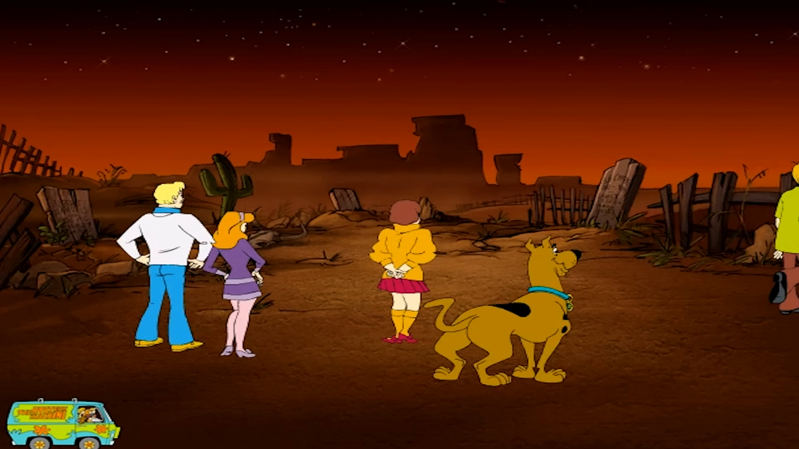
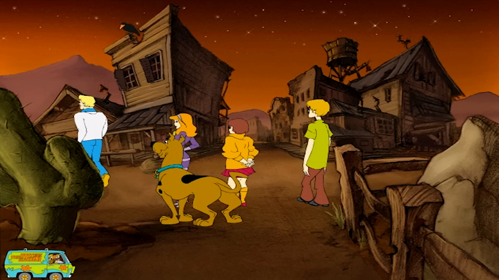
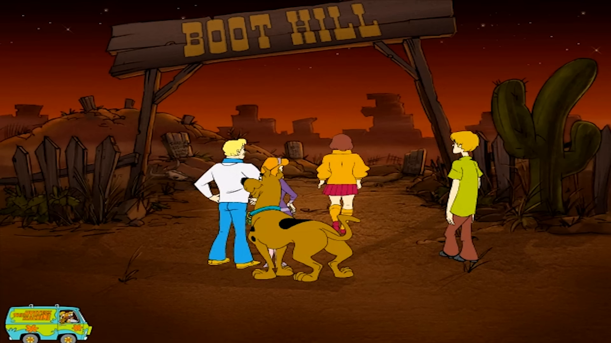

# scooby — Work Index

> Master ordered ledger of work packets (WPs) and execution checklists (ECs).
> Each WP is one unit of work with a goal, dependencies, and exit criteria.
> ECs are step-by-step checklists for the WPs most likely to sprawl.
>
> **Last updated:** 2026-11-14 (WP-014 ✅: `TGIFILE.ART` read as a `Common::Archive` in the fork)
>
> **Status vocabulary (closed set):**
> ✅ Done · 🚧 In Progress · 📝 Drafted (WP file authored, not yet started) · 📦 Queued (deps met, WP file not yet authored) · ⏸ Blocked (dep unmet) · 🔮 Placeholder (forward-looking, intentionally not authored)

---

## Current state

**Current phase:** Phase 3. The scaffold (WP-010 ✅ 2026-11-13) builds against the pinned ScummVM, and the detection table (WP-012 ✅ 2026-11-14) recognises the four in-scope discs with their generations. Phase 2's provisional scope is done. In Phase 3, the Gen 1 art file is read through `Common::Archive` (WP-014 ✅ 2026-11-14); `object.ini`, audio and cel decoding are next.
**Primary blocker:** none for images. ~~WP-002 (TGIFILE.ART payload decode)~~ ✅ 2026-11-13: every `TGIFILE.ART` image decodes (RLE over big-endian RGB565). Phase 1 exit criterion #1 is met on recognizability, so Phase 2 is no longer blocked by art. Phase 1 exit criterion #3 (audio codec) is met by WP-004 ✅ 2026-11-13, and #4 (engine-family answer) by WP-005 ✅ 2026-11-13. All four Phase 1 exit criteria are met.
**Next unblocked:** Phase 0 pre-work. WP-007 ✅ landed 2026-06-02; WP-003 ✅ landed 2026-06-02; **WP-008 ✅ landed 2026-06-03** (object.ini interpreter behavior characterized; engine is name-driven, MODE_A). Remaining order: WP-010 (WP-001 ✅, WP-002 ✅ and WP-009 ✅ 2026-11-13). The WP-003 baseline (pre-payload region characterized as the engine name table; no palette present; off-by-4 header-offset correction landed) is now available to WP-001 (palette-hunt scope drops from EC-001; the OBJ→asset-entry 1:1 mapping cuts asset-resolution scope) and to WP-002 (first-decode strategy: palette is NOT in the pre-payload region — it is either per-asset leading bytes or per-record metadata; investigate both). The WP-008 baseline (engine name-driven, 215 OBJ_* sections discriminated by `ID=`, deterministic naming rule confirmed) gives WP-002's `probe_art.py` a direct labeling path (`entry_<index>_<wp003_name>.png`) and gives WP-009 a canonical room-ID list to use for screenshot naming.

### Phase 1 findings landed (2026-06)

- **WP-014 `TGIFILE.ART` archive (2026-11-14): the first Phase 3 reader.** The fork's `ArtArchive` serves every Gen 1 room and object block by name through `Common::Archive`, and the engine opens it at startup from the disc root. Its block list and each block's size word match `probe_art.py` on Showdown (522 blocks) and Phantom (486). Malformed name records are rejected with a warning. [Evidence](WP-014-tgifile-art-archive.md#result-2026-11-14).
- **WP-012 detection table (2026-11-14): four discs, each with its generation.** The fork detects Showdown (`showdown`, Gen 1), Phantom (`phantomknight`, Gen 1), Jinx (`jinxsphinx`, Gen 2) and Case File #1 (`casefile1`, Gen 3) from the disc root, each on three files by size and MD5. Gen 2 and Gen 3 are marked unsupported for now. Case File #2, Case File #3 and *Activity Challenge* are not matched. *Activity Challenge* has no entry yet; WP-013 has since classified it as Gen 2. [Evidence](WP-012-detection-table.md#result-2026-11-14).
- **WP-013 *Activity Challenge* verdict (2026-11-14): Gen 2, Jinx's engine.** Its `Scooby.exe` comes from the same source tree as Jinx's (`C:\Projects\Scooby\Bonus\Mmfw\` beside `C:\Projects\SCOOBY\mummy\Mmfw\`) and was linked a day earlier. All 112 of its `MM*` classes are Jinx classes, and 532 of its 549 engine strings are Jinx's. Its four `MMFW` archives open with Jinx's header bytes. Its game layer is its own: mini-games around a campfire hub. VISION's "almost certainly a different engine" is withdrawn, and the title moves from Excluded to **Unassigned** in the Phase 5 scope rule; placing it in a tier is a separate decision. [Evidence](../formats/scooby-exe.md#activity-challenge-wp-013).
- **Toolchain corrected (2026-11-14): Visual C++ 6.0, not 5.0.** `tools/rich_header.py` mislabelled Rich Header product IDs (it called the VC6 C compiler "Linker 5.10" and the VC6 C++ compiler "MASM 6.13"). Checked against Microsoft's `prodid` enum names, richprint's comp.id database and each binary's PE header (linker 6.00 in all five); the script is fixed. Game C++: Gen 1 build 8966, Jinx 8168, Case File #1 the VC6 Processor Pack (8943). The build-number grouping across generations holds; the "Gen 2 upgrade" and "IBS shipped Jinx's `.obj` files" readings do not. For decompdecomp, which supplies VC 6.0, byte-identical matches become plausible. [Evidence](../formats/scooby-exe.md#toolchain).
- **WP-010 ScummVM scaffold (2026-11-13): builds clean, pin recorded.** The `barefootbetters/scummvm` `scooby-engine` branch is based on `c553503d9d`. It builds with MSYS2 UCRT64, with the engine enabled (0 warnings in `engines/scooby/`) and disabled (default engine set, scooby absent). The five debug channels are listed by `--list-debugflags=scooby`. Upstream's `AI-GUIDELINES.md` (no AI co-authorship, human maintainer) is recorded as a Phase 5 decision. [Evidence](WP-010-scummvm-scaffold.md#result-2026-11-13).
- **WP-006 Phantom verdict (2026-11-13): Gen 1, the same engine build.** Phantom's `TGIFILE.ART` passes every `probe_art.py --verify` check, and its `.dat` audio passes `probe_audio.py --verify`. All 71 functions WP-001 labelled are byte-identical in Phantom's `Scooby.exe` with addresses masked. One reader covers both Gen 1 titles. [Evidence](../formats/tgifile-art.md#cross-title-verification-2026-06).
- **WP-005 Case File #2 verdict (2026-11-13): a different engine.** `Case File #2.exe` shares no engine code markers with the Gen 1–3 lineage: no RTTI, `MMFW`, error templates, source paths, or the lineage's import-library set (the 2026-06 "MSVC 5.0 C++ 8034" label for it was a tool mislabel, corrected 2026-11-14). It runs an `R*`-class framework with Miles, LZO and libjpeg that also powers a *Powerpuff Girls* demo on the same disc (`trinket.dll`, `ompp32x.dll` "OM++") and the publisher's launcher on both Case File discs. The 2026-06-03 "Gen 4" label is withdrawn, and Case File #2 moves to **Excluded** in the Phase 5 scope rule. [Evidence](../formats/scooby-exe.md#case-file-2-wp-005). **Phase 1 exit criterion #4 met; all four are now met.**
- **WP-004 audio decoded (2026-11-13).** `Music.dat`, `Sfx.dat` and `Voice.dat` hold 1,165 clips in total, indexed by name, and every clip is **uncompressed PCM**: mostly 22050 Hz 16-bit signed little-endian, mono or stereo, plus four clips at 44100 Hz and one 8-bit unsigned. Each clip has a 16-byte header (size, rate, channels, bits, pan, volume, loop flag, lip-sync fps and count). Voice clips carry a lip-sync track of one mouth shape per frame. The PCM starts on the sector after the header, which is traced in `SoundStream::Open` (`0x446010`) and checked on every clip. ScummVM's raw PCM stream covers it, and Miles is not involved. [Spec](../formats/audio-archives.md), tool [`tools/probe_audio.py`](../../tools/probe_audio.py). **Phase 1 exit criterion #3 met.**
- **WP-001 `Scooby.exe` traced in Ghidra (2026-11-13).** Ghidra 12.1.4, headless. 68 functions are labeled by debug channel; the label list is in [`tools/ghidra-scripts/`](../../tools/ghidra-scripts/wp001-labels.txt). Map: [scooby-exe §Resource loading map](../formats/scooby-exe.md#resource-loading-map). Findings:
  - **Header.** The `TGIFILE.ART` header was misread. The object table is 453 `u32` sector descriptors (`start << 14 | count`), not 8-byte records, so the name table starts at `0x834` with **1,788** records. That table names all 69 rooms, so scene 18 is `ROOM_Artie` and scene 19 is `ROOM_Title_Screen`.
  - **Animation.** Sequences (table 0) are fully specified, with a click polygon per step. The 1,266 ANIM names are exactly the 1,266 sequences, and an ANIM id encodes the owner's low byte and the sequence index.
  - **Masks.** Mask A is the opaque RGB565 pixels and mask B the translucent **ARGB4444** pixels. Transparency comes from the masks, not from pixel `0x0000`, which corrects WP-002: black outlines are opaque. Also found: solid-colour cels, and raw cels stored little-endian.
  - **`object.ini`** is read live per object through `GetPrivateProfileStringA`; the `ID=` switch is at `0x408F90`. `scrappyid` values are `Voice.dat` clip names. Inventory art is sequences of `OBJ_TOOLBAR` / `OBJ_CURSOR`.
  - **Audio.** The `.dat` index layout is resolved, a lead for WP-004.
  - `probe_art.py --verify` now checks every data-side claim across the whole file.
  - **Open:** room-block word `0x10` and placement field `+0x88`.
- **WP-002 `TGIFILE.ART` decoded (2026-11-13).** Blind decode from the data file; WP-001 Ghidra was blocked. [Spec](../formats/tgifile-art.md#archive-layout), decoder [`tools/probe_art.py`](../../tools/probe_art.py). The index was the puzzle, not the codec. The 453 "asset entries" are not `(start, end)` offsets, and `0x10017E` is not the first payload (it is mid-cel in OBJ 1). The real layout is 453 object resources packed on 2,048-byte sectors from `0x20000` (resource `i` = `OBJ` id `i`), then 69 scene blocks ending exactly at end of file. Every image is a cel: a 24-byte header, an RLE pixel stream (`F0 count hi lo` = run, otherwise a 2-byte literal), and span-list masks. Pixels are **RGB565 big-endian, no palette**, which closes the palette hunt. `--verify` decodes all 9,111 cels (453 objects + 69 backgrounds) and parses all 17,407 mask chunks exactly. Entry 0 renders as Daphne; OBJ 1 is Fred and OBJ 2 is Scooby; scenes are Ghost Town backgrounds. Still open: descriptor encodings, the scene-to-`ROOM_*` mapping, and animation-sequence records. These are the new, narrower WP-001 targets.
- **Engine generations identified.** Cross-title Rich Header + archive-format inspection (Showdown / Phantom / Jinx / Case File #1) reveals **one engine lineage spanning three format generations** — Gen 1 (Showdown, Phantom), Gen 2 (Jinx), Gen 3 (Case File #1). See [Engine Lineage in vision](../01-VISION.md#engine-lineage-2026-06-finding) and [scooby-exe.md cross-title comparison](../formats/scooby-exe.md#cross-title-toolchain-comparison-engine-generations).
- **Code-level inheritance from TerraGlyph to ImageBuilder Software confirmed** at the source level: Case File #1 carries Jinx's `MM*` classes, `MMFW` labels and `MMVisualCursor.cpp`, recompiled by IBS with a newer VC6 build. *Corrected 2026-11-14:* this entry first said Case File #1 embeds Jinx-era compiled object files, from the "MSVC 5.0 build 8034 + Linker 5.10 build 8168" mislabel. Only 36 C objects keep Jinx's compiler build 8168. Documented in [scooby-exe](../formats/scooby-exe.md).
- **`MMFW` archive container documented.** New Gen 2/3 format spec at [mmfw-container](../formats/mmfw-container.md). Replaces `TGIFILE.ART` starting with Jinx (Oct 2001).
- **Scope rule revised.** Phase 5 scope tightened to ordered tiers: Minimum (Showdown), Extended-high-confidence (+ Phantom), Extended-medium-confidence (+ Jinx, requires Gen 2 parser), Stretch (+ Case Files, requires Gen 3 adapters).
- **WP-007 baseline landed (2026-06-02).** [`Scooby.exe` strings + import-table baseline](../formats/scooby-exe.md#binary-identity-wp-007-baseline) across all four cached binaries — Showdown (Gen 1), Phantom (Gen 1), Jinx (Gen 2), Case File #1 (Gen 3). Load-bearing corrections to the [cross-title runtime-dependencies table](../formats/scooby-exe.md#cross-title-runtime-dependencies): Jinx and Case File #1 do NOT statically import Bink/Smacker/QuickTime — Gen 2 uses MSVFW32 DrawDib for AVI playback, Gen 3 uses `ole32`/`libexpat` (COM filter-graph + XML config). Gen 2/3 also dropped registry usage (`ADVAPI32.dll` not imported) and load DirectSound dynamically. Phantom's import table is byte-identical to Showdown's. Source-tree path strings reveal `C:\Scooby\GBH\` (Showdown), `C:\Scooby\FBF\` (Phantom), `C:\Projects\SCOOBY\mummy\Mmfw\` (Jinx), `F:\Scooby\Museum\framework\` (Case File #1) — same `MMVisualCursor.cpp` filename in Jinx + Case File #1 is direct source-level inheritance evidence on top of the earlier Rich-Header `MSVC 5.0 build 8034` match.
- **WP-008 object.ini interpreter behavior characterized (2026-06-03).** [`object.ini` is a flat list of 215 `[OBJ_*]` sections](../formats/scooby-exe.md#objectini-interpreter-behavior) discriminated by an `ID=` field (5 values: `exitobject`, `clickableobject`, `inventoryobject`, `requiresobject`, `simpleobject`). No top-level rooms/cursors/inventory sections — those buckets are synthesized from cross-references (37 rooms, 23 cursors, 11 inventory). Asset-reference format: **MODE_A — direct WP-003 name-table strings** (`ROOM_*`/`OBJ_*`/`ANIM_*`); zero numeric indices. WP-003 cross-check: **221 / 286 match (77.27 %)** — the 65 unmatched are scripted/engine rooms with no pre-rendered backgrounds, invisible hotspot OBJs, and inventory-specific cursor/toolbar animations that live in other name-keyed stores. `Scooby.eng` is a 10-message system-error string table for `Scooby.exe`'s boot path; no `object.ini` field references it. Two source-binary SHAs (`object.ini`, `Scooby.eng`) propagated into [tools/exes/README §Showdown](../../tools/exes/README.md#showdown-gen-1); `Scooby.eng` SHA byte-identical to Phantom's. Parsers shipped under [`tools/parse_ini.py`](../../tools/parse_ini.py) + [`tools/parse_eng.py`](../../tools/parse_eng.py).
- **WP-003 pre-payload region characterized (2026-06-02).** [`TGIFILE.ART` pre-payload region](../formats/tgifile-art.md#pre-payload-region--engine-name-table) is the **engine resource-name catalog** — 68-byte records (`4B uint32LE id + 44B zero-padded ASCII name + 20B metadata`) with type-tagged IDs (`0x10` = ROOM, `0x20` = OBJ, `0x3x` = ANIM). Continuous block at file `0x0F60`–`0xE6CC` has **811 records** (42 ROOM + 453 OBJ + 316 ANIM); the OBJ count exactly matches `asset_count` and OBJ IDs are contiguous 0–452, confirming `entry[i]` is the payload for `OBJ` id `i`. **Spec correction landed** — `asset_count` is at `0x0118` (not `0x011C`); the asset entry table is at `0x011C`–`0x0F43` (not `0x0120`–`0x0F47`); the pre-payload region begins at `0x0F44`. **Negative palette finding:** no 256-entry RGB / RGBA palette in the pre-payload region — palette discovery moves to WP-002 (per-asset leading bytes or per-record metadata). **Mixed tail region (`0xE6CC`–`0x10017E`, ≈ 990 KB):** further name records interleaved with F0-opcode packed data; schema deferred to WP-001 / WP-002. WP-007 strings cross-check: 100 % of ROOM names, 50.3 % of OBJ names, 20.6 % of ANIM names appear in `tools/exes/showdown/strings-ansi.txt` — corroborates the [scooby-exe interpreter hypothesis](../formats/scooby-exe.md#hypotheses-unverified) (most resource resolution is data-driven via name-table lookup, not hardcoded).

---

## Phase 0 — Pre-Work (run before WP-001)

These WPs require no Ghidra, no format decoding, and no binary analysis. They
build the ground-truth references that make Phase 1 debugging tractable, and
pin the ScummVM API target before implementation decisions are made. None block
each other; recommended execution order is left-to-right in the table.

| WP | Title | Status | Deps | EC | Notes |
|---|---|---|---|---|---|
| [WP-007](WP-007-strings-and-imports.md) | `Scooby.exe` strings dump + import table | ✅ Done (2026-06-02) | — | — | ~30 min actual (matched WP body's 20–40 min estimate, vs. the original 15–30 min Phase 0 placeholder). Findings landed in [scooby-exe](../formats/scooby-exe.md) §Binary identity / §String literals / §Import table; cross-title runtime-dependencies table now carries import-verdict cells (no remaining TBD/predicted). Primes EC-001 Steps 3–4. |
| [WP-003](WP-003-pre-payload-region.md) | Pre-payload region scan (palette hunt) | ✅ Done (2026-06-02) | WP-007 ✅ (recommended) | — | ~2 hrs actual (matched 1–2 hr estimate). Findings landed in [tgifile-art.md §Pre-payload region](../formats/tgifile-art.md#pre-payload-region--engine-name-table). Region is the engine name table (811 clean records: 42 ROOM + 453 OBJ + 316 ANIM). Header offsets corrected by −4 (`asset_count` at `0x0118`). Negative palette finding — palette discovery moves to WP-002. Drops palette-hunt scope from EC-001. |
| [WP-008](WP-008-object-ini-catalog.md) | `object.ini` + `Scooby.eng` asset catalog | ✅ Done (2026-06-03) | — | [EC-004](../execution-checklists/EC-004-object-ini-catalog.md) | ~3 hrs actual (vs. half-day estimate). Findings landed in [scooby-exe.md §`object.ini` interpreter behavior](../formats/scooby-exe.md#objectini-interpreter-behavior). Engine is **name-driven** (MODE_A); 215 OBJ_* sections discriminated by `ID=`; 77.27 % cross-check vs WP-003 name table. Unblocks WP-009 naming + WP-002 first-decode labeling. |
| [WP-009](WP-009-reference-screenshots.md) | Reference screenshot library (*Showdown*) | ✅ Done (2026-11-13) | WP-008 ✅ | — | 35 of 37 catalog rooms captured at 1080p from the longplay, plus the `OBJ_DAPHNE_A` anchor; `ROOM_Main_Menu` and `ROOM_P27_Chase_B4` are Gaps (not in the video). Frames were picked by scoring the video against the decoded `TGIFILE.ART` backgrounds, so every capture is matched to its scene block, which also completes WP-002's in-game comparison. Finding: scene index = ROOM id, and all 37 rooms have backgrounds, which corrects WP-008's "21 scripted rooms" ([tgifile-art](../formats/tgifile-art.md#scene-index--room-id-wp-009-2026-11-13)). [Gallery](../assets/screenshots/showdown-screens/index.md). Live render verified on Pages and the ewiki. |
| [WP-010](WP-010-scummvm-scaffold.md) | ScummVM fork + empty `engines/scooby/` scaffold | ✅ Done (2026-11-13) | — | [EC-005](../execution-checklists/EC-005-scummvm-scaffold.md) | **Closed 2026-11-13.** Pin `c553503d9d`; builds enabled and disabled under MSYS2 UCRT64; channels `resource`/`graphics`/`audio`/`script`/`input`. See [WP-010 §Result](WP-010-scummvm-scaffold.md#result-2026-11-13). Pre-flight: [pre-flight-WP-010-2026-11-13](../reference/pre-flight-WP-010-2026-11-13.md). |

---

## Phase 1 — Format Research

| WP | Title | Status | Deps | EC | Notes |
|---|---|---|---|---|---|
| [WP-001](WP-001-ghidra-session.md) | Ghidra session: `Scooby.exe` imports + `TGIFILE.ART` decode trace | ✅ Done (2026-11-13) | WP-003 ✅, WP-007 ✅ (recommended) | [EC-001](../execution-checklists/EC-001-ghidra-session.md) | **Closed 2026-11-13, all five exit criteria met.** All six narrowed targets resolved except room-block word `0x10` and placement `+0x88`, which have no reader found. See [WP-001 §Result](WP-001-ghidra-session.md#result-2026-11-13). Pre-flight: [pre-flight-WP-001-2026-11-13](../reference/pre-flight-WP-001-2026-11-13.md). *Pre-run notes:* EC-001 Step 1 (PE Rich Header) ✅ done — toolchain identified across 4 titles. WP-007 baseline ✅ — Step 3 (Imports table review) is now a cross-check against [scooby-exe §Import table](../formats/scooby-exe.md#import-table-wp-007), not a re-extraction. WP-003 baseline ✅ — palette-hunt scope drops from the TGIFILE.ART decode trace; the OBJ→asset-entry 1:1 mapping cuts asset-resolution scope. **WP-008 baseline ✅** — four new explicit Ghidra targets surfaced (per [WP-001 §Background](WP-001-ghidra-session.md#background)): the `object.ini` consumer (switch on `ID=` value + name-hash lookup, xref-anchored on `Failed to load room.`), the `scrappyid=Global.Scrappy.*` script-table resolver, the inventory-anim resolver (`OBJ_INV_*` `toolbaranim=`/`usecursor=` names live outside TGIFILE.ART), and the scripted-room render branch (21 rooms with no TGIFILE.ART entry render via per-room code like `Horseshoe_Corral_Room.cpp`). Steps 2, 4, 5 (Ghidra load, file-I/O labeling, TGIFILE.ART decode trace) still pending. **WP-002 ✅ (2026-11-13) narrows Step 5:** the image decode is solved from the data alone. What still needs the executable is how `Scooby.exe` uses the 69 scene descriptors and 453 object descriptors (not offsets), how it maps scene blocks to `ROOM_*` names, and how it interprets animation-sequence records. See [tgifile-art §Remaining unknowns](../formats/tgifile-art.md#remaining-unknowns). |
| [WP-002](WP-002-tgifile-art-decoder.md) | `TGIFILE.ART` payload decoder + first image extraction | ✅ Done (2026-11-13) | WP-001 ✅ (preferred, not strict) | [EC-002](../execution-checklists/EC-002-probe-art-harness.md) | **Phase 1 exit criterion #1 met.** One session, blind (WP-001 blocked). Entry 0 decodes to Daphne; all 9,111 cels in the file decode and verify. Format in [tgifile-art §Cel format](../formats/tgifile-art.md#cel-format): RLE over big-endian RGB565, no palette. The index model was corrected: the entry table is not offsets; resources are sector-aligned from `0x20000`. Pre-flight: [pre-flight-WP-002-2026-11-13](../reference/pre-flight-WP-002-2026-11-13.md). First decode committed at `tools/samples/tgifile-art-entry0.png`, the one named exception to the samples policy. *WP-001 (2026-11-13) confirmed the RLE algorithm in `Scooby.exe` and corrected two rules: transparency comes from the masks (mask B pixels are ARGB4444), and the 18 non-RLE cels are raw little-endian words.* Not done: Phantom cross-check (EC-002 Phase D; disc not mounted) and frame comparison against WP-009 screenshots. *Pre-run notes:* Phase 1 exit criterion #1. WP-003 baseline ✅ — first-decode strategy: palette is NOT in the pre-payload region; investigate per-asset leading bytes and per-record metadata (offsets 48–67 of name-table records) as palette sources. The mixed tail region of the pre-payload (`0xE6CC`–`0x10017E`) also contains F0-opcode packed data and may co-locate per-asset palettes or pre-decoded frame data. **WP-008 baseline ✅** — engine is name-driven; `probe_art.py` can label decoded entries directly as `entry_<index>_<wp003_name>.png` (sanitization rule per [WP-008 §Notes](WP-008-object-ini-catalog.md#notes); a no-op on every observed name). The 65 unmatched references from the WP-008 cross-check are not expected to resolve to decoded entries — verifying that none of them do is part of EC-002's probe coverage. |
| [WP-003](WP-003-pre-payload-region.md) | Inspect the 1 MB region between asset entries and first payload (palette hunt) | ✅ Done (2026-06-02) | — | — | Also listed in Phase 0. Pre-payload region is the engine name table — see [tgifile-art.md §Pre-payload region](../formats/tgifile-art.md#pre-payload-region--engine-name-table). Header offsets corrected by −4 bytes. No palette in this region (palette discovery → WP-002). |
| [WP-004](WP-004-audio-archive-decode.md) | Audio archive index + codec identification | ✅ Done (2026-11-13) | — | — | **Closed 2026-11-13; all five exit criteria met. Phase 1 exit criterion #3 met.** Uncompressed PCM in all three files; the clip header and lip-sync layout are traced and `probe_audio.py --verify` checks all 1,165 clips. See [WP-004 §Result](WP-004-audio-archive-decode.md#result-2026-11-13). Pre-flight: [pre-flight-WP-004-2026-11-13](../reference/pre-flight-WP-004-2026-11-13.md). *Pre-run notes:* Phase 1 exit criterion #3. **WP-001 lead (2026-11-13):** the index layout is resolved ([audio-archives §Index table](../formats/audio-archives.md#index-records)). The header's `0x08` field is the table offset, and clips are named `<Section>.<Clip>` and found by name. Only the codec remains. **WP-008 baseline ✅** — `Scooby.eng` is NOT in-game dialogue (10 boot/init system-error messages only). Dialogue text store is a new unknown — most likely `Voice.dat`, embedded in `Scooby.exe`, or a not-yet-identified file. `pickupsfx=<none>` is the only audio key in 215 `object.ini` OBJ sections, weakening "voice clips referenced by name from `object.ini`" — audio cues are likely triggered by the `scrappyid` script system (WP-001 lead). See [WP-004 §Notes](WP-004-audio-archive-decode.md#notes). |
| [WP-005](WP-005-engine-family-check.md) | Engine-family check across Case File ISOs | ✅ Done (2026-11-13) | — | [EC-003](../execution-checklists/EC-003-engine-family-check.md) | **Closed 2026-11-13. Case File #1: same lineage (Gen 3), different formats. Case File #2: INCOMPATIBLE, a different engine shared with a *Powerpuff Girls* demo; excluded from Phase 5 scope.** Phase 1 exit criterion #4 met. See [WP-005 §Result](WP-005-engine-family-check.md#result-2026-11-13). Pre-flight: [pre-flight-WP-005-2026-11-13](../reference/pre-flight-WP-005-2026-11-13.md). *Before:* Case File #1 done — one engine lineage across three generations confirmed; code-level TerraGlyph→IBS inheritance confirmed. Case File #2 verification still owed. |
| [WP-006](WP-006-phantom-archive-format.md) | Phantom archive format verification (Gen 1 vs Gen 2) | ✅ Done (2026-11-13) | — | — | **Closed 2026-11-13. Gen 1:** same header layout (count-driven; Phantom opens `35 00 00 00` = 53 rooms), full `--verify` pass, audio passes, and all 71 WP-001-labelled functions byte-identical. See [WP-006 §Result](WP-006-phantom-archive-format.md#result-2026-11-13). Pre-flight: [pre-flight-WP-006-2026-11-13](../reference/pre-flight-WP-006-2026-11-13.md). |
| [WP-011](WP-011-casefile-decompdecomp.md) | Case File #1 executable analysis with decompdecomp (collaboration trial) | 🚧 In Progress | Cooperative-room access from the collaborator (external; received 2026-11-11) | — (inline checklist) | Added 2026-11-11. Track B of the [`Scooby.exe` analysis plan](../formats/scooby-exe.md#two-analysis-tracks), complementary to WP-001's Ghidra track. An outside collaborator has started a decompdecomp decompilation of Case File #1 (Gen 3); his progress figures are **Reported**, not reproduced. Repository access and a cooperative room arrived 2026-11-11; executable identity with the host's copy is confirmed (SHA-1 and size); local build and capped trial are next. The WP defines an evidence model, repository-hygiene rules, a capped trial, and a Proposed decision to evaluate decompdecomp. Does not change the engine-family classification (WP-005) or the Gen 1 blocker order. |
| [WP-013](WP-013-activity-challenge-engine-check.md) | Engine-family check: *Activity Challenge* (2001) | ✅ Done (2026-11-14) | — (WP-005's method) | — | **Closed 2026-11-14. Gen 2: same lineage as Jinx, same `MMFW` formats.** Same source tree, `MM*` classes, engine strings and import shape; archives open with Jinx's header bytes. Moves to Unassigned in the Phase 5 scope rule. The fork's detection table has had a `kGen2` entry, `activitychallenge` (`ADGF_UNSUPPORTED`), since fork commit `644305dddc`; see [WP-013 §Detection](WP-013-activity-challenge-engine-check.md#detection). See [WP-013 §Result](WP-013-activity-challenge-engine-check.md#result-2026-11-14). Pre-flight: [pre-flight-WP-013-2026-11-14](../reference/pre-flight-WP-013-2026-11-14.md). |

**Phase 1 exit gate:** see [Project Vision](../01-VISION.md) → "Phase 1 — Format Research" exit criteria. Summary: one `TGIFILE.ART` entry rendered to PNG/BMP, structure documented in `docs/formats/`, audio codec named, engine-family question answered.

---

## Phase 2 — ScummVM Engine Scaffold (placeholder)

Authored after Phase 1 exit. Tracked here to maintain phase ordering only.

| Provisional scope | Anchored to |
|---|---|
| Fork `scummvm/scummvm`; pin commit hash in `02-SCUMMVM-INTEGRATION.md` | **Moved to WP-010 (Phase 0)** |
| Create `engines/scooby/` skeleton with `module.mk`, `configure.engine`; debug channel stubs | **Moved to WP-010 (Phase 0)** |
| `MetaEngineDetection` + `MetaEngine` subclasses; engine class with empty `run()` | **Done in WP-010** ([`02-SCUMMVM-INTEGRATION.md`](../02-SCUMMVM-INTEGRATION.md) §1, §2) |
| `ADGameDescription` table populated from Phase 1 findings, **carrying a per-entry generation flag** (Gen 1/2/3) per the engine lineage finding | **[WP-012](WP-012-detection-table.md) ✅ 2026-11-14** (§3) |
| `POTFILES` (after translatable strings exist) | §10 |

| WP | Title | Status | Depends on | EC | Notes |
|---|---|---|---|---|---|
| [WP-012](WP-012-detection-table.md) | Detection table with a per-entry generation flag | ✅ Done (2026-11-14) | WP-010 ✅, WP-005 ✅, WP-006 ✅ | — (inline) | Four entries (Showdown and Phantom Gen 1, Jinx Gen 2, Case File #1 Gen 3), tested on the mounted ISOs. Fork commit `5a88016fea`. Game ids `phantomknight` and `jinxsphinx` avoid ids other engines use. See [WP-012 §Result](WP-012-detection-table.md#result-2026-11-14). Pre-flight: [pre-flight-WP-012-2026-11-14](../reference/pre-flight-WP-012-2026-11-14.md). |

---

## Phase 3 — Resource Loading (placeholder)

| Provisional scope |
|---|
| `TGIFILE.ART` parser as `Common::Archive` subclass (Gen 1): **[WP-014](WP-014-tgifile-art-archive.md) ✅ 2026-11-14** |
| `MMFW` container parser as `Common::Archive` subclass (Gen 2 / Gen 3) |
| Audio loader through `Audio::Mixer` |
| `Scooby.eng` parser (Gen 1 / Gen 2) |
| `object.ini` parser into engine structs (Gen 1 / Gen 2) |
| XML config parser (Gen 3) — likely wraps ScummVM's bundled libxml or a small in-engine parser |

| WP | Title | Status | Depends on | EC | Notes |
|---|---|---|---|---|---|
| [WP-014](WP-014-tgifile-art-archive.md) | `TGIFILE.ART` reader as a `Common::Archive` (Gen 1) | ✅ Done (2026-11-14) | WP-012 ✅, WP-001 ✅, WP-006 ✅ | — (inline) | `ArtArchive` in fork commit `155144012a`. Room and object blocks by name; the block list and every block's size word match `probe_art.py` on Showdown and Phantom. See [WP-014 §Result](WP-014-tgifile-art-archive.md#result-2026-11-14). Pre-flight: [pre-flight-WP-014-2026-11-14](../reference/pre-flight-WP-014-2026-11-14.md). |

---

## Phase 4 — Game Logic (placeholder)

| Provisional scope |
|---|
| Room/scene management and transitions |
| Cursor system and object interaction |
| Inventory |
| Bink video playback via ScummVM's decoder |
| Puzzle state machine — data-driven first, Ghidra-assisted where data falls short |

---

## Phase 5 — Polish & Contribution (placeholder)

| Provisional scope |
|---|
| Test in-scope titles per Phase 5 scope rule in vision |
| Save/load if engine supports it |
| ScummVM wiki page |
| PR to `scummvm/scummvm` targeting `ADGF_TESTING` |
| All twelve acceptance gates from `02-SCUMMVM-INTEGRATION.md` pass |

---

## Reference Screenshots — *Showdown in Ghost Town* (WP-009)

One screenshot per distinct room, captured from a YouTube longplay. Required tier serves WP-002's decoder (EC-002 pre-flight); stretch tier serves WP-001 Ghidra / Phase 3 reimplementation. Full gallery lives at [`docs/assets/screenshots/showdown-screens/`](../assets/screenshots/showdown-screens/index.md) — tracked in git, served by GitHub Pages.

This section carries only 1–2 representative thumbnails as a teaser linking to the gallery; the full 16+ image set does NOT live inline here (it would bloat WORK_INDEX). Embed syntax for adding a teaser row:

```markdown
|  | Boot Hill 1 | `ROOM_P21_Boot_Hill1` |
```

| Screenshot | Room | ID |
|---|---|---|
| [](../assets/screenshots/showdown-screens/index.md) | Town Center | `ROOM_P01_Town_Center` |
| [](../assets/screenshots/showdown-screens/index.md) | Boot Hill 2 | `ROOM_P22_Boot_Hill2` |

---

## References

- Vision and phase plan: [docs/01-VISION](../01-VISION.md)
- ScummVM integration contract: [docs/02-SCUMMVM-INTEGRATION](../02-SCUMMVM-INTEGRATION.md)
- WP lifecycle: [docs/reference/wp-lifecycle](../reference/wp-lifecycle.md)
- Pre-flight gate: [docs/reference/pre-flight](../reference/pre-flight.md)
- Format specs: [docs/formats/tgifile-art](../formats/tgifile-art.md), [audio-archives](../formats/audio-archives.md), [scooby-exe](../formats/scooby-exe.md), [mmfw-container](../formats/mmfw-container.md)
- Phase 0 WPs: [WP-007](WP-007-strings-and-imports.md), [WP-008](WP-008-object-ini-catalog.md), [WP-009](WP-009-reference-screenshots.md), [WP-010](WP-010-scummvm-scaffold.md)
- Executable analysis: [WP-001](WP-001-ghidra-session.md) (Ghidra), [WP-011](WP-011-casefile-decompdecomp.md) (decompdecomp collaboration)
- Phase 2 WPs: [WP-012](WP-012-detection-table.md) (detection table)
- Phase 3 WPs: [WP-014](WP-014-tgifile-art-archive.md) (`TGIFILE.ART` archive)

---

*Promote Phase 2-5 entries to authored WPs as Phase 1 closes — not before. Premature WP authoring is its own form of churn.*
